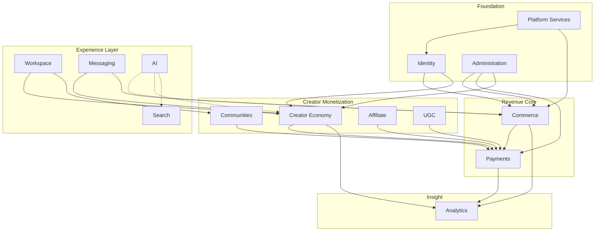

# Jimvio Business Capability Model v1.0

**Official technology-independent capability map · July 2026**

> Capabilities define **what** Jimvio must always be able to do — regardless of technology, implementation, or organizational structure.  
> Every feature, service, workflow, and future product **must map** to one or more capabilities.

**Companion:** [Domain Architecture](../domain-architecture/) (who owns implementation) · [Product Bible](../product-bible/) (why we exist)

---

## Table of contents

1. [Capability model overview](#capability-model-overview)
2. [Capability map](#capability-map)
3. [Level 1–3 capabilities](#level-13-capabilities)
4. [Ownership matrix](#ownership-matrix)
5. [Capability-to-domain mapping](#capability-to-domain-mapping)
6. [AI opportunities](#ai-opportunities)
7. [Using the BCM](#using-the-bcm)

---

## Capability model overview

### Definitions

| Term | Definition |
|------|------------|
| **Capability** | A stable business ability the platform provides |
| **L1** | Major capability area — executive portfolio level |
| **L2** | Sub-capability — product and architecture planning level |
| **L3** | Detailed specification — PRD and roadmap level |
| **Owner domain** | The [Domain Architecture](../domain-architecture/) bounded context responsible for the capability |

### Principles

| Principle | Rule |
|-----------|------|
| **Technology-independent** | Capabilities survive stack changes (Next.js → microservices) |
| **Long-lived** | Capabilities persist; implementations evolve |
| **Mappable** | Every PRD, FS, and feature names its capabilities |
| **Single owner** | Each L2 capability has one owner domain |
| **Composable** | Features combine capabilities; capabilities do not duplicate |

### BCM vs Domain Architecture

| View | Question answered | Audience |
|------|-------------------|----------|
| **Business Capability Model (this)** | What must the business always do? | Leadership, Product, Enterprise Architecture |
| **Domain Architecture** | Who owns the code, data, and APIs? | Engineering, Security, Architecture |

*Example: "Checkout" is a Commerce capability. Commerce Domain owns implementation. Payments Domain owns money capture.*

---

## Capability map



---

# Level 1–3 Capabilities

---

## 1. Identity

**L1 purpose:** Establish who is acting on the platform — authentication, profiles, roles, sessions, and account trust.

**Owner domain:** Identity

### Level 2 sub-capabilities

| L2 ID | Sub-capability |
|-------|----------------|
| ID.1 | Authentication |
| ID.2 | Profile Management |
| ID.3 | Role Management |
| ID.4 | Session Management |
| ID.5 | Account Status & Trust |
| ID.6 | Two-Factor Authentication |

### Level 3 detail

#### ID.1 Authentication

| Attribute | Detail |
|-----------|--------|
| **Purpose** | Verify user identity via email/password, OAuth, and magic links |
| **Business value** | Platform trust; gate access to commerce and creator monetization |
| **Primary users** | All registered users; guests (limited) |
| **Dependencies** | Platform Services (Supabase Auth); Administration (maintenance mode) |
| **Future expansion** | SSO/SAML; passkeys; organization accounts |

#### ID.2 Profile Management

| Attribute | Detail |
|-----------|--------|
| **Purpose** | Manage user identity surface — name, avatar, slug, public presence |
| **Business value** | Personalization; creator/seller discoverability |
| **Primary users** | Buyer, seller, creator, affiliate, community owner |
| **Dependencies** | Platform Services (media for avatars) |
| **Future expansion** | Verified badges; multi-profile; brand pages |

#### ID.3 Role Management

| Attribute | Detail |
|-----------|--------|
| **Purpose** | Assign and activate platform roles that unlock capabilities |
| **Business value** | Self-serve monetization paths; least-privilege access |
| **Primary users** | All users (self-activate); admin (assign) |
| **Dependencies** | Administration (elevated role assignment) |
| **Future expansion** | Custom roles; team permissions; delegated access |

#### ID.4 Session Management

| Attribute | Detail |
|-----------|--------|
| **Purpose** | Manage active sessions, devices, and revocation |
| **Business value** | Security; account recovery; multi-device experience |
| **Primary users** | All authenticated users |
| **Dependencies** | Authentication; Platform Services (middleware) |
| **Future expansion** | Device trust scoring; geo-aware session policies |

#### ID.5 Account Status & Trust

| Attribute | Detail |
|-----------|--------|
| **Purpose** | Suspend, ban, or restore accounts based on policy violations |
| **Business value** | Platform safety; fraud prevention; regulatory compliance |
| **Primary users** | Administration (enforce); affected users (status) |
| **Dependencies** | Administration (policy); Messaging (notifications) |
| **Future expansion** | Trust scores; graduated enforcement; appeals workflow |

#### ID.6 Two-Factor Authentication

| Attribute | Detail |
|-----------|--------|
| **Purpose** | Add second factor for high-value account protection |
| **Business value** | Reduced account takeover; seller/creator confidence |
| **Primary users** | Sellers, creators, admins (recommended mandatory for admin) |
| **Dependencies** | Authentication |
| **Future expansion** | Hardware keys; risk-based step-up auth |

---

## 2. Commerce

**L1 purpose:** Enable buying and selling of goods — catalog through fulfillment — without owning money movement.

**Owner domain:** Commerce

### Level 2 sub-capabilities

| L2 ID | Sub-capability |
|-------|----------------|
| COM.1 | Catalog Management |
| COM.2 | Product Discovery |
| COM.3 | Cart Management |
| COM.4 | Checkout |
| COM.5 | Order Management |
| COM.6 | Pricing |
| COM.7 | Inventory |
| COM.8 | Shipping |
| COM.9 | Discounts & Promotions |
| COM.10 | Returns & Refunds (business) |
| COM.11 | Reviews & Ratings |

### Level 3 detail

#### COM.1 Catalog Management

| Attribute | Detail |
|-----------|--------|
| **Purpose** | Create, edit, publish, and organize products and variants |
| **Business value** | Seller revenue; marketplace breadth; supply chain integration |
| **Primary users** | Seller (vendor); admin (moderation) |
| **Dependencies** | Identity (seller role); Administration (approval); Platform Services (media) |
| **Future expansion** | Multi-warehouse; product bundles; B2B catalogs |

#### COM.2 Product Discovery

| Attribute | Detail |
|-----------|--------|
| **Purpose** | Browse, filter, and surface products across marketplace surfaces |
| **Business value** | Conversion; buyer engagement; seller visibility |
| **Primary users** | Buyer, guest, affiliate (link context) |
| **Dependencies** | Search; Analytics (views); Creator Economy (graph rails) |
| **Future expansion** | Personalized feeds; category intelligence; demand signals |

#### COM.3 Cart Management

| Attribute | Detail |
|-----------|--------|
| **Purpose** | Add, update, remove items; persist cart across sessions |
| **Business value** | Conversion funnel; reduced abandonment |
| **Primary users** | Buyer |
| **Dependencies** | Identity (authenticated cart); Catalog Management; Inventory |
| **Future expansion** | Saved carts; cart sharing; B2B quote carts |

#### COM.4 Checkout

| Attribute | Detail |
|-----------|--------|
| **Purpose** | Collect shipping, apply discounts, prepare order for payment |
| **Business value** | Revenue conversion; trust at point of purchase |
| **Primary users** | Buyer |
| **Dependencies** | Cart; Shipping; Pricing; Payments (initiation); Identity |
| **Future expansion** | One-click checkout; guest checkout; multi-vendor split |

#### COM.5 Order Management

| Attribute | Detail |
|-----------|--------|
| **Purpose** | Track order lifecycle from placement through delivery |
| **Business value** | Buyer confidence; seller operations; dispute evidence |
| **Primary users** | Buyer, seller, admin |
| **Dependencies** | Payments (status sync); Messaging (notifications); Shipping |
| **Future expansion** | Partial fulfillment; order amendments; B2B PO workflows |

#### COM.6 Pricing

| Attribute | Detail |
|-----------|--------|
| **Purpose** | Define and validate product prices, currencies, and price rules |
| **Business value** | Margin control; competitive positioning; promo support |
| **Primary users** | Seller; admin |
| **Dependencies** | Catalog Management; Discounts |
| **Future expansion** | Dynamic pricing; regional pricing; wholesale tiers |

#### COM.7 Inventory

| Attribute | Detail |
|-----------|--------|
| **Purpose** | Track stock levels and availability per variant |
| **Business value** | Prevent overselling; operational accuracy |
| **Primary users** | Seller; system (CJ sync) |
| **Dependencies** | Catalog Management; Platform Services (CJ integration) |
| **Future expansion** | Multi-location inventory; reservation; low-stock alerts |

#### COM.8 Shipping

| Attribute | Detail |
|-----------|--------|
| **Purpose** | Calculate rates, collect addresses, track shipments |
| **Business value** | Global reach; delivery transparency |
| **Primary users** | Buyer (select); seller (fulfill) |
| **Dependencies** | Checkout; Order Management |
| **Future expansion** | Carrier integrations; real-time tracking; local pickup |

#### COM.9 Discounts & Promotions

| Attribute | Detail |
|-----------|--------|
| **Purpose** | Apply coupons, sales, and promotional pricing at checkout |
| **Business value** | Conversion; campaign support; seller marketing |
| **Primary users** | Buyer; seller; admin |
| **Dependencies** | Pricing; Checkout |
| **Future expansion** | Stackable rules; affiliate-specific codes; flash sales engine |

#### COM.10 Returns & Refunds (business)

| Attribute | Detail |
|-----------|--------|
| **Purpose** | Manage return requests and business approval for refunds |
| **Business value** | Buyer trust; dispute reduction |
| **Primary users** | Buyer, seller, admin |
| **Dependencies** | Order Management; Payments (refund execution); Administration |
| **Future expansion** | Automated return labels; restocking fees; exchange flows |

#### COM.11 Reviews & Ratings

| Attribute | Detail |
|-----------|--------|
| **Purpose** | Collect and display buyer feedback on products |
| **Business value** | Social proof; quality signal; SEO |
| **Primary users** | Buyer (write); all (read) |
| **Dependencies** | Order Management (verified purchase); Administration (moderation) |
| **Future expansion** | Photo reviews; seller responses; review incentives |

---

## 3. Payments

**L1 purpose:** Own all money movement — capture, ledger, payouts, refunds, and gateway orchestration.

**Owner domain:** Payments

### Level 2 sub-capabilities

| L2 ID | Sub-capability |
|-------|----------------|
| PAY.1 | Payment Capture |
| PAY.2 | Payment Verification |
| PAY.3 | Wallet Management |
| PAY.4 | Transaction Ledger |
| PAY.5 | Payouts |
| PAY.6 | Refunds |
| PAY.7 | Payment Provider Routing |
| PAY.8 | Subscription Billing |

### Level 3 detail

#### PAY.1 Payment Capture

| Attribute | Detail |
|-----------|--------|
| **Purpose** | Initiate payment with buyer-selected gateway and method |
| **Business value** | Revenue collection; global payment reach |
| **Primary users** | Buyer |
| **Dependencies** | Commerce (checkout.ready); Payment Provider Routing; Identity |
| **Future expansion** | Saved payment methods; BNPL; crypto settlement |

#### PAY.2 Payment Verification

| Attribute | Detail |
|-----------|--------|
| **Purpose** | Verify webhook callbacks and finalize payment status |
| **Business value** | Financial accuracy; fraud prevention; idempotency |
| **Primary users** | System (webhooks); admin (reconciliation) |
| **Dependencies** | Payment Provider Routing; Commerce (order sync) |
| **Future expansion** | Real-time fraud scoring; manual review queue |

#### PAY.3 Wallet Management

| Attribute | Detail |
|-----------|--------|
| **Purpose** | Maintain user balance, credits, and debits |
| **Business value** | Creator/seller earnings; instant platform credits |
| **Primary users** | Seller, creator, affiliate |
| **Dependencies** | Transaction Ledger; Identity |
| **Future expansion** | Multi-currency wallets; wallet-to-wallet transfer |

#### PAY.4 Transaction Ledger

| Attribute | Detail |
|-----------|--------|
| **Purpose** | Immutable record of all financial movements |
| **Business value** | Audit; reconciliation; dispute resolution |
| **Primary users** | Users (history); admin; finance |
| **Dependencies** | Platform Services (database integrity) |
| **Future expansion** | Export to accounting systems; double-entry ledger |

#### PAY.5 Payouts

| Attribute | Detail |
|-----------|--------|
| **Purpose** | Withdraw earned balance to external accounts |
| **Business value** | Creator/seller retention; cash-out trust |
| **Primary users** | Seller, creator, affiliate |
| **Dependencies** | Wallet Management; Administration (approval); Payment Provider Routing |
| **Future expansion** | Scheduled payouts; split payouts; tax withholding |

#### PAY.6 Refunds

| Attribute | Detail |
|-----------|--------|
| **Purpose** | Execute approved refunds to original payment method or wallet |
| **Business value** | Buyer protection; regulatory compliance |
| **Primary users** | Admin; system (automated partial) |
| **Dependencies** | Commerce (return approval); Transaction Ledger |
| **Future expansion** | Partial refunds; store credit option; chargeback workflow |

#### PAY.7 Payment Provider Routing

| Attribute | Detail |
|-----------|--------|
| **Purpose** | Route payments to optimal gateway by region, method, and availability |
| **Business value** | Conversion; geographic coverage; resilience |
| **Primary users** | System |
| **Dependencies** | Platform Services (gateway config); Administration |
| **Future expansion** | Smart routing; failover; cost optimization |

#### PAY.8 Subscription Billing

| Attribute | Detail |
|-----------|--------|
| **Purpose** | Recurring billing for community tiers and memberships |
| **Business value** | Recurring creator revenue; predictable MRR |
| **Primary users** | Buyer (subscribe); community owner (receive) |
| **Dependencies** | Communities (tier definition); Payment Capture |
| **Future expansion** | Trials; proration; dunning management |

---

## 4. Creator Economy

**L1 purpose:** Enable creator-led monetization beyond traditional commerce — profiles, live, courses, and discovery graphs.

**Owner domain:** Creator Economy

### Level 2 sub-capabilities

| L2 ID | Sub-capability |
|-------|----------------|
| CE.1 | Creator Profiles & Storefronts |
| CE.2 | Live Commerce |
| CE.3 | Courses & Learning |
| CE.4 | Creator Verification |
| CE.5 | Commerce Graph |
| CE.6 | Business Graph & Opportunities |

### Level 3 detail

#### CE.1 Creator Profiles & Storefronts

| Attribute | Detail |
|-----------|--------|
| **Purpose** | Public creator identity with linked products, campaigns, and content |
| **Business value** | Creator brand; discovery; conversion from audience |
| **Primary users** | Creator (influencer); buyer (discover) |
| **Dependencies** | Identity; Commerce (product links); UGC; Affiliate |
| **Future expansion** | Custom domains; storefront themes; creator portfolios |

#### CE.2 Live Commerce

| Attribute | Detail |
|-----------|--------|
| **Purpose** | Live sessions with shoppable clips and real-time engagement |
| **Business value** | High-conversion sales; audience engagement |
| **Primary users** | Creator; buyer |
| **Dependencies** | Commerce (products); Messaging (alerts); Analytics |
| **Future expansion** | Multi-host live; shoppable overlay; replay monetization |

#### CE.3 Courses & Learning

| Attribute | Detail |
|-----------|--------|
| **Purpose** | Structured learning content with modules, lessons, and progress |
| **Business value** | Knowledge monetization; community value |
| **Primary users** | Community owner; learner |
| **Dependencies** | Communities (host); Payments (paid access) |
| **Future expansion** | Certificates; quizzes; cohort-based courses |

#### CE.4 Creator Verification

| Attribute | Detail |
|-----------|--------|
| **Purpose** | Validate creator identity and grant trust badges |
| **Business value** | Brand safety; buyer confidence |
| **Primary users** | Creator (apply); admin (approve) |
| **Dependencies** | Identity; Administration |
| **Future expansion** | Tiered verification; automated checks |

#### CE.5 Commerce Graph

| Attribute | Detail |
|-----------|--------|
| **Purpose** | Surface product relationships and discovery rails across pages |
| **Business value** | Cross-sell; session depth; GMV lift |
| **Primary users** | Buyer; creator (linked products) |
| **Dependencies** | Commerce (catalog); Analytics (signals) |
| **Future expansion** | Graph-powered recommendations; seller network effects |

#### CE.6 Business Graph & Opportunities

| Attribute | Detail |
|-----------|--------|
| **Purpose** | Connect creators, brands, and revenue opportunities |
| **Business value** | Marketplace for collaborations; earnings enablement |
| **Primary users** | Creator; seller; affiliate |
| **Dependencies** | Analytics; AI (scoring); UGC; Affiliate |
| **Future expansion** | Opportunity marketplace; automated matching |

---

## 5. Communities

**L1 purpose:** Enable owned communities with membership, content, and paid tiers.

**Owner domain:** Creator Economy *(Communities capability; Social owns delivery transport)*

### Level 2 sub-capabilities

| L2 ID | Sub-capability |
|-------|----------------|
| CM.1 | Community Creation & Management |
| CM.2 | Membership & Tiers |
| CM.3 | Community Content |
| CM.4 | Paid Communities |
| CM.5 | Community Discovery |

### Level 3 detail

#### CM.1 Community Creation & Management

| Attribute | Detail |
|-----------|--------|
| **Purpose** | Create, configure, and administer community hubs |
| **Business value** | Creator retention; recurring engagement |
| **Primary users** | Community owner |
| **Dependencies** | Identity (role); Workspace (hub UI) |
| **Future expansion** | Community templates; white-label hubs |

#### CM.2 Membership & Tiers

| Attribute | Detail |
|-----------|--------|
| **Purpose** | Join, leave, and manage tier-based access |
| **Business value** | Gated value; subscription revenue |
| **Primary users** | Member; community owner |
| **Dependencies** | Identity; Payments (subscription); Administration |
| **Future expansion** | Free trials; tier upgrades; family plans |

#### CM.3 Community Content

| Attribute | Detail |
|-----------|--------|
| **Purpose** | Posts, announcements, and member-generated content |
| **Business value** | Engagement; community stickiness |
| **Primary users** | Community owner; member; moderator |
| **Dependencies** | Messaging (delivery); Administration (moderation) |
| **Future expansion** | Rich media posts; polls; events calendar |

#### CM.4 Paid Communities

| Attribute | Detail |
|-----------|--------|
| **Purpose** | Monetize community access via one-time or recurring payment |
| **Business value** | Creator MRR; platform take rate |
| **Primary users** | Community owner; paying member |
| **Dependencies** | Payments (Subscription Billing); Membership & Tiers |
| **Future expansion** | Tiered content libraries; tipping |

#### CM.5 Community Discovery

| Attribute | Detail |
|-----------|--------|
| **Purpose** | Surface communities to relevant audiences |
| **Business value** | Member acquisition; network growth |
| **Primary users** | Buyer; creator |
| **Dependencies** | Search; Analytics; Creator Economy |
| **Future expansion** | Category browse; featured communities; SEO landing pages |

---

## 6. Affiliate

**L1 purpose:** Enable performance-based promotion and commission-based earnings.

**Owner domain:** Creator Economy

### Level 2 sub-capabilities

| L2 ID | Sub-capability |
|-------|----------------|
| AF.1 | Affiliate Program Management |
| AF.2 | Link Generation & Tracking |
| AF.3 | Click Attribution |
| AF.4 | Commission Calculation |
| AF.5 | Affiliate Performance Analytics |

### Level 3 detail

#### AF.1 Affiliate Program Management

| Attribute | Detail |
|-----------|--------|
| **Purpose** | Enroll affiliates and define program rules per seller/product |
| **Business value** | Performance marketing; seller distribution |
| **Primary users** | Seller; affiliate; admin |
| **Dependencies** | Identity (affiliate role); Commerce (products) |
| **Future expansion** | Multi-tier affiliate networks; brand programs |

#### AF.2 Link Generation & Tracking

| Attribute | Detail |
|-----------|--------|
| **Purpose** | Create trackable affiliate links with UTM and attribution metadata |
| **Business value** | Measurable promotion; fraud-resistant tracking |
| **Primary users** | Affiliate; creator |
| **Dependencies** | Commerce (product catalog) |
| **Future expansion** | Deep links; QR codes; social platform integrations |

#### AF.3 Click Attribution

| Attribute | Detail |
|-----------|--------|
| **Purpose** | Attribute clicks and conversions to affiliate within defined window |
| **Business value** | Fair commission; fraud prevention |
| **Primary users** | System |
| **Dependencies** | Analytics (click events); Commerce (order placement) |
| **Future expansion** | Multi-touch attribution; cross-device tracking |

#### AF.4 Commission Calculation

| Attribute | Detail |
|-----------|--------|
| **Purpose** | Compute earned commission on qualifying orders |
| **Business value** | Affiliate motivation; seller ROI clarity |
| **Primary users** | System; affiliate (view earnings) |
| **Dependencies** | Payments (wallet credit); Order Management |
| **Future expansion** | Tiered commission rates; bonus structures |

#### AF.5 Affiliate Performance Analytics

| Attribute | Detail |
|-----------|--------|
| **Purpose** | Report clicks, conversions, and earnings to affiliates |
| **Business value** | Transparency; optimization signal |
| **Primary users** | Affiliate; seller |
| **Dependencies** | Analytics |
| **Future expansion** | Benchmarking; AI optimization suggestions |

---

## 7. UGC

**L1 purpose:** Enable brands to run user-generated content campaigns with creator participation and verified payouts.

**Owner domain:** Creator Economy

### Level 2 sub-capabilities

| L2 ID | Sub-capability |
|-------|----------------|
| UGC.1 | Campaign Management |
| UGC.2 | Creator Participation |
| UGC.3 | Content Submission & Review |
| UGC.4 | View Verification |
| UGC.5 | UGC Payouts |

### Level 3 detail

#### UGC.1 Campaign Management

| Attribute | Detail |
|-----------|--------|
| **Purpose** | Create, configure, and close UGC campaigns with rules and budgets |
| **Business value** | Brand marketing; creator earnings opportunities |
| **Primary users** | Seller; admin |
| **Dependencies** | Identity (seller); Administration (approval) |
| **Future expansion** | Campaign marketplace; automated briefs |

#### UGC.2 Creator Participation

| Attribute | Detail |
|-----------|--------|
| **Purpose** | Discover, join, and track campaign participation |
| **Business value** | Creator income; campaign fill rate |
| **Primary users** | Creator |
| **Dependencies** | Campaign Management; Creator Profiles |
| **Future expansion** | Invite-only campaigns; creator matching |

#### UGC.3 Content Submission & Review

| Attribute | Detail |
|-----------|--------|
| **Purpose** | Submit content, review quality, approve or reject |
| **Business value** | Brand safety; quality control |
| **Primary users** | Creator (submit); seller/admin (review) |
| **Dependencies** | Platform Services (media); Administration; Messaging |
| **Future expansion** | AI pre-screening; rights management |

#### UGC.4 View Verification

| Attribute | Detail |
|-----------|--------|
| **Purpose** | Verify content views for performance-based compensation |
| **Business value** | Fair payouts; fraud prevention |
| **Primary users** | System |
| **Dependencies** | Analytics (view snapshots); Platform Services (cron) |
| **Future expansion** | Platform API integrations (YouTube, TikTok); real-time verification |

#### UGC.5 UGC Payouts

| Attribute | Detail |
|-----------|--------|
| **Purpose** | Trigger and execute creator compensation for approved UGC |
| **Business value** | Creator trust; campaign completion |
| **Primary users** | Creator; seller |
| **Dependencies** | Payments (wallet credit); Content Submission |
| **Future expansion** | Escrow; milestone payouts; bonus pools |

---

## 8. AI

**L1 purpose:** Provide assistive intelligence across Jimvio — contextual, bounded, never owning transactions.

**Owner domain:** AI

### Level 2 sub-capabilities

| L2 ID | Sub-capability |
|-------|----------------|
| AI.1 | Copilot |
| AI.2 | AI Search |
| AI.3 | Recommendations |
| AI.4 | Opportunity Engine |
| AI.5 | AI Analytics & Insights |
| AI.6 | AI Automation (future) |

### Level 3 detail

#### AI.1 Copilot

| Attribute | Detail |
|-----------|--------|
| **Purpose** | Contextual conversational assistant across platform surfaces |
| **Business value** | Productivity; reduced support load; platform stickiness |
| **Primary users** | All authenticated users |
| **Dependencies** | Identity; read-only tools from Commerce, Analytics, Creator Economy |
| **Future expansion** | Role-specific copilots; voice interface |

#### AI.2 AI Search

| Attribute | Detail |
|-----------|--------|
| **Purpose** | Natural-language and intent-based search across products and content |
| **Business value** | Discovery conversion; reduced search friction |
| **Primary users** | Buyer; creator |
| **Dependencies** | Search; Commerce (catalog); Platform Services (embeddings) |
| **Future expansion** | Multimodal search; conversational refinement |

#### AI.3 Recommendations

| Attribute | Detail |
|-----------|--------|
| **Purpose** | Surface relevant products, creators, and opportunities |
| **Business value** | GMV lift; session depth; personalization |
| **Primary users** | Buyer; creator |
| **Dependencies** | Analytics (signals); Commerce Graph |
| **Future expansion** | Real-time personalization; cross-sell bundles |

#### AI.4 Opportunity Engine

| Attribute | Detail |
|-----------|--------|
| **Purpose** | Score and explain revenue opportunities for creators and sellers |
| **Business value** | Earnings enablement (North Star metric) |
| **Primary users** | Creator; seller; affiliate |
| **Dependencies** | Business Graph; Analytics; UGC; Affiliate |
| **Future expansion** | Proactive alerts; automated opportunity briefs |

#### AI.5 AI Analytics & Insights

| Attribute | Detail |
|-----------|--------|
| **Purpose** | Natural-language summaries of dashboards and metrics |
| **Business value** | Democratized analytics; faster decisions |
| **Primary users** | Seller; creator; admin |
| **Dependencies** | Analytics (read-only data) |
| **Future expansion** | Predictive forecasting; anomaly detection narratives |

#### AI.6 AI Automation (future)

| Attribute | Detail |
|-----------|--------|
| **Purpose** | User-approved bounded automation of repetitive workflows |
| **Business value** | Operational efficiency; scale without headcount |
| **Primary users** | Seller; creator; admin |
| **Dependencies** | All domains (strict tool allowlist); user approval gates |
| **Future expansion** | Scheduled agents; workflow builder |

---

## 9. Messaging

**L1 purpose:** Enable communication and alerts — DMs, community chat, notifications, and email.

**Owner domain:** Social

### Level 2 sub-capabilities

| L2 ID | Sub-capability |
|-------|----------------|
| MSG.1 | Direct Messaging |
| MSG.2 | Community Chat |
| MSG.3 | In-App Notifications |
| MSG.4 | Transactional Email |
| MSG.5 | Toast & Inline Feedback |

### Level 3 detail

#### MSG.1 Direct Messaging

| Attribute | Detail |
|-----------|--------|
| **Purpose** | Private conversations between platform users |
| **Business value** | Trust; negotiation; support escalation |
| **Primary users** | Buyer, seller, creator |
| **Dependencies** | Identity; Platform Services (realtime) |
| **Future expansion** | File attachments; message search; business inbox |

#### MSG.2 Community Chat

| Attribute | Detail |
|-----------|--------|
| **Purpose** | Real-time chat within community workspaces |
| **Business value** | Community engagement; retention |
| **Primary users** | Community members; moderators |
| **Dependencies** | Communities (content authority); Workspace |
| **Future expansion** | Threads; reactions; voice channels |

#### MSG.3 In-App Notifications

| Attribute | Detail |
|-----------|--------|
| **Purpose** | Deliver platform alerts to notification center |
| **Business value** | Re-engagement; transaction awareness |
| **Primary users** | All authenticated users |
| **Dependencies** | All event-producing capabilities (via `notify-user` facade) |
| **Future expansion** | Push notifications; preference center; digest mode |

#### MSG.4 Transactional Email

| Attribute | Detail |
|-----------|--------|
| **Purpose** | Send order, payment, and account emails |
| **Business value** | Trust; deliverability; compliance |
| **Primary users** | All users (receive) |
| **Dependencies** | Platform Services (Resend); Commerce; Payments |
| **Future expansion** | Localized templates; marketing email separation |

#### MSG.5 Toast & Inline Feedback

| Attribute | Detail |
|-----------|--------|
| **Purpose** | Immediate UI feedback for user actions |
| **Business value** | UX clarity; reduced uncertainty |
| **Primary users** | All users |
| **Dependencies** | Platform Services (Design System) |
| **Future expansion** | Actionable toasts; undo patterns |

---

## 10. Search

**L1 purpose:** Enable discovery across products, creators, communities, and platform commands.

**Owner domain:** Commerce *(product search)* · AI *(semantic search)* · Creator Economy *(creator/community discovery)*

### Level 2 sub-capabilities

| L2 ID | Sub-capability | Primary owner |
|-------|----------------|---------------|
| SRCH.1 | Product Search | Commerce |
| SRCH.2 | Creator Discovery | Creator Economy |
| SRCH.3 | Community Discovery | Creator Economy |
| SRCH.4 | Command Center Search | Workspace |
| SRCH.5 | Search Personalization | AI |

### Level 3 detail

#### SRCH.1 Product Search

| Attribute | Detail |
|-----------|--------|
| **Purpose** | Full-text and filtered search across marketplace catalog |
| **Business value** | Conversion; catalog utilization |
| **Primary users** | Buyer; guest; affiliate |
| **Dependencies** | Catalog Management; Analytics (popular queries) |
| **Future expansion** | Faceted search; visual search; voice search |

#### SRCH.2 Creator Discovery

| Attribute | Detail |
|-----------|--------|
| **Purpose** | Find creators by niche, performance, and relevance |
| **Business value** | Brand-creator matching; campaign fill |
| **Primary users** | Seller; buyer |
| **Dependencies** | Creator Profiles; Analytics |
| **Future expansion** | Creator marketplace browse; verified filters |

#### SRCH.3 Community Discovery

| Attribute | Detail |
|-----------|--------|
| **Purpose** | Find communities by topic, tier, and activity |
| **Business value** | Member acquisition |
| **Primary users** | Buyer; creator |
| **Dependencies** | Communities (CM.5) |
| **Future expansion** | Trending communities; recommendation rails |

#### SRCH.4 Command Center Search

| Attribute | Detail |
|-----------|--------|
| **Purpose** | Global ⌘K navigation across pages, actions, and entities |
| **Business value** | Power-user productivity; platform cohesion |
| **Primary users** | All authenticated users |
| **Dependencies** | Workspace; Identity (role-scoped results) |
| **Future expansion** | Action execution from search; recent history |

#### SRCH.5 Search Personalization

| Attribute | Detail |
|-----------|--------|
| **Purpose** | Rank results by user context, history, and intent |
| **Business value** | Relevance; conversion lift |
| **Primary users** | All users |
| **Dependencies** | AI; Analytics; Identity |
| **Future expansion** | Embedding-based ranking; session-aware reranking |

---

## 11. Analytics

**L1 purpose:** Measure, report, and visualize platform behavior — read-only, never mutating business state.

**Owner domain:** Analytics

### Level 2 sub-capabilities

| L2 ID | Sub-capability |
|-------|----------------|
| ANA.1 | Event Collection |
| ANA.2 | Role Dashboards |
| ANA.3 | Creator Analytics |
| ANA.4 | Seller Analytics |
| ANA.5 | Admin Reports & Exports |
| ANA.6 | Platform Marketing Metrics |

### Level 3 detail

#### ANA.1 Event Collection

| Attribute | Detail |
|-----------|--------|
| **Purpose** | Capture behavioral events from all capabilities |
| **Business value** | Data foundation for decisions and AI |
| **Primary users** | System |
| **Dependencies** | All capabilities (event producers); Platform Services |
| **Future expansion** | Event bus; warehouse ETL; real-time stream |

#### ANA.2 Role Dashboards

| Attribute | Detail |
|-----------|--------|
| **Purpose** | Role-appropriate KPI views (buyer, seller, creator, affiliate) |
| **Business value** | Self-serve insight; reduced support |
| **Primary users** | All roles |
| **Dependencies** | Identity (role scope); Event Collection |
| **Future expansion** | Customizable widgets; goal tracking |

#### ANA.3 Creator Analytics

| Attribute | Detail |
|-----------|--------|
| **Purpose** | Performance metrics for creators — views, earnings, campaigns |
| **Business value** | Creator optimization; retention |
| **Primary users** | Creator; affiliate |
| **Dependencies** | Creator Economy; Payments; UGC; Affiliate |
| **Future expansion** | Cohort analysis; content performance breakdown |

#### ANA.4 Seller Analytics

| Attribute | Detail |
|-----------|--------|
| **Purpose** | Sales, inventory, and order metrics for vendors |
| **Business value** | Seller success; platform GMV |
| **Primary users** | Seller |
| **Dependencies** | Commerce; Payments |
| **Future expansion** | Demand forecasting; competitor benchmarks |

#### ANA.5 Admin Reports & Exports

| Attribute | Detail |
|-----------|--------|
| **Purpose** | Platform-wide revenue, user, and operational reports |
| **Business value** | Leadership decisions; compliance; investor reporting |
| **Primary users** | Admin |
| **Dependencies** | Administration; all revenue capabilities |
| **Future expansion** | Scheduled reports; BI tool integration |

#### ANA.6 Platform Marketing Metrics

| Attribute | Detail |
|-----------|--------|
| **Purpose** | Page views, funnels, and acquisition metrics |
| **Business value** | Growth optimization |
| **Primary users** | Product; marketing; admin |
| **Dependencies** | Platform Services (Vercel Analytics) |
| **Future expansion** | Attribution modeling; A/B test framework |

---

## 12. Workspace

**L1 purpose:** Unified shell and navigation — Creator Hub, community workspaces, Command Center, and Super App.

**Owner domain:** Creator Economy *(hub content)* · Platform Services *(shell infrastructure)*

### Level 2 sub-capabilities

| L2 ID | Sub-capability | Primary owner |
|-------|----------------|---------------|
| WS.1 | Creator Hub | Creator Economy |
| WS.2 | Community Workspace | Creator Economy |
| WS.3 | Command Center | Platform Services |
| WS.4 | Super App Dock | Platform Services |
| WS.5 | Jimvio OS Shell | Platform Services |

### Level 3 detail

#### WS.1 Creator Hub

| Attribute | Detail |
|-----------|--------|
| **Purpose** | Central workspace for creator monetization tools (`/c`) |
| **Business value** | Creator retention; earnings enablement |
| **Primary users** | Creator; affiliate |
| **Dependencies** | UGC; Affiliate; Analytics; Creator Profiles |
| **Future expansion** | Customizable dashboard; widget marketplace |

#### WS.2 Community Workspace

| Attribute | Detail |
|-----------|--------|
| **Purpose** | Rooms, spaces, and tools within a community hub |
| **Business value** | Community stickiness; tier value |
| **Primary users** | Community owner; member; moderator |
| **Dependencies** | Communities; Messaging; Courses |
| **Future expansion** | Plugin spaces; calendar; resource library |

#### WS.3 Command Center

| Attribute | Detail |
|-----------|--------|
| **Purpose** | Global ⌘K search and quick navigation |
| **Business value** | Power-user efficiency; one-platform feel |
| **Primary users** | All authenticated users |
| **Dependencies** | Search; Identity |
| **Future expansion** | Action palette; AI-powered commands |

#### WS.4 Super App Dock

| Attribute | Detail |
|-----------|--------|
| **Purpose** | Persistent navigation across platform modules |
| **Business value** | Cross-module discovery; session continuity |
| **Primary users** | All users |
| **Dependencies** | Identity (role-aware items); Platform Services |
| **Future expansion** | Customizable dock; notification badges |

#### WS.5 Jimvio OS Shell

| Attribute | Detail |
|-----------|--------|
| **Purpose** | Application shell wrapping all authenticated experiences |
| **Business value** | One connected ecosystem (Platform Principle #1) |
| **Primary users** | All authenticated users |
| **Dependencies** | Design System; Identity; Workspace modules |
| **Future expansion** | Multi-panel layout; workspace presets |

---

## 13. Administration

**L1 purpose:** Govern the platform — moderation, configuration, disputes, audit, and operations.

**Owner domain:** Administration

### Level 2 sub-capabilities

| L2 ID | Sub-capability |
|-------|----------------|
| ADM.1 | Platform Configuration |
| ADM.2 | Content Moderation |
| ADM.3 | User & Role Administration |
| ADM.4 | Dispute Resolution |
| ADM.5 | Audit & Compliance |
| ADM.6 | Supply Chain Operations |
| ADM.7 | Maintenance & Incident Mode |

### Level 3 detail

#### ADM.1 Platform Configuration

| Attribute | Detail |
|-----------|--------|
| **Purpose** | Manage feature flags, AI config, and platform settings |
| **Business value** | Controlled rollout; operational flexibility |
| **Primary users** | Admin |
| **Dependencies** | Platform Services |
| **Future expansion** | Environment-specific config; A/B framework |

#### ADM.2 Content Moderation

| Attribute | Detail |
|-----------|--------|
| **Purpose** | Review and approve products, UGC, and community content |
| **Business value** | Brand safety; legal compliance |
| **Primary users** | Admin; moderator |
| **Dependencies** | Commerce; UGC; Communities |
| **Future expansion** | AI-assisted moderation queue; appeal workflow |

#### ADM.3 User & Role Administration

| Attribute | Detail |
|-----------|--------|
| **Purpose** | Assign roles, suspend accounts, manage elevated access |
| **Business value** | Security; support operations |
| **Primary users** | Admin |
| **Dependencies** | Identity |
| **Future expansion** | Support role with scoped permissions |

#### ADM.4 Dispute Resolution

| Attribute | Detail |
|-----------|--------|
| **Purpose** | Mediate buyer-seller disputes and order issues |
| **Business value** | Trust; chargeback reduction |
| **Primary users** | Admin; buyer; seller |
| **Dependencies** | Order Management; Payments; Messaging |
| **Future expansion** | Automated mediation; escrow integration |

#### ADM.5 Audit & Compliance

| Attribute | Detail |
|-----------|--------|
| **Purpose** | Log administrative actions and support compliance reporting |
| **Business value** | Regulatory readiness; forensic capability |
| **Primary users** | Admin; security |
| **Dependencies** | All capabilities (audit events) |
| **Future expansion** | Full audit_log table; GDPR export automation |

#### ADM.6 Supply Chain Operations

| Attribute | Detail |
|-----------|--------|
| **Purpose** | CJ Dropshipping import, sync, and order queue management |
| **Business value** | Catalog breadth; fulfillment automation |
| **Primary users** | Admin; seller |
| **Dependencies** | Commerce (catalog, inventory); Platform Services |
| **Future expansion** | Multi-supplier orchestration; Shopify sync |

#### ADM.7 Maintenance & Incident Mode

| Attribute | Detail |
|-----------|--------|
| **Purpose** | Platform-wide maintenance and graceful degradation |
| **Business value** | Safe deployments; incident response |
| **Primary users** | Super admin |
| **Dependencies** | Identity (session sign-out); Platform Services |
| **Future expansion** | Read-only mode; degraded capability flags |

---

## 14. Platform Services

**L1 purpose:** Shared infrastructure capabilities that enable all other capabilities — technology-facing but business-critical.

**Owner domain:** Platform Services *(cross-cutting; no single domain — governed by Administration)*

### Level 2 sub-capabilities

| L2 ID | Sub-capability |
|-------|----------------|
| PS.1 | Media Management |
| PS.2 | Authentication Infrastructure |
| PS.3 | Database & Data Integrity |
| PS.4 | Realtime Infrastructure |
| PS.5 | Email Infrastructure |
| PS.6 | Design System & Experience Layer |
| PS.7 | Feature Flags |
| PS.8 | Integration Hub |
| PS.9 | Deployment & Runtime |

### Level 3 detail

#### PS.1 Media Management

| Attribute | Detail |
|-----------|--------|
| **Purpose** | Upload, transform, store, and deliver images and video |
| **Business value** | Rich catalog; UGC content; creator profiles |
| **Primary users** | All content-creating roles |
| **Dependencies** | Cloudinary (external) |
| **Future expansion** | Video transcoding; CDN optimization; DAM |

#### PS.2 Authentication Infrastructure

| Attribute | Detail |
|-----------|--------|
| **Purpose** | Supabase Auth, OAuth providers, session middleware |
| **Business value** | Secure identity foundation |
| **Primary users** | System |
| **Dependencies** | Identity (business rules) |
| **Future expansion** | Custom auth providers; session federation |

#### PS.3 Database & Data Integrity

| Attribute | Detail |
|-----------|--------|
| **Purpose** | Postgres, RLS, migrations, RPC integrity |
| **Business value** | Data trust; multi-tenant security |
| **Primary users** | System; engineering |
| **Dependencies** | All domains (data owners) |
| **Future expansion** | Read replicas; connection pooling at scale |

#### PS.4 Realtime Infrastructure

| Attribute | Detail |
|-----------|--------|
| **Purpose** | Live updates for chat, orders, and notifications |
| **Business value** | Responsive UX; engagement |
| **Primary users** | System |
| **Dependencies** | Supabase Realtime |
| **Future expansion** | Dedicated realtime service; presence |

#### PS.5 Email Infrastructure

| Attribute | Detail |
|-----------|--------|
| **Purpose** | Transactional email delivery via Resend |
| **Business value** | Communication reliability |
| **Primary users** | Messaging (consumer) |
| **Dependencies** | Resend (external) |
| **Future expansion** | Deliverability monitoring; template CMS |

#### PS.6 Design System & Experience Layer

| Attribute | Detail |
|-----------|--------|
| **Purpose** | Tokens, `Ds*` components, and consistent UI patterns |
| **Business value** | One platform feel; development velocity |
| **Primary users** | Engineering; design |
| **Dependencies** | Design System repo |
| **Future expansion** | Component documentation site; Figma sync |

#### PS.7 Feature Flags

| Attribute | Detail |
|-----------|--------|
| **Purpose** | Toggle capabilities without deployment |
| **Business value** | Safe rollout; kill switch |
| **Primary users** | Admin; engineering |
| **Dependencies** | Administration (config) |
| **Future expansion** | Percentage rollout; user targeting |

#### PS.8 Integration Hub

| Attribute | Detail |
|-----------|--------|
| **Purpose** | Webhooks, cron jobs, and external API orchestration |
| **Business value** | Ecosystem connectivity; automation |
| **Primary users** | System; admin |
| **Dependencies** | Payments (webhooks); Commerce (CJ) |
| **Future expansion** | Partner API marketplace; Zapier integration |

#### PS.9 Deployment & Runtime

| Attribute | Detail |
|-----------|--------|
| **Purpose** | Vercel hosting, edge functions, environment management |
| **Business value** | Global performance; operational reliability |
| **Primary users** | Engineering; DevOps |
| **Dependencies** | All capabilities (runtime) |
| **Future expansion** | Multi-region; blue-green deploys |

---

# Ownership Matrix

Every L2 capability has **one primary owner domain**.

| L1 Capability | Owner domain | Notes |
|---------------|--------------|-------|
| Identity | **Identity** | Upstream foundation |
| Commerce | **Commerce** | Excludes money movement |
| Payments | **Payments** | Single financial truth |
| Creator Economy | **Creator Economy** | Profiles, live, courses, graphs |
| Communities | **Creator Economy** | Social owns chat delivery |
| Affiliate | **Creator Economy** | Commissions via Payments |
| UGC | **Creator Economy** | Payouts via Payments |
| AI | **AI** | Read-only assistive |
| Messaging | **Social** | `notify-user` facade |
| Search | **Commerce** (+ AI, Creator Economy) | Split by sub-capability |
| Analytics | **Analytics** | Read-only reporting |
| Workspace | **Creator Economy** + **Platform Services** | Content vs shell |
| Administration | **Administration** | Governs all domains |
| Platform Services | **Administration** (governance) | Shared infrastructure |

---

# Capability-to-Domain Mapping

| Domain | L1 capabilities owned | L2 count |
|--------|-------------------------|----------|
| **Identity** | Identity | 6 |
| **Commerce** | Commerce, Search (partial) | 12 |
| **Payments** | Payments | 8 |
| **Creator Economy** | Creator Economy, Communities, Affiliate, UGC, Workspace (partial), Search (partial) | 27 |
| **AI** | AI, Search (partial) | 7 |
| **Social** | Messaging | 5 |
| **Analytics** | Analytics | 6 |
| **Administration** | Administration, Platform Services (governance) | 16 |

*Total L2 capabilities: 87*

---

# AI Opportunities

AI enhances capabilities **without becoming a dependency**. Core flows must work when AI is unavailable.

| L1 Capability | AI opportunity | Phase | Coupling |
|---------------|----------------|-------|----------|
| **Identity** | Risk-based auth prompts; account recovery assistance | Future | Low |
| **Commerce** | Product description generation; demand forecasting | v1.1 | Low (assist) |
| **Payments** | Fraud anomaly narratives; reconciliation summaries | Future | Low (read-only) |
| **Creator Economy** | Profile optimization; live session summaries | v1.1 | Low |
| **Communities** | Content moderation assist; engagement insights | v1.1 | Low |
| **Affiliate** | Link performance optimization suggestions | v1.1 | Low |
| **UGC** | Submission pre-screening; brief generation | v1.1 | Medium (optional gate) |
| **AI** | All sub-capabilities | Now | N/A |
| **Messaging** | Smart reply suggestions; notification prioritization | Future | Low |
| **Search** | Semantic search; intent parsing; personalization | Now | Medium (degrades to keyword) |
| **Analytics** | NL dashboard summaries; anomaly explanations | v1.1 | Low |
| **Workspace** | Command Center AI actions; Copilot context | Now | Low |
| **Administration** | Moderation queue prioritization; dispute summaries | v1.1 | Low |
| **Platform Services** | Embedding pipeline; AI config management | Now | Low |

### AI rules (all capabilities)

| Rule | Detail |
|------|--------|
| **No transaction coupling** | AI never initiates payment, refund, or payout |
| **User approval** | Destructive or financial-adjacent actions require explicit user consent |
| **Graceful degradation** | Capability fully functional without AI |
| **Read-only default** | AI reads via tools; writes only through documented user-initiated flows |
| **No PII to LLM** | Identity and payment data never sent to external models |

---

# Using the BCM

## When building a feature

```
1. Which L1 capability(ies) does this feature enable?
2. Which L2 sub-capability(ies) does it extend?
3. Who is the owner domain? (Domain Architecture)
4. Does a PRD exist naming these capabilities?
5. Are dependencies between capabilities documented?
```

## PRD metadata example

```markdown
| **Capabilities** | COM.4 Checkout, PAY.1 Payment Capture |
| **Domain owner** | Commerce (primary), Payments (integration) |
```

## Roadmap planning

Portfolio leaders allocate investment by **L1 capability maturity**:

| Maturity | Definition |
|----------|------------|
| **Emerging** | Scaffold or partial (🟡) |
| **Operational** | Production-ready for core flows (🟢) |
| **Optimized** | Metrics-driven iteration |
| **Leading** | Competitive differentiation |

## Quarterly review

| Review | Action |
|--------|--------|
| Capability gaps | New L2 needed? |
| Ownership disputes | Update matrix + ADR |
| AI opportunities | Promote from future to v1.1 |
| Domain extraction | L1 with high L2 count → service candidate |

---

## Document relationships

| Document | View |
|----------|------|
| **Business Capability Model (this)** | What the business must do |
| [Domain Architecture](../domain-architecture/) | Who owns implementation |
| [Product Blueprint](../product-blueprint/) | Module specifications |
| [PRD Standard](../prd/) | Feature intake |
| [System Architecture](../system-architecture/) | Technical modules |

---

**Jimvio Business Capability Model v1.0** — *Stable capabilities. Evolving implementations.*

*End of document*
