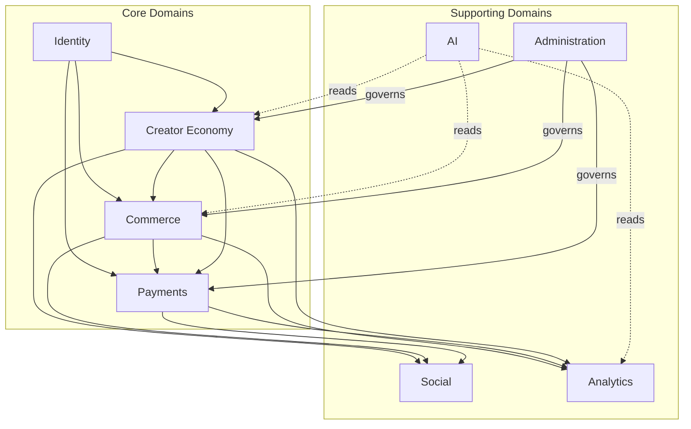
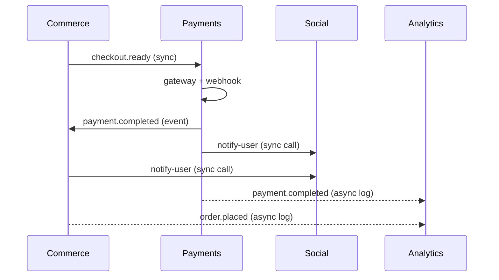

# Jimvio Domain Architecture v1.0

**Official business boundaries · Domain-Driven Design · July 2026**

> Every feature belongs to **exactly one** business domain.  
> Each domain owns its business logic, public APIs, permissions, events, and data.  
> Domains communicate through **defined contracts** — not hidden coupling.

**Companion:** [System Architecture](../system-architecture/) (technical view) · [Product Bible](../product-bible/) (product view)

---

## Table of contents

1. [Identity Domain](#1-identity-domain)
2. [Commerce Domain](#2-commerce-domain)
3. [Payments Domain](#3-payments-domain)
4. [Creator Economy Domain](#4-creator-economy-domain)
5. [AI Domain](#5-ai-domain)
6. [Social Domain](#6-social-domain)
7. [Analytics Domain](#7-analytics-domain)
8. [Administration Domain](#8-administration-domain)
9. [Domain Communication](#domain-communication)
10. [Entity Ownership](#entity-ownership)
11. [Anti-Corruption & Evolution](#anti-corruption--evolution)

---

## Domain map



**Legend:** Solid = transactional dependency · Dashed = read-only / assistive

---

# 1. Identity Domain

## Purpose

Establish **who** is acting on the platform — authentication, profile identity, roles, sessions, and account status.

## Business responsibility

| Owns | Does not own |
|------|--------------|
| User registration, login, logout, OAuth | Product catalog |
| Profile identity (name, avatar, slug) | Wallet balances |
| Role assignment (`user_roles`) | Order placement |
| Session lifecycle, 2FA, revocation | Community content |
| Account status (active, suspended, banned) | Payment processing |

## Owned data

| Entity | Table / store | Notes |
|--------|---------------|-------|
| User identity | `profiles` | Core user record |
| Credentials | Supabase Auth | External to app tables |
| Roles | `user_roles` | buyer, vendor, affiliate, influencer, community_owner, admin |
| 2FA secrets | `user_2fa_secrets` | Encrypted |
| Session registry | `platform_settings` (`sessions:{userId}`) | Device list |
| Account status | `profiles.account_status` | suspended, banned, etc. |

## Public APIs

| Interface | Type | Consumers |
|-----------|------|-----------|
| `getCachedUser()` | Server helper | All domains |
| `lib/auth/actions.ts` | Server actions | UI |
| `get_user_roles` RPC | Database | All domains |
| `requireAdmin()` / role guards | API helpers | Commerce, Payments, Admin |
| `app/auth/callback` | Route | OAuth |
| `proxy.ts` session refresh | Middleware | Platform |

## Events produced

| Event | Payload (conceptual) |
|-------|---------------------|
| `user.registered` | `userId`, `email` |
| `user.role_activated` | `userId`, `role` |
| `user.suspended` | `userId`, `reason` |
| `user.session_revoked` | `userId`, `deviceId` |
| `user.2fa_enabled` | `userId` |

## Events consumed

*None — Identity is upstream.*

## Dependencies

| Dependency | Direction |
|------------|-----------|
| Supabase Auth | External provider |
| Administration | Policy config for maintenance mode |

## Security rules

- Credentials never stored in application tables
- 2FA secrets server-only; never sent to client or LLM
- Session revocation enforced in middleware before any domain logic
- Service role never used for user-initiated identity operations

## Permissions

| Actor | Capabilities |
|-------|--------------|
| User | Own profile, own sessions, activate eligible roles |
| Admin | Assign roles, suspend accounts (via Administration) |
| System | Session refresh, OAuth callback |

## Future expansion

- SSO / SAML for enterprise (36-month)
- Organization accounts with team members
- Identity provider abstraction layer
- Passkeys / WebAuthn

---

# 2. Commerce Domain

## Purpose

Manage the **buying and selling** of goods — catalog, cart, checkout orchestration, orders, fulfillment — without owning money movement.

## Business responsibility

| Owns | Does not own |
|------|--------------|
| Products, variants, media references | Payment capture |
| Catalog taxonomy, categories | Wallet credits |
| Cart state | Affiliate commission calculation |
| Checkout session (pre-payment) | UGC campaigns |
| Order lifecycle (business states) | Community membership |
| Shipping rate selection | User authentication |
| CJ / Shopify product sync | Refund execution |

## Owned data

| Entity | Table | Notes |
|--------|-------|-------|
| Product | `products`, `product_variants`, `product_media` | Vendor-owned |
| Category | `product_categories` | Taxonomy |
| Cart | `carts`, `cart_items` | Per user |
| Order | `orders`, `order_items` | Post-checkout |
| Order history | `order_status_history` | Audit |
| Product views | `product_views` | Analytics input |
| CJ mapping | `cj_product_map`, `cj_order_queue` | Supply chain |
| Reviews | `reviews` | Product feedback |

## Public APIs

| Interface | Consumers |
|-----------|-----------|
| `lib/actions/marketplace.ts` | UI, Cart |
| `lib/actions/checkout.ts` | Checkout UI |
| `lib/actions/orders.ts` | Order pages |
| `lib/actions/order-lifecycle.ts` | Status transitions |
| `services/products.ts` | Marketplace, Search |
| `services/orders.ts` | Dashboard, AI tools |
| `GET /api/marketplace/search` | Search domain |
| `POST /api/products/[id]/view` | Analytics |

## Events produced

| Event | Consumers |
|-------|-----------|
| `product.created` | Administration (moderation), Analytics |
| `product.published` | Search, Marketplace, Creator Economy |
| `product.viewed` | Analytics, AI (signals) |
| `cart.updated` | Analytics |
| `checkout.started` | Analytics |
| `checkout.ready` | **Payments** (initiate) |
| `order.placed` | Payments, Social, Analytics, Creator Economy |
| `order.shipped` | Social, Analytics |
| `order.delivered` | Social, Analytics |
| `order.cancelled` | Payments, Social |

## Events consumed

| Event | From | Action |
|-------|------|--------|
| `payment.completed` | Payments | Finalize order status |
| `payment.failed` | Payments | Mark order payment failed |
| `refund.issued` | Payments | Update order status |
| `user.role_activated` | Identity | Unlock seller features |
| `product.approved` | Administration | Publish product |

## Dependencies

| Domain | Why |
|--------|-----|
| Identity | User/vendor identity, auth |
| Payments | Payment finalization (downstream) |
| Administration | Product moderation |
| Analytics | Read-only metrics |
| AI | Read-only search assistance |

## Security rules

- Vendors access only own products/orders (`requireVendorOwnerOrAdmin`)
- Buyers access only own orders
- Price validation server-side at checkout — never trust client
- **Tier 1 protected** — changes require full lifecycle

## Permissions

| Role | Commerce capabilities |
|------|----------------------|
| Guest | Browse, view products |
| Buyer | Cart, checkout, own orders |
| Seller (`vendor`) | Own catalog, own store orders |
| Admin | All (via Administration) |

## Future expansion

- Multi-warehouse inventory service
- Tax calculation engine (separate bounded context)
- Discount/coupon subdomain
- B2B wholesale catalog
- Product bundles subdomain

---

# 3. Payments Domain

## Purpose

Own all **money movement** — payment capture, wallet ledger, payouts, refunds, gateway integration. Single source of financial truth.

## Business responsibility

| Owns | Does not own |
|------|--------------|
| Payment initiation & verification | Product catalog |
| Webhook processing & idempotency | Order fulfillment logistics |
| Wallet balances & transactions | UGC content |
| Payout requests & execution | User profiles |
| Refund execution | Community posts |
| Gateway routing | Affiliate link creation |
| Community subscription payment finalization | |

## Owned data

| Entity | Table | Notes |
|--------|-------|-------|
| Transaction | `transactions` | Payment records |
| Wallet | `wallets` | Balance per user |
| Payout | `payouts` | Withdrawal requests |
| Failed credits | `failed_wallet_credits` | Reconciliation |
| Webhook audit | `webhook_events` | Idempotency |
| Payment status history | `order_payment_status_history` | Linked to orders |

## Public APIs

| Interface | Consumers |
|-----------|-----------|
| `lib/payments/router.ts` | Checkout |
| `lib/payments/finalize-order-payment.ts` | Webhooks only |
| `lib/payments/community-payment-finalizer.ts` | Creator Economy |
| `app/api/payments/*` | External gateways |
| `app/api/webhooks/*` | Gateway callbacks |
| `lib/actions/wallet.ts` | Wallet UI |
| `increment_wallet_balance` RPC | Internal only |

## Events produced

| Event | Consumers |
|-------|-----------|
| `payment.initiated` | Analytics, Administration |
| `payment.completed` | **Commerce** (order), **Social**, Analytics, Creator Economy |
| `payment.failed` | Commerce, Social, Analytics |
| `refund.issued` | Commerce, Analytics |
| `wallet.credited` | Social, Analytics |
| `wallet.debited` | Analytics |
| `payout.requested` | Administration, Social |
| `payout.completed` | Social, Analytics |

## Events consumed

| Event | From | Action |
|-------|------|--------|
| `checkout.ready` | Commerce | Initialize payment |
| `order.placed` | Commerce | Await payment |
| `commission.earned` | Creator Economy | Credit wallet |
| `ugc.payout_triggered` | Creator Economy | Credit wallet |
| `subscription.paid` | Creator Economy | Credit community owner |

## Dependencies

| Domain | Why |
|--------|-----|
| Identity | Payer identity |
| Commerce | Order reference |
| Administration | Refund approval, payout approval |
| External gateways | Flutterwave, PesaPal, PawaPay, etc. |

## Security rules

- **Single finalization path** — `finalize-order-payment.ts` only
- Webhook signature verification mandatory
- Idempotency via `webhook_events.idempotency_key`
- Wallet mutations only via RPC or documented finalizers
- No client-side payment logic
- **Tier 1 protected**

## Permissions

| Role | Payments capabilities |
|------|----------------------|
| Buyer | Initiate own checkout payment |
| Seller/Creator/Affiliate | View wallet, request payout |
| Admin | Refunds, payout approval, gateway config |

## Future expansion

- Payment orchestration microservice
- Stripe Connect
- Split payments (multi-vendor)
- Escrow subdomain for UGC
- Multi-currency wallet balances
- Automated payout schedules

---

# 4. Creator Economy Domain

## Purpose

Enable **creator-led monetization** beyond traditional commerce — affiliate, UGC, communities, live, courses, campaigns.

## Business responsibility

| Owns | Does not own |
|------|--------------|
| Affiliate links & click attribution | Payment capture |
| UGC campaigns & submissions | Order fulfillment |
| Communities, memberships, tiers | User authentication |
| Courses, lessons, progress | Wallet ledger (requests credit) |
| Live sessions, clip metadata | Product catalog (links only) |
| Creator public profile content | Platform moderation policy |
| Commerce/Business Graph relationships | |

## Owned data

| Entity | Table | Notes |
|--------|-------|-------|
| Affiliate | `affiliates`, `affiliate_links`, `affiliate_clicks`, `affiliate_commissions` | |
| UGC | `ugc_campaigns`, `ugc_submissions`, `ugc_payouts`, `ugc_view_snapshots` | |
| Community | `communities`, `community_memberships`, `community_posts` | |
| Community workspace | `rooms`, `spaces`, `community_messages` | Hub `/c` |
| Course | `community_courses`, `course_modules`, `course_lessons`, `lesson_progress` | |
| Creator profile | `influencers` + profile extensions | Public identity |
| Short video | `short_videos`, `short_video_views` | Live commerce |
| Graph edges | Commerce/Business graph adapters | Relationship metadata |

## Public APIs

| Interface | Consumers |
|-----------|-----------|
| `lib/actions/affiliate.ts` | Affiliate UI |
| `lib/ugc/*` | UGC UI |
| `services/communityService.ts` | Community UI |
| `lib/creator-profile/` | Profile pages |
| `lib/commerce-graph/`, `lib/business-graph/` | Cross-surface rails |
| `app/api/affiliates/track` | Public tracking |
| `app/api/ugc/*` | Campaign flows |
| `app/c/*` | Creator Hub |

## Events produced

| Event | Consumers |
|-------|-----------|
| `affiliate.click` | Analytics |
| `commission.earned` | **Payments** (wallet credit) |
| `campaign.created` | Analytics, AI |
| `campaign.joined` | Social, Analytics |
| `ugc.submitted` | Social, Administration |
| `ugc.approved` | Social, Payments (pending) |
| `ugc.payout_triggered` | **Payments** |
| `community.created` | Analytics, Search |
| `member.joined` | Social, Analytics |
| `subscription.paid` | **Payments** |
| `course.published` | Social, Analytics |
| `lesson.completed` | Analytics |
| `live.started` | Social, Analytics |
| `clip.viewed` | Analytics |
| `creator.verified` | Social, Identity (badge) |

## Events consumed

| Event | From | Action |
|-------|------|--------|
| `payment.completed` | Payments | Unlock paid community tier |
| `product.published` | Commerce | Link to creator profile |
| `user.role_activated` | Identity | Unlock creator/affiliate features |
| `product.approved` | Administration | Surface in creator storefront |

## Dependencies

| Domain | Why |
|--------|-----|
| Identity | Roles, profiles |
| Commerce | Product linking, order attribution |
| Payments | Commissions, subscriptions, UGC payouts |
| Social | Notifications for community/UGC |
| Analytics | Performance metrics |
| AI | Recommendations (read-only) |

## Security rules

- Community content access via membership tier + workspace role
- Affiliate attribution server-enforced window
- UGC submission ownership validated
- Paid content URLs cannot bypass tier check
- Click fraud rate limiting

## Permissions

| Role | Creator Economy capabilities |
|------|------------------------------|
| Guest | Browse public campaigns, communities |
| Creator (`influencer`) | UGC submit, affiliate links, profile |
| Affiliate | Affiliate links, analytics |
| Seller | Create UGC campaigns |
| Community owner | Full hub admin |
| Workspace moderator | Scoped moderation |

## Future expansion

- Creator reputation scoring subdomain
- Campaign marketplace (brands browse creators)
- Rights management for UGC content
- Federated community protocol
- Live commerce shoppable overlay subdomain

---

# 5. AI Domain

## Purpose

Provide **assistive intelligence** across Jimvio — contextual, explanatory, bounded. Never owns business transactions.

## Business responsibility

| Owns | Does not own |
|------|--------------|
| Copilot conversation & context | Orders, payments, wallet |
| AI search intent parsing | Product catalog data |
| Opportunity scoring & explanations | User credentials |
| Provider adapters (Gemini, OpenAI) | Community content |
| Token budgets & rate limits | Affiliate attribution |
| Tool registry (read-only) | |

## Owned data

| Entity | Table | Notes |
|--------|-------|-------|
| AI usage logs | `ai_usage_logs` (planned) | Tokens, tools — no message content |
| AI config | `platform_settings` (`ai_*` keys) | Provider, limits |
| Embeddings | Via `match_products` RPC | Commerce-owned vectors; AI reads |
| Opportunity scores | Opportunity Engine adapters | Computed; not persisted long-term v1 |

## Public APIs

| Interface | Consumers |
|-----------|-----------|
| `POST /api/ai/chat` | Copilot UI |
| `POST /api/ai/search` | Marketplace AI search |
| `lib/ai/copilot/` | Copilot shell |
| `lib/ai/ai-search-service.ts` | Search |
| `lib/opportunity-engine/` | Dashboard |
| `lib/command-center/search.ts` | ⌘K (partial) |

## Events produced

| Event | Consumers |
|-------|-----------|
| `ai.query` | Analytics |
| `ai.tool_invoked` | Analytics, Administration |
| `ai.rate_limited` | Analytics |

## Events consumed

| Event | From | Use |
|-------|------|-----|
| `product.published` | Commerce | Search index (via existing pipeline) |
| `product.viewed` | Commerce | Personalization signals |
| `order.placed` | Commerce | Context only (read via tool) |
| `campaign.created` | Creator Economy | Opportunity scoring |
| *Route context* | Experience layer | Copilot context injection |

**Rule:** AI **consumes read-only** snapshots and tools — never subscribes to mutate other domains.

## Dependencies

| Domain | Why | Coupling |
|--------|-----|----------|
| Identity | Auth, roles for tool scope | Loose |
| Commerce | Product search tool | Loose (API) |
| Creator Economy | Opportunity data | Loose |
| Analytics | Metric summaries for tools | Loose |
| External LLM | Gemini, OpenAI | External |

## Security rules

- Authenticated only; no guest Copilot
- Tools are allowlist — no arbitrary DB access
- PII never sent to LLM
- AI cannot invoke payment, refund, or payout operations
- Prompt injection defenses in system prompt
- Rate limits per user/day

## Permissions

| Role | AI capabilities |
|------|-----------------|
| Authenticated user | Copilot, search AI |
| Role-scoped | Tool access varies (vendor analytics, order status) |
| Admin | Platform AI config (Administration) |

## Future expansion

- AI Gateway microservice
- RAG knowledge base subdomain
- User-approved bounded agents (v2)
- Marketplace demand forecasting
- Separate embedding pipeline ownership debate (may move to Commerce or Analytics)

---

# 6. Social Domain

## Purpose

**Engagement and communication** — messaging, notifications, activity signals. Does not own commercial transactions or content authority.

## Business responsibility

| Owns | Does not own |
|------|--------------|
| In-app notifications | Order state |
| Transactional email triggers | Payment processing |
| Direct messaging transport | Community post content (Creator Economy) |
| Community chat delivery | User identity |
| Notification preferences (future) | UGC campaign rules |
| Toast feedback (Sonner via DS) | |

## Owned data

| Entity | Table | Notes |
|--------|-------|-------|
| Notification | `notifications` | In-app |
| Conversation | `conversations`, `conversation_messages` | DM |
| Community chat | `community_messages` | *Shared with Creator Economy — see ownership* |
| Email | Sent via Resend; no content store | |

### Shared entity note: `community_messages`

**Primary owner:** Creator Economy (content authority)  
**Social domain owns:** Delivery, realtime transport, unread state, notification triggers

## Public APIs

| Interface | Consumers |
|-----------|-----------|
| `lib/notifications/notify-user.ts` | **All domains** (single entry) |
| `lib/actions/notifications.ts` | Notification UI |
| `lib/email/transactional.ts` | Payment, Commerce, Social |
| `hooks/useChatRoom.ts` | Chat UI |
| `app/api/messages/*` | Messaging |
| `dsToast` / `DsToaster` | UI feedback |

## Events produced

| Event | Consumers |
|-------|-----------|
| `notification.delivered` | Analytics |
| `message.sent` | Analytics |
| `email.sent` | Analytics (future) |

## Events consumed

| Event | From | Notification action |
|-------|------|---------------------|
| `order.placed` | Commerce | Order confirmation |
| `payment.completed` | Payments | Payment success |
| `payment.failed` | Payments | Payment failure |
| `wallet.credited` | Payments | Earnings alert |
| `payout.completed` | Payments | Payout sent |
| `ugc.submitted` | Creator Economy | Review alert |
| `member.joined` | Creator Economy | Welcome |
| `live.started` | Creator Economy | Live alert |
| `message.sent` | Social | Unread badge |
| `user.suspended` | Identity | Account notice |

**Rule:** Domains call `notify-user.ts` — they do not insert into `notifications` directly.

## Dependencies

| Domain | Why |
|--------|-----|
| Identity | Recipient identity |
| All event-producing domains | Notification triggers |
| Resend | Email delivery |
| Supabase Realtime | Live delivery |

## Security rules

- Users see only own notifications
- Message access participant-scoped
- No PII in notification preview text
- Email unsubscribe compliance

## Permissions

| Role | Social capabilities |
|------|---------------------|
| Authenticated | Receive notifications, send messages |
| Community member | Community chat (tier-gated) |
| Admin | System notifications |

## Future expansion

- Push notification providers (FCM, APNs)
- Notification orchestration service
- Granular preference center
- Activity feed subdomain (aggregated events)
- Following graph (if separated from Creator Economy)

---

# 7. Analytics Domain

## Purpose

**Measure and report** platform behavior — read-only aggregation. Never mutates business state.

## Business responsibility

| Owns | Does not own |
|------|--------------|
| Event aggregation logic | Source transactions |
| Role dashboards | Orders, products |
| Admin reports & exports | User credentials |
| Platform marketing stats | Payment execution |
| Funnel definitions | |
| KPI computation | |

## Owned data

| Entity | Table / source | Notes |
|--------|--------------|-------|
| Product views | `product_views` | *Written by Commerce; Analytics owns reporting* |
| Affiliate clicks | `affiliate_clicks` | *Written by Creator Economy* |
| Video views | `short_video_views` | *Written by Creator Economy* |
| UGC views | `ugc_view_snapshots` | *Written by Creator Economy* |
| Aggregates | Computed at query time | No separate warehouse v1 |
| Vercel Analytics | External | Page metrics |

### Ownership clarification

Analytics **owns the reporting contract** for behavioral events. Source domains **produce** events; Analytics **defines** how they are measured and displayed. Event tables may remain in source domain schemas until data warehouse extraction (1M+ users).

## Public APIs

| Interface | Consumers |
|-----------|-----------|
| `services/dashboard-analytics.ts` | Dashboard UI |
| `services/creator-analytics.ts` | Creator Hub |
| `app/api/*/analytics` | Role dashboards |
| `lib/admin/build-revenue-report.ts` | Admin |
| Vercel Analytics / Speed Insights | Platform |

## Events produced

| Event | Consumers |
|-------|-----------|
| `report.generated` | Administration (audit) |

## Events consumed

| Event | From |
|-------|------|
| All domain events | *Read-only subscription or batch ETL* |
| `product.viewed` | Commerce |
| `order.placed` | Commerce |
| `payment.completed` | Payments |
| `affiliate.click` | Creator Economy |
| `ai.query` | AI |
| `search.performed` | Search (Commerce/AI) |

## Dependencies

| Domain | Why | Coupling |
|--------|-----|----------|
| All domains | Event data | Read-only |
| Identity | Role-scoped dashboards | Loose |
| Administration | Export permissions | Loose |

## Security rules

- Role-scoped data access — server enforced
- Admin exports audited
- No cross-user PII in aggregate reports
- Analytics never writes to Commerce/Payments tables

## Permissions

| Role | Analytics capabilities |
|------|------------------------|
| User | Own role dashboard |
| Admin | Platform reports, exports |

## Future expansion

- ClickHouse / BigQuery warehouse
- Real-time OLAP
- Cohort analysis subdomain
- Predictive forecasting (with AI domain)
- External analytics API for sellers

---

# 8. Administration Domain

## Purpose

**Govern the platform** — moderation, configuration, audit, disputes, system operations. Elevated privileges; does not own core business workflows.

## Business responsibility

| Owns | Does not own |
|------|--------------|
| Admin operations & UI | Day-to-day commerce flow |
| Product/campaign moderation decisions | Payment gateway logic |
| User role assignment (elevated) | User self-registration |
| Platform settings & feature flags | Product catalog content |
| Dispute resolution workflow | Community content creation |
| CJ import operations | |
| Maintenance mode | |
| Audit policy (enforcement) | |

## Owned data

| Entity | Table | Notes |
|--------|-------|-------|
| Platform config | `platform_settings`, `platform_secrets` | Feature flags, AI config |
| Disputes | dispute tables | Moderation |
| Admin audit | Partial — `webhook_events`, order history | Full `audit_log` planned |
| CJ intel | `cj_logs`, `cj_sync_logs` | Supply chain ops |

## Public APIs

| Interface | Consumers |
|-----------|-----------|
| `app/admin/*` | Admin UI |
| `lib/actions/admin-*.ts` | Admin operations |
| `requireAdmin()` | All admin routes |
| `lib/platform-maintenance.ts` | Middleware |
| `lib/platform-settings*.ts` | Platform config |

## Events produced

| Event | Consumers |
|-------|-----------|
| `admin.action` | Analytics, Audit |
| `product.approved` | Commerce |
| `product.rejected` | Commerce, Social |
| `dispute.resolved` | Commerce, Payments |
| `user.role_assigned` | Identity |
| `maintenance.enabled` | Identity (sign-out) |

## Events consumed

| Event | From | Action |
|-------|------|--------|
| `ugc.submitted` | Creator Economy | Moderation queue |
| `payment.failed` | Payments | Investigation |
| `payout.requested` | Payments | Approval queue |
| `webhook.failed` | Payments | Retry cron trigger |

## Dependencies

| Domain | Why |
|--------|-----|
| Identity | Admin role verification |
| All domains | Governed operations |
| Payments | Refunds, payout approval |
| Commerce | Product/order moderation |

## Security rules

- `admin` role required; super admin for maintenance
- Service role for elevated DB operations — server only
- All destructive actions require confirmation
- 2FA recommended for admin accounts
- Audit trail for role changes and payouts (expanding)

## Permissions

| Role | Administration capabilities |
|------|----------------------------|
| Admin | Full platform ops |
| Super admin (`ADMIN_EMAILS`) | Maintenance mode, system secrets |
| Support (future) | Read-only user lookup |

## Future expansion

- Dedicated support role with scoped permissions
- Admin API for operations automation
- Fraud detection dashboard
- Compliance reporting subdomain
- Multi-region admin delegation

---

# Domain Communication

## Communication rules

| Rule | Detail |
|------|--------|
| **1. Single entry for side effects** | Notifications via `notify-user.ts`; payments via `finalize-order-payment.ts`; wallet via RPC |
| **2. No cross-domain internal imports** | Domain A must not import Domain B's `lib/` internals — use public API or events |
| **3. Events over direct calls** | Prefer documented events for async; sync calls only when user waits |
| **4. Read-only cross-domain** | AI and Analytics read via tools/APIs — never write |
| **5. Identity upstream** | All domains depend on Identity; Identity depends on nothing |

## Communication patterns



| Pattern | When | Example |
|---------|------|---------|
| **Sync call (public API)** | User waiting | Checkout → Payments initiate |
| **Domain event (sync handler)** | Immediate consistency | `payment.completed` → order finalize |
| **Notification facade** | User alert | Any domain → `notify-user.ts` |
| **Webhook (external)** | Gateway callback | PesaPal → Payments |
| **Cron (batch)** | Scheduled | UGC view sync |
| **Realtime (push)** | Live UI | Order status → client |
| **Read tool (AI)** | Assistive | AI → Commerce search |

## Anti-patterns (forbidden)

| Anti-pattern | Why forbidden |
|--------------|---------------|
| Commerce writes to `wallets` directly | Payments owns ledger |
| AI calls `finalize-order-payment` | AI is read-only |
| Creator Economy inserts `notifications` | Social owns delivery |
| Analytics updates `orders` | Analytics is read-only |
| Client calls Supabase service role | Security boundary |
| Domain imports another domain's actions without public contract | Hidden coupling |

## Future: event bus (1M+ users)

```
Domain mutation → outbox table (same TX)
              → message broker
              → domain consumers (Social, Analytics, Search index)
```

Until then: **documented sync events + `notify-user` facade**.

---

# Entity Ownership

Every entity has **exactly one owner domain**. Other domains reference via ID — never duplicate authoritative state.

| Entity | Owner domain | Others may |
|--------|--------------|------------|
| `profiles` | Identity | Read |
| `user_roles` | Identity | Read |
| `products` | Commerce | Read, link (Creator Economy) |
| `orders` | Commerce | Read (Payments, Analytics) |
| `transactions` | Payments | Read (Analytics, Admin) |
| `wallets` | Payments | Read (Analytics) |
| `affiliate_links` | Creator Economy | Read (Analytics) |
| `ugc_campaigns` | Creator Economy | Moderate (Administration) |
| `communities` | Creator Economy | Read (AI, Analytics) |
| `community_messages` | Creator Economy (content) / Social (delivery) | *Split — migrate to Social v2* |
| `notifications` | Social | Produce via facade |
| `notifications` trigger | Source domain | Call `notify-user` |
| `product_views` | Commerce (write) / Analytics (report) | *Split write/read ownership* |
| `platform_settings` | Administration | Read (all domains) |
| `ai_usage_logs` | AI | Read (Admin, Analytics) |

### Duplicate ownership resolutions

| Tension | Resolution |
|---------|--------------|
| `community_messages` | Creator Economy owns content; Social owns transport — long-term merge under Social with Creator Economy as content API |
| Behavioral event tables | Source domain writes; Analytics owns schema for warehouse ETL at scale |
| `profiles` vs creator profile | Identity owns `profiles`; Creator Economy owns `influencers` extension |

---

# Anti-Corruption & Evolution

## Bounded context mapping (today → future)

| Today (modular monolith) | Future (extracted service) |
|--------------------------|----------------------------|
| `lib/payments/` | Payments Service |
| `lib/actions/checkout.ts` + Commerce | Commerce Service |
| `lib/ugc/` + `lib/community/` | Creator Economy Service |
| `lib/ai/` | AI Gateway Service |
| `lib/notifications/` | Notification Service |

**Rule:** Extract only when [System Architecture Part 7](../system-architecture/) scale triggers fire.

## Domain tier protection

| Domain | Feature tier |
|--------|--------------|
| Identity | T1 |
| Payments | T1 |
| Commerce (checkout, orders) | T1–T2 |
| Creator Economy | T3 |
| AI | T3 |
| Social | T3 |
| Analytics | T4 |
| Administration | T1 (elevated ops) |

## Adding a new feature — domain assignment

```
1. Which domain owns the business rule?
2. Which domain owns the data?
3. Which events does it produce/consume?
4. Does it need a new subdomain or fit existing?
5. Update this document + System Architecture event catalog
6. Write FS-NNN + TSL-NNN
```

---

## Document relationships

| Document | View |
|----------|------|
| **Domain Architecture (this)** | Business boundaries (DDD) |
| [Business Capability Model](../business-capability-model/) | What the business must do (technology-independent) |
| [System Architecture](../system-architecture/) | Technical modules, infrastructure |
| [Product Bible](../product-bible/) | Product narrative |
| [Technical Architecture](../technical-architecture/) | Implementation stack |
| [Operating Model](../operating-model/) | Process |

---

## Maintenance

| Trigger | Action |
|---------|--------|
| New bounded context | Add domain section + update map |
| Entity ownership dispute | Resolve in this doc + ADR |
| Service extraction | Update bounded context mapping |
| Quarterly | Architecture review with CTO |

---

**Jimvio Domain Architecture v1.0** — *One entity. One owner. Clear boundaries.*

*End of document*
