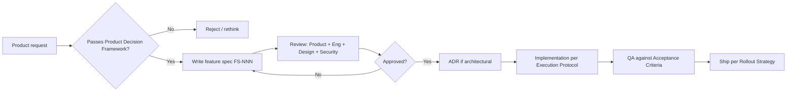

# Jimvio Feature Specifications

**Official engineering intake documents · Version 1.0 · July 2026**

Feature specifications eliminate ambiguity. Every engineer, designer, and QA tester should build the **same feature** after reading the same spec.

> **Product requirements:** Major features start with an approved [PRD (`PRD-NNN`)](../prd/) before the Feature Spec is written.

---

## Document stack

```
PRD-NNN (product)  →  FS-NNN (engineering)  →  TSL-NNN (Tier 1–2 contract)  →  Implementation
```

## When to write a spec

Write a feature spec **before implementation** when a change:

- Introduces a new user-facing capability
- Modifies authentication, payments, checkout, or orders
- Adds a new platform module or global shell behavior
- Changes API contracts or database schema
- Integrates AI into a production user flow
- Spans more than one engineering squad or sprint

**Skip a full spec** for: bug fixes with obvious scope, copy changes, dependency bumps, DS token additions with no behavior change.

---

## Specification index

| ID | Feature | Status | Owner |
|----|---------|--------|-------|
| [FS-001](./FS-001-jimvio-ai-production-integration.md) | Jimvio AI Production Integration | Proposed | Platform / AI |
| [TSL-001](../technical-spec-library/TSL-001-jimvio-ai-production-integration.md) | *(engineering pair)* | Proposed | Platform / AI |
| — | *Use [template](./FEATURE-SPECIFICATION-TEMPLATE.md) + [TSL template](../technical-spec-library/TSL-TEMPLATE.md)* | — | — |

---

## Workflow



### Reviewers (required sign-off)

| Role | Validates |
|------|-----------|
| **Product** | Goals, user stories, business value, non-goals |
| **Engineering** | API/DB dependencies, NFRs, risks, rollback |
| **Design** | UX, a11y, DS compliance |
| **Security** | Auth, PII, rate limits (payments: mandatory extra review) |
| **QA** | Acceptance criteria, testing strategy |

---

## File naming

```
docs/feature-specs/FS-NNN-short-kebab-title.md
```

- `NNN` — sequential three-digit ID
- Update index table in this README when adding specs

---

## Template

**[FEATURE-SPECIFICATION-TEMPLATE.md](./FEATURE-SPECIFICATION-TEMPLATE.md)** — 30 required sections with field-level guidance.

---

## Related governance

| Document | Relationship |
|----------|--------------|
| [**PRDs**](../prd/) | Product requirements — write and approve PRD before FS |
| [Operating Model](../operating-model/JIMVIO-PRODUCT-OPERATING-MODEL-v1.0.md) | Lifecycle, tiers, review gates, release |
| [Technical Spec Library](../technical-spec-library/) | Engineering contracts (`TSL-NNN`) |
| [Product Blueprint](../product-blueprint/JIMVIO-PRODUCT-BLUEPRINT-v1.0.md) | Module context, personas, KPIs |
| [Technical Architecture](../technical-architecture/JIMVIO-TECHNICAL-ARCHITECTURE-BLUEPRINT-v1.0.md) | Stack, API standards, security |
| [Product Decision Framework](../product-blueprint/JIMVIO-PRODUCT-BLUEPRINT-v1.0.md) | Pre-spec gate |
| [ADRs](../adr/README.md) | Architectural decisions |
| [Design System](../design-system/README.md) | UI constraints |

---

## Quality bar

A spec is **ready for engineering** when:

- [ ] All 30 sections completed (or explicitly marked N/A with reason)
- [ ] Acceptance criteria are testable (Given/When/Then)
- [ ] Non-goals prevent scope creep
- [ ] Permissions matrix matches [user roles](../product-blueprint/01-user-roles.md)
- [ ] Error, loading, empty, and success states defined
- [ ] Rollout and rollback strategies documented
- [ ] Open questions resolved or assigned with owners

---

## Change log

| Version | Date | Changes |
|---------|------|---------|
| 1.0 | July 2026 | Template, process, FS-001 exemplar |
