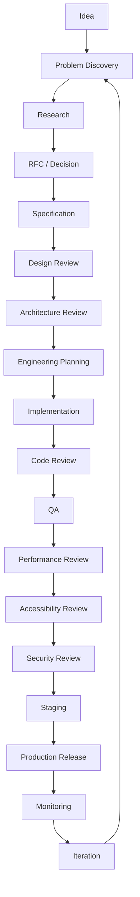
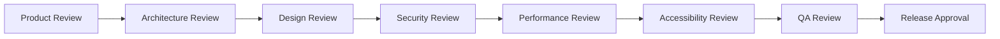
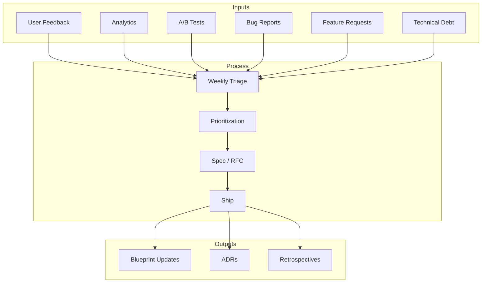

# Jimvio Product Operating Model v1.0

**Official · July 2026**

> How Jimvio is built, reviewed, approved, implemented, released, and improved.  
> **Strategic governance:** [Product Operating System (JPOS)](../product-operating-system/) · Comparable in rigor to operating models at Shopify, Stripe, Notion, Linear, GitHub, Vercel, and Airbnb — adapted for a Creator Commerce Operating System at startup scale.

---

## Executive summary

Jimvio optimizes for **rapid innovation without sacrificing stability**. Every feature passes a defined lifecycle, tier-appropriate review gates, and a structured release before reaching millions of users. Quality, security, accessibility, and performance are **gates**, not afterthoughts.

**Core rules:**
1. **Protect what works** — Tier 1 changes require explicit approval
2. **Specify before build** — Feature specs eliminate ambiguity
3. **Review before merge** — No gate may be skipped for tier
4. **Ship incrementally** — Alpha → Beta → Gradual → Global
5. **Measure and iterate** — Every release has success metrics and rollback plan

---

## Document map

| Part | Topic |
|------|-------|
| 1 | Product Lifecycle |
| 2 | Team Responsibilities |
| 3 | Feature Tiers |
| 4 | Review Gates |
| 5 | Release Strategy |
| 6 | Success Metrics |
| 7 | Continuous Improvement |

**Companion documents:** [Product Blueprint](../product-blueprint/) · [Technical Architecture](../technical-architecture/) · [Feature Specs](../feature-specs/) · [ADRs](../adr/)

---

# PART 1 — PRODUCT LIFECYCLE

Every feature — from idea to iteration — follows this lifecycle. Stages may overlap but **cannot be skipped** for the feature's tier (see Part 3).



## Stage definitions

| Stage | Owner | Output | Gate to proceed |
|-------|-------|--------|-----------------|
| **Idea** | Anyone | Problem hypothesis | Logged in backlog |
| **Problem Discovery** | Product | Validated problem statement | Passes [Product Decision Framework](../product-blueprint/JIMVIO-PRODUCT-BLUEPRINT-v1.0.md) (10 questions) |
| **Research** | Product + Design + Eng | User evidence, competitive scan, feasibility | Problem confirmed with data or strong qualitative signal |
| **RFC** | Engineering / Product | Decision doc for ambiguous or cross-cutting work | Reviewers approve approach (ADR if architectural) |
| **Specification** | Product + Eng | [PRD PRD-NNN](../prd/PRD-TEMPLATE.md) then [Feature Spec FS-NNN](../feature-specs/FEATURE-SPECIFICATION-TEMPLATE.md) | PRD approved (Product, Design, Leadership); FS approved (Product, Eng, Design, Security, QA) |
| **Design Review** | Design | UX flows, DS compliance, mobile-first | Design sign-off; no one-off styles |
| **Architecture Review** | Engineering | Impact analysis, dependencies, API/DB changes | ADR if needed; no protected-domain changes without approval |
| **Engineering Planning** | Engineering | Task breakdown, files touched, risks, estimate | Plan linked to spec; minimal scope confirmed |
| **Implementation** | Engineering | Code per [Execution Protocol](../adr/README.md) | `tsc` clean; follows JPES |
| **Code Review** | Engineering | PR approved by staff-level or domain owner | No regressions; reuse verified |
| **QA** | QA / Eng | AC checklist from spec §10 | All P0 AC pass |
| **Performance Review** | Engineering | LCP/CLS/bundle impact | Meets spec §14 or no regression |
| **Accessibility Review** | Design / Eng | Keyboard, SR, contrast | Meets spec §12 |
| **Security Review** | Security / Eng | Auth, PII, rate limits | Meets spec §13; mandatory for T1–T2 |
| **Staging** | Engineering | Deploy to preview/staging | Smoke test pass |
| **Production Release** | Eng + Product | Per Part 5 rollout | Release approval obtained |
| **Monitoring** | Engineering + Product | Metrics from spec §15 | Dashboards/alerts active 48h |
| **Iteration** | Product | Learnings, v1.1 scope | Retrospective if Tier 1–3 |

## Lifecycle shortcuts (allowed)

| Scenario | Skip | Still required |
|----------|------|----------------|
| **Bug fix** (P0 production) | RFC, full spec | Root cause, fix PR, QA, rollback plan |
| **Copy / content** | Architecture, Security | Design review if user-facing |
| **Tier 5 experiment** | Full spec (use lightweight RFC) | Rollback, metrics, time-box |
| **DS token addition** | Spec if no behavior change | Design review |

## Protected lifecycle rule

Changes touching **authentication, payments, checkout, orders, pricing, inventory, affiliate logic, or database schema** always run the **full Tier 1 lifecycle** — no shortcuts.

---

# PART 2 — TEAM RESPONSIBILITIES

RACI: **R** = Responsible · **A** = Accountable · **C** = Consulted · **I** = Informed

## Leadership

| Role | Accountable for | Key responsibilities |
|------|-----------------|----------------------|
| **Founder** | Vision, Tier 1 approval, company risk | North Star alignment; approve payments/auth/checkout changes; investor narrative |
| **Chief Product Officer (CPO)** | Product strategy, roadmap, prioritization | Product Decision Framework; blueprint maintenance; release prioritization |
| **Chief Technology Officer (CTO)** | Technical excellence, architecture, security | Architecture review; Tier 1–2 approval; technical debt budget; hiring bar |

## Product & design

| Role | Accountable for | Key responsibilities |
|------|-----------------|----------------------|
| **Product Manager** | Specs, backlog, success metrics | Write/review PRD-NNN + FS-NNN; user stories; rollout; post-launch iteration |
| **Product Designer** | Design System compliance, UX quality | Design review gate; flows; component specs; no visual exceptions |
| **UX Designer** | Usability, research, accessibility UX | User research; a11y review; mobile-first patterns; usability testing |

## Engineering

| Role | Accountable for | Key responsibilities |
|------|-----------------|----------------------|
| **Head of Engineering** | Delivery, code quality, team velocity | Engineering planning; code review bar; CI/CD; release approval |
| **Principal / Staff Engineer** | Architecture, platform health | Architecture review; ADRs; mentor; Tier 1 implementation oversight |
| **Software Engineer** | Feature implementation | Execution Protocol; minimal safe change; tests; documentation updates |
| **Frontend Engineer** | UI, performance, a11y implementation | DS components; lazy loading; Core Web Vitals; error/empty states |
| **Backend Engineer** | APIs, services, data integrity | Server actions; webhooks; idempotency; RLS; migrations |
| **AI Engineer** | Jimvio AI, embeddings, safety | Provider integration; prompt safety; tool boundaries; token budgets |
| **DevOps / Platform Engineer** | Deployment, observability, infra | Vercel; cron; env/secrets; monitoring; incident response |
| **QA Engineer** | Quality gates, regression prevention | AC validation; test plans; staging sign-off; release checklist |

## Operations & community

| Role | Accountable for | Key responsibilities |
|------|-----------------|----------------------|
| **Support** | User trust, issue triage | Bug reports → backlog; user-facing error patterns; FAQ for AI Copilot |
| **Community Team** | Creator/seller success | Feedback loop; beta programs; creator onboarding signal |

## RACI matrix (key activities)

| Activity | Founder | CPO | CTO | PM | Design | Eng | QA | Security |
|----------|:-------:|:---:|:---:|:--:|:------:|:---:|:--:|:--------:|
| Roadmap priority | A | R | C | R | C | C | I | I |
| Feature spec approval | I | A | C | R | C | C | C | C |
| Tier 1 release | A | C | A | R | C | R | R | A |
| ADR approval | I | C | A | I | I | R | I | C |
| Production incident | I | C | A | I | I | R | C | C |
| Blueprint updates | I | A | C | R | C | C | I | I |

---

# PART 3 — FEATURE TIERS

Features are classified by **blast radius** and **business criticality**. Tier determines lifecycle depth and approval requirements.

## Tier definitions

### Tier 1 — Critical Platform Features

**Definition:** Failure causes revenue loss, security breach, data loss, or platform-wide outage.

| Examples | Approval required |
|----------|-------------------|
| Authentication, 2FA, session management | Founder + CTO + Security |
| Payments, checkout, order finalization | Founder + CTO + Security + CPO |
| Wallet credits, payouts | Founder + CTO + Security |
| Database schema (core tables) | CTO + ADR |
| Admin access control | CTO + Security |

**Lifecycle:** Full (Part 1) — no shortcuts  
**Spec:** Mandatory FS-NNN + security appendix  
**Rollback:** Pre-tested before any deploy

---

### Tier 2 — Core Commerce Features

**Definition:** Directly affects buying, selling, or order fulfillment for all users.

| Examples | Approval required |
|----------|-------------------|
| Marketplace browse/search/checkout path | CPO + CTO |
| Product catalog, cart | CPO + Eng lead |
| Orders, tracking, refunds (UI) | CPO + CTO |
| Seller Hub core flows | CPO + Product |
| Payment method selector (UI only) | CPO + CTO |

**Lifecycle:** Full spec; architecture review if API/DB touch  
**Rollback:** Feature flag or revert deploy

---

### Tier 3 — Creator Economy Features

**Definition:** Creator, affiliate, community, UGC, courses, live — growth and retention drivers.

| Examples | Approval required |
|----------|-------------------|
| UGC campaigns, affiliate links | CPO + Eng lead |
| Communities, courses, live | CPO + Design |
| Creator profiles, Commerce Graph | Product + Eng lead |
| Jimvio AI (Copilot production) | CPO + CTO + AI lead |
| Opportunity Engine, Workspace | Product + Eng lead |

**Lifecycle:** Full FS-NNN; design review mandatory  
**Release:** Beta before GA typical

---

### Tier 4 — Enhancement Features

**Definition:** Improves existing flows without new platform capabilities or critical path changes.

| Examples | Approval required |
|----------|-------------------|
| Dashboard widget, analytics card | Eng lead + Design |
| DS migration of existing page | Design + Eng lead |
| Notification preference | Product + Eng |
| SEO, sitemap improvements | Eng lead |
| Copy, empty state improvements | Product or Design |

**Lifecycle:** Lightweight spec (sections 1–10, 18–21, 26–27 minimum)  
**Review:** Code review + QA sufficient for P2 items

---

### Tier 5 — Experimental Features

**Definition:** Time-boxed experiments; failure is acceptable; easy to remove.

| Examples | Approval required |
|----------|-------------------|
| A/B test variants | Product + Eng |
| Prototype AI feature behind flag | Product + AI lead |
| New onboarding experiment | Product + Design |
| Internal tooling | Eng lead |

**Lifecycle:** 1-page RFC + success metric + rollback date  
**Max duration:** 90 days without promote-to-T3 or kill decision  
**Must:** Feature flag; no Tier 1–2 dependencies

---

## Tier assignment (decision tree)

```
Does it touch auth, payments, checkout, orders, wallet, or core schema?
  YES → Tier 1
  NO → Does it affect purchase or fulfillment path?
    YES → Tier 2
    NO → Is it creator/affiliate/community/UGC/AI?
      YES → Tier 3
      NO → Is it net-new capability?
        YES → Tier 3 or 4 (PM decides)
        NO → Tier 4 or 5
```

**When in doubt, classify up** — higher tier = more safety.

---

# PART 4 — REVIEW GATES

Every feature passes applicable gates before production. **Gates are blocking** — failed gate returns work to previous stage.



## Gate definitions

| Gate | Owner | Criteria | Artifact |
|------|-------|----------|----------|
| **Product Review** | CPO / PM | Goals, non-goals, AC, business value; tier correct | Approved FS-NNN §1–10, 16–17, 26–27 |
| **Architecture Review** | CTO / Staff Eng | Minimal change; no dup logic; API/DB impact; ADR if needed | ADR, impact analysis, spec §22–23 |
| **Design Review** | Product Designer | DS tokens; mobile-first; loading/empty/error; no dead ends | Spec §11–12; DS component list |
| **Security Review** | CTO / Security | Auth, PII, rate limits, input validation | Spec §13; mandatory T1–T2 |
| **Performance Review** | Eng lead | Bundle, LCP, API p95, lazy load | Spec §14; Speed Insights check |
| **Accessibility Review** | Design / Eng | Keyboard, SR, contrast, reduced motion | Spec §12; manual spot check |
| **QA Review** | QA / Eng | All P0 AC pass; regression smoke | Spec §10, §28 checklist |
| **Release Approval** | CPO + Eng lead (+ Founder for T1) | Rollout plan; rollback tested; monitoring ready | Spec §26–27; release notes |

## Gate requirements by tier

| Gate | T1 | T2 | T3 | T4 | T5 |
|------|:--:|:--:|:--:|:--:|:--:|
| Product | ✅ | ✅ | ✅ | 🟡 | 🟡 |
| Architecture | ✅ | ✅ | ✅ | — | — |
| Design | ✅ | ✅ | ✅ | ✅ | 🟡 |
| Security | ✅ | ✅ | 🟡 | — | — |
| Performance | ✅ | ✅ | ✅ | 🟡 | — |
| Accessibility | ✅ | ✅ | ✅ | ✅ | — |
| QA | ✅ | ✅ | ✅ | ✅ | 🟡 |
| Release Approval | ✅+F | ✅ | ✅ | 🟡 | — |

✅ = required · 🟡 = lightweight · — = optional · **F** = Founder sign-off

## Quality Gate alignment

Maps to [Jimvio Quality Gate v1.0](../adr/README.md) — Architecture, UX, Performance, Code Quality, Accessibility, Security, Design System, Testing, Business Logic protection.

---

# PART 5 — RELEASE STRATEGY

## Release phases

| Phase | Audience | Purpose | Duration |
|-------|----------|---------|----------|
| **Alpha** | Internal team (5–15) | Break feature; find blockers | 1–2 weeks |
| **Internal Testing** | All employees + trusted creators | Broader feedback; AC validation | 1 week |
| **Beta** | Invited users (flag or allowlist) | Real-world usage; metric baseline | 2–4 weeks |
| **Limited Rollout** | 5% → 25% of users | Monitor error/latency at scale | 1–2 weeks |
| **Gradual Rollout** | 25% → 50% → 100% | Confidence before full exposure | 1 week |
| **Global Release** | All users | GA; marketing if applicable | — |

## Release mechanics

| Mechanism | Use when |
|-----------|----------|
| **Feature flag** (`platform_settings`) | Tier 3–5; instant rollback |
| **Vercel preview** | Per-PR QA |
| **Staging** | Pre-prod smoke (production-like env) |
| **Canary deploy** | Tier 1–2 infrastructure changes |
| **Maintenance window** | Tier 1 schema migration only |

## Rollback

| Trigger | Action | Owner |
|---------|--------|-------|
| Error rate > 2× baseline for 15 min | Disable feature flag | On-call Eng |
| Payment success rate drop > 5% | **Immediate** revert + incident | CTO + Founder |
| Security vulnerability reported | Disable + patch | Security + CTO |
| User-reported data leak | Disable + investigate | Founder + CTO |

**Rollback rules:**
1. Every Tier 1–3 feature ships with documented rollback (spec §27)
2. Rollback must not corrupt data (forward-only migrations need down scripts for T1)
3. Post-rollback: incident retrospective within 48h for T1–T2

## Release checklist (pre-GA)

- [ ] All tier-required gates passed
- [ ] Feature flag tested (on/off)
- [ ] Monitoring dashboards and alerts configured
- [ ] Release notes drafted (internal + user-facing if applicable)
- [ ] Support briefed on new feature and known limitations
- [ ] Rollback executed successfully in staging

---

# PART 6 — SUCCESS METRICS

Success is measured across **platform health** and **business outcomes**. Every Tier 1–3 feature defines metrics in spec §15 before launch.

## Platform quality metrics

| Category | Metric | Target | Owner |
|----------|--------|--------|-------|
| **Quality** | Production incident count (T1/T2) | 0 per month | CTO |
| **Quality** | P0 bug escape rate | < 1 per release | QA |
| **Performance** | LCP p75 (marketplace, dashboard) | < 2.5s | Eng |
| **Performance** | CLS p75 | < 0.1 | Eng |
| **Reliability** | Payment success rate | > 95% | CTO |
| **Reliability** | API error rate (5xx) | < 0.1% | Eng |
| **Reliability** | Uptime | 99.9% | DevOps |

## User satisfaction metrics

| Metric | Target | Source |
|--------|--------|--------|
| NPS (quarterly) | ↑ | Survey |
| Support ticket volume per MAU | ↓ | Support |
| Feature-specific satisfaction | Per spec | In-app feedback |
| Copilot thumbs up rate | > 70% | Analytics (when shipped) |

## Business metrics

| Category | Metric | Target direction |
|----------|--------|------------------|
| **Revenue** | GMV | ↑ |
| **Revenue** | Platform take rate | Stable or ↑ |
| **Creator growth** | Active creators (30-day) | ↑ |
| **Creator growth** | Creator earnings per active user | ↑ |
| **Seller growth** | Active sellers (30-day) | ↑ |
| **Seller growth** | Time to first sale (new seller) | ↓ |
| **Retention** | D30 retention by role | ↑ |
| **Retention** | Buyer repeat purchase rate | ↑ |
| **Conversion** | Browse → checkout → paid funnel | ↑ |

## Release success criteria (per feature)

Within **14 days** of GA, compare to baseline:

| Result | Action |
|--------|--------|
| Primary metric ↑ ≥ 5% | Success — iterate |
| Flat (±5%) | Monitor 14 more days — optimize or pivot |
| Primary metric ↓ > 5% | Rollback or kill (Tier 5) — retrospective |
| Quality metric regression | Hotfix or rollback regardless of business metric |

---

# PART 7 — CONTINUOUS IMPROVEMENT

Jimvio improves through structured feedback loops — not ad hoc reactions.



## User feedback

| Channel | Owner | Cadence |
|---------|-------|---------|
| In-app feedback (Copilot thumbs, surveys) | Product | Weekly triage |
| Support tickets | Support → Product | Daily P0; weekly themes |
| Creator/seller interviews | Product + Community | Monthly |
| Community hub discussions | Community team | Weekly signal to PM |

**Output:** Tagged backlog items with persona + module + severity.

## Analytics

| Layer | Tool | Use |
|-------|------|-----|
| Product | Vercel Analytics, custom DB events | Funnel, feature adoption |
| Performance | Speed Insights | CWV regression detection |
| Business | Admin reports, `dashboard-analytics` | GMV, earnings, retention |
| AI | `ai_usage_logs` (when shipped) | Token cost, acceptance rate |

**Cadence:** Weekly product review (metrics dashboard); monthly leadership review.

## A/B testing

| Rule | Detail |
|------|--------|
| Tier | Tier 5 experiments only (unless explicit CPO approval) |
| Duration | Min 7 days or 1,000 exposures per variant |
| Metric | One primary metric defined upfront |
| Ethics | No dark patterns; user can dismiss |
| Cleanup | Winning variant promoted or experiment removed within 30 days |

## Bug reports

| Severity | SLA | Path |
|----------|-----|------|
| **P0** — outage, payment failure, data leak | 4h response; hotfix | Incident process |
| **P1** — major feature broken | 24h | Sprint priority |
| **P2** — minor regression | Next sprint | Backlog |
| **P3** — cosmetic | Backlog | Tier 4 when capacity |

## Feature requests

1. Log with source (user, support, internal)
2. Score via Product Decision Framework (10 questions)
3. Map to module in Product Blueprint
4. Prioritize in quarterly roadmap (Part 11 of Product Blueprint)
5. Declined requests documented with reason (transparency)

## Technical debt reduction

| Practice | Detail |
|----------|--------|
| **Debt budget** | 20% of engineering capacity per sprint |
| **Debt registry** | GitHub issues labeled `tech-debt` with impact score |
| **Triggers for action** | Same area touched 3× for bugs; p95 latency regression; security audit finding |
| **Preferred paydown** | CI/CD (no workflows today); test coverage for payments/auth; Redis for rate limits; `.env.example` completeness |
| **No debt in Tier 1** | Payment/auth paths must be clean before new features |

## Cadence calendar

| Meeting | Frequency | Participants | Output |
|---------|-----------|--------------|--------|
| Backlog triage | Weekly | PM, Eng lead, Design | Prioritized sprint |
| Product review | Weekly | CPO, PM, Founder | Metrics, roadmap adjustments |
| Architecture review | Bi-weekly | CTO, Staff Eng | ADRs, debt decisions |
| Release review | Per Tier 1–3 ship | CPO, CTO, QA | Go/no-go |
| Quarterly planning | Quarterly | Leadership | Roadmap phases |
| Blueprint review | Quarterly | CPO, CTO | Doc updates |
| Retrospective | Per major release | Ship team | Process improvements |

---

## Governance stack (complete)

```
Product Bible — permanent strategic truth
        ↓
Product Operating System (JPOS) — HOW product decisions are made
        ↓
Product Operating Model (this document) — tactical lifecycle, tiers, release
        ↓
Product Blueprint — WHAT the product is
Technical Architecture — HOW the system is built
Feature Specs — WHAT to build next
ADRs — WHY architectural decisions
Design System — HOW UI looks
JPES / Execution Protocol / Quality Gate — HOW individuals execute
```

---

## AI assistants (Cursor, Copilot, internal tools)

AI contributors to Jimvio **must** follow:

1. [Product Decision Framework](../product-blueprint/JIMVIO-PRODUCT-BLUEPRINT-v1.0.md) before proposing features
2. [Feature Spec template](../feature-specs/FEATURE-SPECIFICATION-TEMPLATE.md) before implementation
3. [Execution Protocol](../adr/README.md) during implementation
4. **Never** modify Tier 1 domains without explicit human approval in the task
5. Update blueprints and ADRs when shipping architectural changes

---

## Document maintenance

| Trigger | Action |
|---------|--------|
| Process change | Update this doc + ADR |
| New tier or gate | Part 3 or 4 amendment |
| Post-incident | Retrospective → process fix within 7 days |
| Quarterly | Leadership review of operating model |

---

## Approval

| Role | Status | Date |
|------|--------|------|
| Founder | Proposed | July 2026 |
| CPO | Proposed | July 2026 |
| CTO | Proposed | July 2026 |

---

**Jimvio Product Operating Model v1.0** — *Innovate fast. Ship safe. Improve always.*

*End of document*
