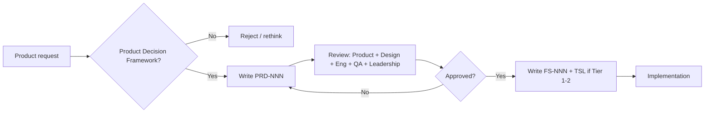

# Jimvio Product Requirements Documents (PRD)

**Official product intake standard · Version 1.0 · July 2026**

Every **major feature** must have an approved PRD before implementation begins.

---

## Document stack

```
Product Decision Framework
        ↓
   PRD-NNN (this)     ← Product, Design, Leadership, QA alignment
        ↓
   FS-NNN             ← Engineering feature specification
        ↓
   TSL-NNN            ← Technical implementation contract (Tier 1–2)
        ↓
   Implementation
```

| Document | Audience | Sections | When required |
|----------|----------|----------|---------------|
| **[PRD](./PRD-TEMPLATE.md)** | Product, Design, Leadership, QA, AI | 33 | Every major feature |
| [Feature Spec (FS)](../feature-specs/) | Engineering, Design, Security, QA | 30 | Before implementation |
| [Technical Spec (TSL)](../technical-spec-library/) | Engineering | 11 | Tier 1–2 features |

---

## When to write a PRD

**Required** when a change:

- Introduces a new user-facing capability or platform module
- Modifies authentication, payments, checkout, or orders
- Spans more than one domain or squad
- Integrates AI into a production user flow
- Requires leadership or investor visibility
- Is classified Tier 1–3 in the [Operating Model](../operating-model/)

**Optional (FS only):** Bug fixes with obvious scope, copy changes, Tier 5 experiments, DS token additions with no behavior change.

---

## PRD index

| ID | Feature | Status | Owner | FS pair |
|----|---------|--------|-------|---------|
| — | *Use [PRD template](./PRD-TEMPLATE.md)* | — | — | — |

*When PRD-001 is created, pair with FS-NNN and update this table.*

---

## Master documents

| Document | Purpose |
|----------|---------|
| **[JIMVIO-PRD-STANDARD-v1.0.md](./JIMVIO-PRD-STANDARD-v1.0.md)** | Governance, quality bar, review workflow |
| **[PRD-TEMPLATE.md](./PRD-TEMPLATE.md)** | 33-section template with field guidance |

---

## Review workflow



### Required sign-off

| Role | Validates |
|------|-----------|
| **Product (CPO/PM)** | Goals, non-goals, business value, rollout |
| **Design** | UX, UI, accessibility requirements |
| **Engineering** | Dependencies, NFRs, risks, feasibility |
| **QA** | Acceptance criteria, QA checklist |
| **Security** | Security, privacy (mandatory for payments/auth) |
| **Leadership** | Tier 1 features — Founder/CPO sign-off |

---

## File naming

```
docs/prd/PRD-NNN-short-kebab-title.md
```

- `NNN` — sequential three-digit ID (independent of FS numbering; cross-reference in metadata)
- Update index table in this README when adding PRDs

---

## Quality bar

A PRD is **implementation-ready** when:

- [ ] All 33 sections completed (or explicitly marked N/A with reason)
- [ ] Acceptance criteria are testable (Given/When/Then)
- [ ] Non-goals prevent scope creep
- [ ] Error, loading, empty, and success states defined
- [ ] Rollout and rollback plans documented
- [ ] KPIs and analytics events measurable
- [ ] Permissions matrix matches [user roles](../product-blueprint/01-user-roles.md)
- [ ] Open questions resolved or assigned with owners
- [ ] Paired FS-NNN drafted or linked

---

## Related governance

| Document | Relationship |
|----------|--------------|
| [Platform Standards](../platform-standards/) | Implementation principles |
| [Operating Model](../operating-model/) | Lifecycle, tiers, release gates |
| [Product Operating System (JPOS)](../product-operating-system/) | Decision matrix, portfolio, KPIs |
| [Feature Specs](../feature-specs/) | Engineering intake (FS-NNN) |
| [Technical Spec Library](../technical-spec-library/) | Engineering contracts (TSL-NNN) |
| [Product Blueprint](../product-blueprint/) | Module context, personas |
| [Domain Architecture](../domain-architecture/) | Domain assignment |
| [Design System](../design-system/) | UI constraints |

---

## Change log

| Version | Date | Changes |
|---------|------|---------|
| 1.0 | July 2026 | PRD Standard, 33-section template, workflow |
