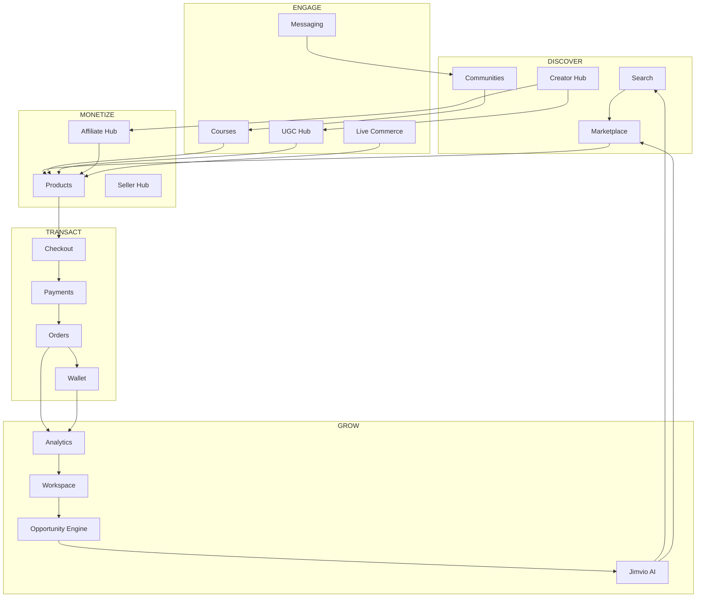
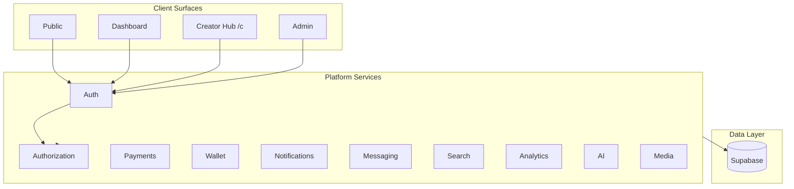

# Jimvio Product Blueprint v1.0

**Official · Confidential · July 2026**

| | |
|---|---|
| **Document owner** | Chief Product Architect |
| **Audience** | Founders, PMs, Engineers, Designers, AI Engineers, Investors |
| **Status** | Single source of truth for product development |
| **Companion docs** | [Module deep-dives](./README.md) · [Design System](../design-system/README.md) · [ADRs](../adr/README.md) |

---

## Table of contents

1. [Company Vision](#part-1--company-vision)
2. [Platform Overview](#part-2--platform-overview)
3. [Platform Modules](#part-3--platform-modules)
4. [User Roles](#part-4--user-roles)
5. [Design System](#part-5--design-system)
6. [AI Strategy](#part-6--ai-strategy)
7. [Platform Services](#part-7--platform-services)
8. [Data Ownership](#part-8--data-ownership)
9. [User Flows](#part-9--user-flows)
10. [Success Metrics](#part-10--success-metrics)
11. [Roadmap](#part-11--roadmap)
12. [Engineering Guidelines](#part-12--engineering-guidelines)

---

# PART 1 — COMPANY VISION

## Vision

Build the world's most trusted **Creator Commerce Operating System** — the infrastructure where anyone, anywhere, can build, grow, and monetize an online business from one connected platform.

Jimvio is **not** another marketplace, affiliate network, or community app. It is the operating layer that unifies them.

## Mission

Enable creators, sellers, affiliates, brands, communities, and buyers to participate in a single ecosystem where commerce, content, community, and intelligence work together — not as separate products bolted onto each other.

## Core Values

| Value | Meaning |
|-------|---------|
| **Trust** | Transparent payments, honest errors, no surprises |
| **Connection** | Every module feeds the next; no dead ends |
| **Simplicity** | Simple first; power revealed progressively |
| **Speed** | Interactions feel immediate; never blocked |
| **Ownership** | Users control decisions; AI assists, never overrides |
| **Global** | Multi-currency, multi-gateway, mobile-first by default |
| **Quality** | Production-grade always; no prototype debt |

## Product Philosophy

- **Simple before powerful** — first experience is clear; advanced features appear when needed
- **One platform** — marketplace, communities, affiliate, UGC, courses, payments, and AI feel like one product
- **No dead ends** — every screen leads to a meaningful next action
- **User success = platform success** — help users sell more, earn more, learn more, collaborate more

## Design Philosophy

| Principle | Application |
|-----------|-------------|
| Simple | Clear hierarchy, one primary action per screen |
| Fast | Skeleton loading, optimistic UI, instant feedback |
| Trustworthy | Explain loading, waiting, payments, errors |
| Modern | Clean surfaces, purposeful whitespace |
| Accessible | Keyboard, screen readers, reduced motion, contrast |
| Consistent | One typography, spacing, color, icon, motion system |
| Professional | Never decorative; never distracting |

Motion: fade, opacity, translate, scale only · 150–220ms · GPU-accelerated · respects `prefers-reduced-motion`.

## Engineering Philosophy

- **Small safe changes** — minimal diffs; never break what works
- **Reuse first** — search codebase before creating anything new
- **Additive architecture** — new modules mount alongside existing systems
- **Production-ready** — loading, success, error, empty, retry on every async surface
- **Long-term maintainability** — every commit leaves the codebase cleaner

*Detailed rules: see [Part 12](#part-12--engineering-guidelines).*

## AI Philosophy

| Rule | Detail |
|------|--------|
| Help | Answer questions, surface opportunities, explain recommendations |
| Never interrupt | Opt-in panels; no blocking modals or forced flows |
| Never replace decisions | User approves purchases, payouts, campaigns, content |
| Always explain | "Why this opportunity?" — transparency builds trust |
| Feel native | Same visual language as Jimvio; context-aware per route |

## Long-Term Vision (10 Years)

| Horizon | State |
|---------|-------|
| **2026–2027** | Unified OS experience; DS adoption; production AI; complete messaging |
| **2028** | Native mobile apps; embedded commerce widgets; creator API |
| **2029** | Third-party app ecosystem on Jimvio platform |
| **2030+** | Default global infrastructure for creator-led commerce — trusted by millions of creators and billions in GMV |

**North Star metric:** Creator and seller earnings enabled per active user — not feature count.

---

# PART 2 — PLATFORM OVERVIEW

## What Jimvio Is

Jimvio is a **Creator Commerce Operating System** with five pillars:

```
┌──────────────────────────────────────────────────────────────────────────┐
│                         JIMVIO OPERATING SYSTEM                          │
├─────────────┬─────────────┬─────────────┬─────────────┬──────────────────┤
│  COMMERCE   │   CREATOR   │     AI      │  BUSINESS   │   FOUNDATION     │
│             │   ECONOMY   │             │    INFRA    │                  │
├─────────────┼─────────────┼─────────────┼─────────────┼──────────────────┤
│ Marketplace │ UGC Hub     │ Jimvio AI   │ Analytics   │ Design System    │
│ Products    │ Affiliate   │ Command ⌘K  │ Wallet      │ Auth & Security  │
│ Orders      │ Communities │ Opportunity │ Messages    │ Performance      │
│ Payments    │ Courses     │   Engine    │ Notifications│ Accessibility   │
│ Checkout    │ Live        │ Search AI   │ Workspace   │ Platform Services│
│ Seller Hub  │ Creator Hub │ Commerce    │ Jimvio OS   │ Localization     │
│             │             │   Graph     │ Super App   │                  │
└─────────────┴─────────────┴─────────────┴─────────────┴──────────────────┘
```

## How Modules Connect

Jimvio follows a **connected commerce loop**:



## Global Shells (One Product Feel)

These layers exist on top of modules so Jimvio never feels fragmented:

| Shell | Function | Scope |
|-------|----------|-------|
| **Jimvio Super App** | Bottom dock — modules, wallet, messages, notifications | Global |
| **Command Center (⌘K)** | Universal search and navigation | Global |
| **Jimvio AI Copilot** | Contextual assistant | Global |
| **Jimvio OS** | Dashboard launcher, workspace switcher | Dashboard |
| **Jimvio Workspace** | Customizable widget grid | Dashboard |
| **Commerce Graph** | Entity relationship rails | Product, creator, community pages |
| **Business Graph** | Network and collaboration discovery | Creator, community, product pages |

## Surface Map

| Surface | Routes | Primary users |
|---------|--------|---------------|
| **Public** | `/marketplace`, `/products`, `/communities`, `/ugc`, `/influencers`, `/checkout` | Guest, Buyer |
| **Dashboard** | `/dashboard/*` | Buyer, Seller, Creator, Affiliate |
| **Creator Hub** | `/c/(hubs)/*` | Members, Community owners |
| **Admin** | `/admin/*` | Administrator |

## Implementation Status (July 2026)

| Symbol | Meaning |
|--------|---------|
| ✅ | Production |
| 🟡 | Partial / scaffold |
| 🔜 | Planned |

---

# PART 3 — PLATFORM MODULES

> Deep-dive per module: [`docs/product-blueprint/modules/`](./modules/)

---

## Marketplace ✅

| Section | Detail |
|---------|--------|
| **Purpose** | Primary product discovery surface for physical and digital goods |
| **Goals** | Maximize qualified product views; drive conversion to product detail and cart |
| **Target users** | Guest, Buyer, Seller (exposure), Creator/Affiliate (promoted products) |
| **Features** | Physical/digital catalogs, flash deals, search/filters, personalized rails, CJ-sourced products |
| **User journey** | Land → Browse/rails → Filter/search → Product detail → Cart |
| **Permissions** | Guest: browse; Buyer+: full browse + personalization |
| **AI opportunities** | NL product search; Copilot recommendations; trending category insights |
| **Notifications** | Price drop, flash deal alerts (roadmap) |
| **Dependencies** | Products, Search, Cart, Checkout, Commerce Graph, Personalized Feed |
| **Security** | Rate-limited view API; sanitized search input |
| **Accessibility** | Keyboard grid; screen reader product cards; skeleton loading |
| **Future expansion** | Social proof rails; real-time inventory; embeddable storefront |

**Routes:** `/marketplace`, `/marketplace/physical`, `/marketplace/digital`, `/marketplace/flash-deals`, `/marketplace/search`

---

## Products ✅

| Section | Detail |
|---------|--------|
| **Purpose** | Central catalog for all sellable goods — physical, digital, variants |
| **Goals** | Enable sellers to list fast; give buyers confidence to purchase |
| **Target users** | Seller, Creator, Buyer, Admin |
| **Features** | CRUD, variants, Cloudinary images, digital delivery, CJ import (admin), Commerce/Business Graph rails |
| **User journey** | Seller creates → Publishes → Buyer evaluates → Adds to cart |
| **Permissions** | Seller: own catalog; Admin: all + CJ import |
| **AI opportunities** | Description generation; auto-tagging; pricing intelligence |
| **Notifications** | Approval/rejection; low stock; new review |
| **Dependencies** | Marketplace, Checkout, Orders, Seller Hub, CJ pipeline |
| **Security** | Vendor ownership enforcement; signed digital URLs; HTML sanitization |
| **Accessibility** | Image alt text; keyboard variant selector |
| **Future expansion** | Bundles; bulk import; multi-warehouse inventory |

**Routes:** `/dashboard/products`, `/products`, `/admin/products/*`

---

## Seller Hub ✅

| Section | Detail |
|---------|--------|
| **Purpose** | Operational command center for vendors — store, orders, inventory, campaigns |
| **Goals** | Reduce time-to-first-sale; improve fulfillment rate and GMV |
| **Target users** | Seller, Brand |
| **Features** | Store setup, storefront, vendor orders, campaigns, inventory, customers, Shopify connect, analytics |
| **User journey** | Activate vendor → Setup store → List products → Fulfill orders → Analyze |
| **Permissions** | Vendor role required; scoped to own store |
| **AI opportunities** | Top product insights; inventory reorder; campaign optimization |
| **Notifications** | New order; payout credited; campaign milestones |
| **Dependencies** | Products, Orders, Payments, Wallet, Analytics |
| **Security** | Store data isolation; OAuth token security |
| **Accessibility** | Keyboard tables; non-color-only status |
| **Future expansion** | Bulk fulfillment; shipping labels; multi-store |

**Routes:** `/dashboard/vendor/*`, `/dashboard/inventory`, `/dashboard/customers`

---

## Creator Hub ✅

| Section | Detail |
|---------|--------|
| **Purpose** | Unified creator identity and monetization — public profile, studio, earnings, content |
| **Goals** | Help creators build audience and diversify income streams |
| **Target users** | Creator, Brand, Buyer (discovery) |
| **Features** | Public profile (`/influencers/[slug]`), tabs (products, UGC, affiliate, courses, videos), video studio, submissions, Commerce/Business Graph, creator analytics |
| **User journey** | Activate creator → Complete profile → Link products/campaigns → Share profile → Earn |
| **Permissions** | Creator edits own profile; public read for all |
| **AI opportunities** | Profile optimization; collaboration matching; content strategy |
| **Notifications** | Verification; earnings milestones; collaboration requests |
| **Dependencies** | Products, UGC, Affiliate, Courses, Live, Communities, Analytics |
| **Security** | Owner-only edit; sanitized bio/links |
| **Accessibility** | Keyboard tabs; mobile-first layout |
| **Future expansion** | Verified badges; custom themes (DS-compliant); embed widget |

**Routes:** `/influencers/*`, `/dashboard/influencer/*`, `/dashboard/creator/earnings`, `/dashboard/submissions`

*Note: DB role is `influencer`; UI says "Creator".*

---

## Affiliate Hub ✅

| Section | Detail |
|---------|--------|
| **Purpose** | Performance-based promotion — trackable links, commissions, analytics |
| **Goals** | Grow affiliate-driven GMV; maximize creator/affiliate earnings |
| **Target users** | Affiliate, Creator, Seller (commission config) |
| **Features** | Link creation, product catalog, click tracking (`/ref/[code]`), analytics, wallet integration |
| **User journey** | Browse products → Generate link → Share → Click tracked → Purchase → Commission |
| **Permissions** | Affiliate/Creator: create links; Seller: set rates |
| **AI opportunities** | Product promotion recommendations; Opportunity Engine scoring |
| **Notifications** | Commission earned; payout threshold |
| **Dependencies** | Products, Orders, Wallet, Creator Hub, Opportunity Engine |
| **Security** | Click fraud detection; server-side attribution |
| **Accessibility** | Copy feedback; keyboard product picker |
| **Future expansion** | Tiered commissions; leaderboards; affiliate API |

**Routes:** `/affiliates`, `/dashboard/links`, `/dashboard/affiliate/*`, `/ref/[code]`

---

## UGC Hub ✅

| Section | Detail |
|---------|--------|
| **Purpose** | User-generated content campaigns — brands launch, creators submit, earn on performance |
| **Goals** | Connect brands with authentic creator content; drive measurable ROI |
| **Target users** | Creator, Seller/Brand, Admin |
| **Features** | Campaign browse/join/submit, view tracking, payouts, admin moderation |
| **User journey** | Browse campaigns → Join → Create → Submit → Views tracked → Payout |
| **Permissions** | Creator: join/submit; Seller: create own campaigns; Admin: all |
| **AI opportunities** | Campaign matching; brief generation; Opportunity Engine |
| **Notifications** | Join confirm; approval/rejection; payout triggered |
| **Dependencies** | Creator Hub, Wallet, Live/Clips, Opportunity Engine |
| **Security** | Submission ownership; view anti-manipulation; moderation pipeline |
| **Accessibility** | Labeled forms; video player controls |
| **Future expansion** | In-app editor; automated verification; campaign templates |

**Routes:** `/ugc/*`, `/dashboard/ugc/*`

---

## Communities ✅

| Section | Detail |
|---------|--------|
| **Purpose** | Audience hubs — feed, spaces, membership tiers, monetization |
| **Goals** | Member retention; subscription revenue; cross-link to commerce |
| **Target users** | Community Owner, Member, Moderator, Creator |
| **Features** | Public discovery, Creator Hub (`/c`), feed, chats, spaces, missions, wallet, leaderboard, tiered access (free/paid/premium) |
| **User journey** | Discover → Subscribe → Engage in feed/spaces → Purchase via linked products |
| **Permissions** | Tier-based content access; moderator/owner escalation |
| **AI opportunities** | Engagement insights; moderation assist; growth opportunities |
| **Notifications** | New member; chat; subscription payment; missions |
| **Dependencies** | Courses, Live, Messaging, Wallet, Payments, Commerce/Business Graph |
| **Security** | Hub auth gating; paid content access control |
| **Accessibility** | Keyboard feed; chat live regions; mobile-first |
| **Future expansion** | Cross-community events; discovery personalization |

**Routes:** `/communities/*`, `/c/(hubs)/*`

---

## Courses ✅

| Section | Detail |
|---------|--------|
| **Purpose** | Structured learning within communities; expertise monetization |
| **Goals** | Course completion; enrollment conversion; community retention |
| **Target users** | Community Owner, Creator, Student/Member |
| **Features** | Course rooms, lessons, progress tracking, tier-gated access, creator profile tab |
| **User journey** | Discover course → Enroll (tier) → Complete lessons → Progress saved |
| **Permissions** | Tier-dependent lesson access; owner creates/edits |
| **AI opportunities** | Course recommendations; lesson summaries; learning paths |
| **Notifications** | New course; completion milestones |
| **Dependencies** | Communities, Payments, Creator Hub |
| **Security** | Server-validated tier access |
| **Accessibility** | Keyboard navigation; readable typography (DS) |
| **Future expansion** | Quizzes; certificates; standalone marketplace |

**Routes:** `/c/(hubs)/courses`, `/c/(hubs)/[slug]/courses`

---

## Live Commerce ✅

| Section | Detail |
|---------|--------|
| **Purpose** | Real-time engagement and shoppable content — live streams, clips, shorts |
| **Goals** | Live-to-commerce conversion; clip-driven discovery |
| **Target users** | Creator, Community Owner, Member, Buyer |
| **Features** | Hub live pages, live activities feed, shorts/clips, view tracking, video studio integration |
| **User journey** | Go live / publish clip → Audience watches → Profile/product click → Purchase |
| **Permissions** | Creator/owner: broadcast; members: watch |
| **AI opportunities** | Optimal live timing; clip performance; highlight moments |
| **Notifications** | Creator went live; clip milestones |
| **Dependencies** | Communities, Creator Hub, Products, Messaging |
| **Security** | Stream auth tokens; chat moderation |
| **Accessibility** | Player controls; reduced motion for autoplay |
| **Future expansion** | Shoppable pins; replay chapters; RTMP ingest |

**Routes:** `/c/(hubs)/live`, `/live-activities`, `/shorts`

---

## Wallet ✅

| Section | Detail |
|---------|--------|
| **Purpose** | Unified earnings ledger — balances, transactions, withdrawals |
| **Goals** | Transparent earnings; fast payout processing |
| **Target users** | Seller, Creator, Affiliate, Community Owner |
| **Features** | Balance (realtime), transaction history, withdrawal requests, earnings breakdown, Super App panel |
| **User journey** | Earn from module → View wallet → Request withdrawal → Payout sent |
| **Permissions** | Own balance only; admin approves payouts |
| **AI opportunities** | Earnings forecast; payout timing advice |
| **Notifications** | Payout sent; failed credit (admin) |
| **Dependencies** | Payments, Orders, UGC, Affiliate, Communities |
| **Security** | Server-authoritative balance; fraud checks on withdrawal |
| **Accessibility** | Currency announced; keyboard transaction table |
| **Future expansion** | Multi-currency; automated schedules; tax docs |

**Routes:** `/dashboard/wallet`, `/dashboard/withdrawals`, `/c/(hubs)/wallet`

---

## Payments ✅

| Section | Detail |
|---------|--------|
| **Purpose** | Multi-gateway payment infrastructure for checkout, subscriptions, payouts |
| **Goals** | >95% success rate; global coverage; zero double-credit |
| **Target users** | Buyer (pay), Seller/Creator (receive), Admin (monitor) |
| **Features** | Flutterwave, PesaPal, PayPal, NowPayments, PawaPay, Binance Pay, AfriPay; webhooks; verification; community subscription finalizer |
| **User journey** | Select method → Pay → Webhook → Order confirmed → Seller credited |
| **Permissions** | Buyer initiates own checkout; admin refunds |
| **AI opportunities** | Method recommendation by region; failure diagnosis |
| **Notifications** | Success/failure email + in-app |
| **Dependencies** | Checkout, Orders, Wallet, Platform settings |
| **Security** | **Protected domain** — webhook signatures; idempotent finalization; no PCI on Jimvio |
| **Accessibility** | Keyboard method selection; processing announcement |
| **Future expansion** | Stripe Connect; saved methods; split payments |

**Routes:** `/api/payments/*`, `/api/webhooks/*`, `/admin/payments/*`

---

## Orders ✅

| Section | Detail |
|---------|--------|
| **Purpose** | Order lifecycle — placement through fulfillment, tracking, cancellation |
| **Goals** | Reliable fulfillment; transparent status; easy reorder |
| **Target users** | Buyer, Seller, Admin |
| **Features** | Buyer/vendor/admin views, lifecycle states, realtime updates, invoices, tracking, reorder |
| **User journey** | Purchase → Track → Receive → Reorder (optional) |
| **Permissions** | Scoped by role (own orders / own store / all) |
| **AI opportunities** | "Where is my order?"; delay explanations |
| **Notifications** | Confirmed, shipped, delivered, cancelled, refunded |
| **Dependencies** | Checkout, Payments, Wallet, CJ fulfillment, Email |
| **Security** | **Protected domain** — server-enforced order visibility |
| **Accessibility** | Status text + icon; keyboard timeline |
| **Future expansion** | Returns flow; split shipments |

**Routes:** `/dashboard/orders`, `/dashboard/vendor/orders`, `/admin/orders/*`

---

## Messaging 🟡

| Section | Detail |
|---------|--------|
| **Purpose** | Direct and community communication |
| **Goals** | Real-time engagement; support resolution |
| **Target users** | All authenticated users; community moderators |
| **Features** | Dashboard inbox, community chat rooms, Super App panel; public `/messages` placeholder |
| **User journey** | Open chat → Send → Realtime delivery → Notification |
| **Permissions** | Participant-scoped; moderator tools in communities |
| **AI opportunities** | Summarize unread; smart replies; spam detection |
| **Notifications** | New message badge |
| **Dependencies** | Communities, Notifications, Supabase realtime |
| **Security** | Rate limits; moderation reporting |
| **Accessibility** | ARIA live regions; keyboard send |
| **Future expansion** | Full DM; push; rich media; E2E option |

**Routes:** `/dashboard/messages`, `/c/(hubs)/[slug]/chats`

---

## Notifications ✅

| Section | Detail |
|---------|--------|
| **Purpose** | Inform without overwhelming — in-app, email, toast, badges |
| **Goals** | Critical events <5s delivery; low notification fatigue |
| **Target users** | All authenticated users |
| **Features** | Typed notifications (order, payment, community, message, etc.); mark read; realtime; email transactional; Sonner toast |
| **User journey** | Event occurs → Notification → Tap → Navigate to context |
| **Permissions** | Own notifications; admin sends system |
| **AI opportunities** | Smart prioritization; daily digest |
| **Notifications** | *(This module)* |
| **Dependencies** | All event-producing modules; Email |
| **Security** | No sensitive data in preview; unsubscribe compliance |
| **Accessibility** | Badge count announced; keyboard list |
| **Future expansion** | Push; granular preferences |

**Routes:** `/dashboard/notifications`

---

## Search ✅

| Section | Detail |
|---------|--------|
| **Purpose** | Universal discovery — products, entities, navigation |
| **Goals** | <200ms latency; low zero-result rate |
| **Target users** | All users |
| **Features** | Marketplace search, autocomplete, AI search, Command Center cross-entity search |
| **User journey** | Query → Suggestions → Results → Destination |
| **Permissions** | Command Center respects role scope |
| **AI opportunities** | Natural language discovery; intent understanding |
| **Notifications** | — |
| **Dependencies** | Marketplace, Command Center, Jimvio AI |
| **Security** | Sanitized queries; AI rate limits |
| **Accessibility** | `role="searchbox"`; arrow-key suggestions |
| **Future expansion** | Unified index (products + creators + communities) |

**Routes:** `/marketplace/search`, navbar, ⌘K Command Center

---

## Jimvio AI 🟡

| Section | Detail |
|---------|--------|
| **Purpose** | Native contextual intelligence across the platform |
| **Goals** | Help users succeed; explain recommendations; never interrupt |
| **Target users** | All authenticated users |
| **Features** | Copilot (global), Command Center, Opportunity Engine, Search AI, Commerce/Business Graph context; stub LLM provider (pluggable) |
| **User journey** | In context → Ask → Actionable answer → User decides |
| **Permissions** | Authenticated; admin insights future |
| **AI opportunities** | *(Core module — see [Part 6](#part-6--ai-strategy))* |
| **Notifications** | Opt-in only; no proactive push |
| **Dependencies** | All modules (context); `/api/ai/chat` |
| **Security** | PII consent; prompt injection defense; rate limits |
| **Accessibility** | Keyboard panel; live region messages |
| **Future expansion** | Tool use (orders, wallet); production LLM; bounded agents |

**Components:** Copilot, Command Center, Opportunity Engine, Search AI

---

## Workspace ✅

| Section | Detail |
|---------|--------|
| **Purpose** | Personalized dashboard command surface — widgets, layout persistence |
| **Goals** | Reduce time to key actions; increase dashboard return rate |
| **Target users** | Creator, Seller, Entrepreneur |
| **Features** | Drag/resize widget grid, pin/hide/reset, module nav, notification widget, OS integration |
| **User journey** | Customize layout → Daily glance → Click through to module |
| **Permissions** | Own layout only |
| **AI opportunities** | Widget recommendations; layout optimization |
| **Notifications** | Via notification center widget |
| **Dependencies** | Analytics, Opportunity Engine, Creator Command Center, Jimvio OS |
| **Security** | User-scoped localStorage; widgets use module auth |
| **Accessibility** | Keyboard pin/hide; reduced motion for drag |
| **Future expansion** | Role defaults; widget marketplace |

**Routes:** `/dashboard` (embedded)

---

## Analytics ✅

| Section | Detail |
|---------|--------|
| **Purpose** | Role-specific metrics and platform reporting |
| **Goals** | Data-driven decisions for every persona |
| **Target users** | All roles + Admin |
| **Features** | Per-role dashboards, charts, admin exports (CSV/XLSX/PDF), Vercel Analytics, platform stats |
| **User journey** | Open analytics → Identify trend → Take action in module |
| **Permissions** | Own data; admin sees platform |
| **AI opportunities** | Anomaly explanation; NL metric queries |
| **Notifications** | Milestone alerts (roadmap) |
| **Dependencies** | All engagement/revenue modules |
| **Security** | Server-scoped; audit exports |
| **Accessibility** | Chart + table fallback |
| **Future expansion** | Cohort analysis; forecasting |

**Routes:** `/dashboard/*/analytics`, `/admin/reports`

---

## Settings ✅

| Section | Detail |
|---------|--------|
| **Purpose** | Account, security, roles, integrations, platform config |
| **Goals** | High profile completion; 2FA adoption for sellers/admin |
| **Target users** | All users; Admin for platform |
| **Features** | Profile, security/2FA, role activation, storefront, payments, integrations, admin platform settings |
| **User journey** | Activate role → Configure → Operate modules |
| **Permissions** | Own settings; admin platform config |
| **AI opportunities** | Setup checklist; security recommendations |
| **Notifications** | Security alerts; save confirmations |
| **Dependencies** | Auth, Roles, Seller Hub, Payments |
| **Security** | 2FA secrets server-only; CSRF on forms |
| **Accessibility** | Labeled forms; `aria-describedby` errors |
| **Future expansion** | Unified settings hub; API keys |

**Routes:** `/dashboard/settings`, `/dashboard/security`, `/admin/settings/*`

---

## Admin ✅

| Section | Detail |
|---------|--------|
| **Purpose** | Platform operations — users, commerce, payments, content, system |
| **Goals** | <24h moderation; 99.9% uptime; audited actions |
| **Target users** | Administrator, Super Administrator |
| **Features** | Users, vendors, products, CJ import, orders, payments, UGC, disputes, verifications, reports, system analysis, maintenance mode |
| **User journey** | Alert → Review → Action → Parties notified |
| **Permissions** | Admin role; super admin for maintenance |
| **AI opportunities** | Fraud alerts; dispute summaries; system anomalies |
| **Notifications** | Admin alerts; action notifications to users |
| **Dependencies** | All modules; service role Supabase |
| **Security** | Admin guard; audit trail; 2FA recommended |
| **Accessibility** | Keyboard tables; accessible confirmations |
| **Future expansion** | Support role; fraud dashboard |

**Routes:** `/admin/*`

---

# PART 4 — USER ROLES

> Full matrix: [`01-user-roles.md`](./01-user-roles.md)

## Role Summary

| Role | DB value | Primary surface |
|------|----------|-----------------|
| Guest | — | Public marketplace, communities, UGC browse |
| Buyer | `buyer` | Marketplace, checkout, orders, library |
| Seller | `vendor` | Seller Hub, products, vendor orders |
| Creator | `influencer` | Creator Hub, studio, UGC, affiliate |
| Affiliate | `affiliate` | Affiliate Hub, links, analytics |
| Brand | `vendor` + campaigns | Seller Hub + UGC campaigns |
| Community Owner | `community_owner` | `/c` hub admin, community analytics |
| Moderator | workspace `moderator` | Community moderation (scoped) |
| Support | 🔜 admin subset | User lookup, tickets (planned) |
| Administrator | `admin` | `/admin/*` |
| Super Administrator | `admin` + `ADMIN_EMAILS` | Maintenance bypass, system config |

## Activation

```
Sign up (buyer) → /dashboard/activate/{vendor|creator|affiliate} → Role unlocked
Community create → community_owner
Admin assign → admin
```

Post-login priority: **admin → vendor → affiliate → influencer → buyer**

---

# PART 5 — DESIGN SYSTEM

Jimvio has one official Design System. **Never create conflicting UI.**

| Resource | Path |
|----------|------|
| **Documentation** | [`docs/design-system/README.md`](../design-system/README.md) |
| **Tokens (TS)** | `lib/design-system/` |
| **Tokens (CSS)** | `styles/jimvio-design-system.css` |
| **Components** | `components/design-system/` (`Ds*` prefix) |

## Rules

1. **New features** import from `@/components/design-system` and `@/lib/design-system`
2. **Legacy pages** keep `components/ui/*` until focused migration — never bulk-replace
3. **Anti-duplication** — no third button/card/input implementation
4. **Tokens only** — `--color-*`, `--radius-*`, `--ds-*`; no hardcoded hex in new code
5. **Motion** — `ds-motion-*` utilities; 150–300ms; GPU; `prefers-reduced-motion`
6. **Accessibility** — `ds-focus-ring`, labels, ARIA on all `Ds*` form components

## Key primitives

`DsButton` · `DsInput` · `DsCard` · `DsProductCard` · `DsSkeleton` · `DsEmptyState` · `DsErrorState` · `DsDialog` · `dsToast` · `DsIcon`

*Architecture: [ADR-001](../adr/001-design-system-foundation.md)*

---

# PART 6 — AI STRATEGY

Jimvio AI is a **platform capability**, not a standalone product. It comprises:

| Component | Role |
|-----------|------|
| **Copilot** | Contextual chat assistant (global) |
| **Command Center** | Search + navigate (⌘K) |
| **Opportunity Engine** | Scored growth opportunities (dashboard) |
| **Search AI** | Natural language product discovery |
| **Commerce Graph** | Relationship context for recommendations |
| **Business Graph** | Collaboration and network discovery |

## Integration by module

| Module | AI capability | User benefit |
|--------|---------------|--------------|
| **Marketplace** | NL search; personalized explanations | Find products faster |
| **Checkout** | Payment method guidance; failure diagnosis | Complete purchase confidently |
| **Communities** | Activity summaries; engagement tips | Grow community |
| **Affiliate** | Product promotion recommendations | Earn more per link |
| **Seller Hub** | Sales insights; inventory suggestions | Optimize store |
| **UGC** | Campaign matching; brief assist | Right campaigns faster |
| **Analytics** | Anomaly explanation; trend summaries | Understand performance |
| **Workspace** | Widget recommendations | Personalized command center |
| **Support** | Ticket summarization; suggested responses | Faster resolution (roadmap) |
| **Orders** | Status queries; delay explanations | Reduce support burden |

## AI guardrails

- No autonomous purchases, payouts, or content publication
- Explain every recommendation ("Why this opportunity?")
- Route-aware context only — no cross-user data without authorization
- Rate limited; PII policy enforced
- Stub provider today → production LLM via pluggable adapter

---

# PART 7 — PLATFORM SERVICES

Shared services power all modules. **Never duplicate.**

| Service | Implementation | Used by |
|---------|----------------|---------|
| **Authentication** | Supabase Auth + middleware (`lib/supabase/middleware.ts`) | All protected routes |
| **Authorization** | `user_roles`, API helpers, hub auth, access control | All modules |
| **Wallet** | `lib/actions/wallet.ts`, balance APIs | Seller, Creator, Affiliate, Community |
| **Notifications** | `lib/notifications/notify-user.ts`, realtime | All modules |
| **Messaging** | Chat rooms, inbox API, Supabase realtime | Communities, Dashboard |
| **Search** | Marketplace engine, suggestions, Command Center | Marketplace, Global |
| **Analytics** | Per-role services, Vercel, admin reports | All modules |
| **AI** | `/api/ai/chat`, copilot lib, search AI | Global |
| **Files / Media** | Cloudinary upload, Supabase storage | Products, UGC, Profiles |
| **Payments** | `lib/payments/router.ts`, webhooks, finalizers | Checkout, Communities, Payouts |
| **Localization** | `CurrencyProvider`, multi-gateway regional support | Checkout, Marketplace |



---

# PART 8 — DATA OWNERSHIP

| Entity | Owner | Platform role | Notes |
|--------|-------|---------------|-------|
| **Users** | Individual | Account holder | GDPR-style deletion via account status |
| **Products** | Seller (vendor) | Listed on marketplace | Admin moderation override |
| **Orders** | Buyer + Seller | Transaction record | Immutable after payment |
| **Communities** | Community Owner | Members have participation rights | Workspace roles separate |
| **Campaigns (UGC)** | Seller/Brand | Creators submit content | Payout triggers seller/admin |
| **Courses** | Community Owner / Creator | Enrolled members access | Tier-gated |
| **Wallet balances** | User | Platform holds ledger | Withdrawal requests user-initiated |
| **Transactions** | Platform | Audit trail | Admin visibility |
| **Analytics** | User (own data) | Platform (aggregate) | No cross-user PII in reports |

**Principles:**
- Users own their content and earnings
- Platform owns infrastructure and aggregate analytics
- Admin access is audited and least-privilege
- No selling of individual user data

---

# PART 9 — USER FLOWS

## Buyer

```
Discover (Search/Marketplace/Community)
  → Product detail (Commerce Graph)
  → Cart → Checkout → Payment → Order confirmation
  → Track order → Reorder
  → Join community → Enroll in course
```

## Seller

```
Activate vendor → Store setup → Create products → Publish
  → Receive orders → Fulfill → Get paid (Wallet)
  → Launch UGC campaign → Review submissions
  → Analytics → Optimize
```

## Creator

```
Activate creator → Build profile → Link products
  → Join UGC campaigns / Create affiliate links
  → Studio (videos/clips) → Go live
  → Earnings (Wallet) → Withdraw
  → Opportunity Engine → Next action
```

## Affiliate

```
Activate affiliate → Browse affiliate products
  → Generate links → Share
  → Track clicks/analytics → Commission → Wallet → Withdraw
```

## Community Owner

```
Create community → Configure tiers → Invite members
  → Publish courses/content → Go live
  → Moderate → Subscription revenue (Wallet)
  → Community analytics
```

## Administrator

```
/admin → Monitor orders/payments/disputes
  → Moderate products/UGC → Manage users/roles
  → Revenue reports → System analysis
  → Platform settings / maintenance
```

---

# PART 10 — SUCCESS METRICS

## Platform-level KPIs

| Category | Metric | Target direction |
|----------|--------|------------------|
| **Growth** | MAU, new role activations | ↑ |
| **Retention** | D30 retention by role | ↑ |
| **Revenue** | GMV, platform take rate | ↑ |
| **Conversion** | Browse → cart → checkout → paid | ↑ |
| **Engagement** | Sessions per user, Command Center usage | ↑ |
| **Performance** | LCP < 2.5s, CLS < 0.1 | Green |
| **Creator success** | Earnings per active creator | ↑ |
| **Seller success** | GMV per active seller, fulfillment rate | ↑ |

## Module KPIs (summary)

| Module | Primary KPI |
|--------|-------------|
| Marketplace | Search-to-purchase conversion |
| Products | View-to-cart rate |
| Seller Hub | Time to first sale |
| Creator Hub | Profile-to-earnings conversion |
| Affiliate Hub | Click-to-conversion rate |
| UGC Hub | Campaign ROI |
| Communities | D30 member retention |
| Courses | Completion rate |
| Live Commerce | Live-to-commerce conversion |
| Wallet | Payout processing time |
| Payments | Success rate > 95% |
| Orders | Fulfillment SLA |
| Messaging | DM adoption (when shipped) |
| Notifications | Critical delivery < 5s |
| Search | Zero-result rate |
| Jimvio AI | Suggestion acceptance rate |
| Workspace | Customization rate |
| Analytics | Weekly dashboard engagement |
| Settings | 2FA adoption (sellers) |
| Admin | Moderation turnaround < 24h |

---

# PART 11 — ROADMAP

Prioritized by **business impact** (revenue, retention, trust).

## Phase 1 — Foundation (Current — Q3 2026) ✅

| Initiative | Impact |
|------------|--------|
| Design System foundation | Consistency, DX, velocity |
| Commerce + Business Graph | Discovery, connection |
| Workspace + Opportunity Engine | Creator retention |
| Super App + OS + Command Center | One platform feel |
| Multi-gateway payments (production) | Global revenue |

## Phase 2 — Intelligence (Q4 2026)

| Initiative | Impact |
|------------|--------|
| Production LLM for Jimvio AI | Copilot value |
| Complete messaging (DM) | Engagement, trust |
| Unified search index | Discovery conversion |
| DS migration (marketplace, dashboard) | Premium UX |
| Push notifications | Retention |

## Phase 3 — Growth (H1 2027)

| Initiative | Impact |
|------------|--------|
| Shoppable live commerce | Live-to-sale revenue |
| Affiliate tiered commissions | Affiliate GMV |
| Course certificates + quizzes | Community retention |
| Seller performance score | Seller quality |
| Support role + tooling | Trust, scale |

## Phase 4 — Scale (H2 2027)

| Initiative | Impact |
|------------|--------|
| Native mobile apps | Mobile-native growth |
| Creator Commerce API | Ecosystem expansion |
| Automated payouts | Seller/creator satisfaction |
| Fraud detection dashboard | Trust, cost reduction |
| Multi-store per seller | Enterprise sellers |

## Phase 5 — Ecosystem (2028+)

| Initiative | Impact |
|------------|--------|
| Third-party app marketplace | Platform network effects |
| Embedded commerce widgets | Distribution |
| Cross-border tax/compliance | Global scale |
| AI bounded agents (user-approved) | Productivity |
| Jimvio as commerce infrastructure | Category leadership |

---

# PART 12 — ENGINEERING GUIDELINES

This blueprint does **not** duplicate engineering rules. Reference the official governance stack:

| Document | Purpose |
|----------|---------|
| **North Star** | Vision and mission |
| **Product Decision Framework** | Should we build it? (10 questions) |
| **Platform Governance v1.0** | Long-term evolution, change impact |
| **Platform Laws** | What we protect |
| **Product Principles** | What users feel |
| **Engineering Constitution** | How we build |
| **Quality Gate v1.0** | Pre-ship checklist (9 gates) |
| **JPES** | Prompt engineering standard |
| **Execution Protocol v1.0** | 7-step workflow |
| **Design System** | [`docs/design-system/README.md`](../design-system/README.md) |
| **ADRs** | [`docs/adr/`](../adr/) |

## Protected domains (never modify without explicit approval)

Authentication · Payments · Checkout · Orders · Routing · Database schema · APIs · Core business logic

## Default implementation workflow

```
Understand → Plan → Reuse search → Minimal diff → DS tokens
  → Full UX states → tsc + lint → Self-review → Ship
```

---

## Document maintenance

| Trigger | Action |
|---------|--------|
| New module shipped | Update Part 3 + module deep-dive |
| Role/permission change | Update Part 4 |
| AI capability launched | Update Part 6 |
| Major architecture change | Create ADR + update Part 2 |
| Quarterly review | Review KPIs (Part 10) and roadmap (Part 11) |

---

**Jimvio Product Blueprint v1.0** — *The Creator Commerce Operating System*

*End of document*
