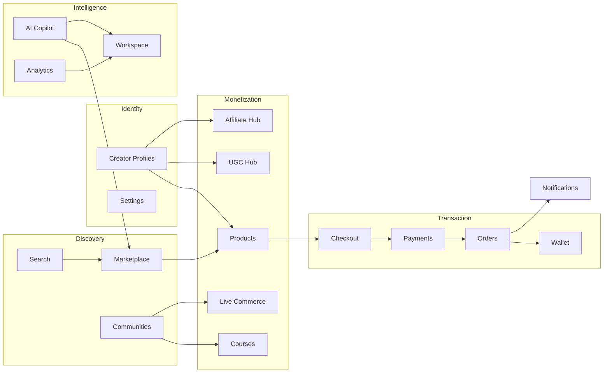

# Jimvio Product Blueprint v1.0

**Status:** Official · **Version:** 1.0 · **Last updated:** July 2026

> The single source of truth for product development across engineering, design, product, and leadership.

---

## Primary document

**[JIMVIO-PRODUCT-BLUEPRINT-v1.0.md](./JIMVIO-PRODUCT-BLUEPRINT-v1.0.md)** — definitive blueprint with all 12 parts:

1. Company Vision · 2. Platform Overview · 3. Platform Modules · 4. User Roles  
5. Design System · 6. AI Strategy · 7. Platform Services · 8. Data Ownership  
9. User Flows · 10. Success Metrics · 11. Roadmap · 12. Engineering Guidelines

---

## Supplementary documents

| Section | Document |
|---------|----------|
| Platform overview | [00-platform-overview.md](./00-platform-overview.md) |
| User roles & permissions | [01-user-roles.md](./01-user-roles.md) |
| **Modules** | |
| Marketplace | [modules/marketplace.md](./modules/marketplace.md) |
| Products | [modules/products.md](./modules/products.md) |
| Orders | [modules/orders.md](./modules/orders.md) |
| Checkout | [modules/checkout.md](./modules/checkout.md) |
| Wallet | [modules/wallet.md](./modules/wallet.md) |
| Payments | [modules/payments.md](./modules/payments.md) |
| Creator Profiles | [modules/creator-profiles.md](./modules/creator-profiles.md) |
| Seller Hub | [modules/seller-hub.md](./modules/seller-hub.md) |
| Affiliate Hub | [modules/affiliate-hub.md](./modules/affiliate-hub.md) |
| UGC Hub | [modules/ugc-hub.md](./modules/ugc-hub.md) |
| Communities | [modules/communities.md](./modules/communities.md) |
| Courses | [modules/courses.md](./modules/courses.md) |
| Live Commerce | [modules/live-commerce.md](./modules/live-commerce.md) |
| Messaging | [modules/messaging.md](./modules/messaging.md) |
| Notifications | [modules/notifications.md](./modules/notifications.md) |
| Search | [modules/search.md](./modules/search.md) |
| AI Copilot | [modules/ai-copilot.md](./modules/ai-copilot.md) |
| Workspace | [modules/workspace.md](./modules/workspace.md) |
| Analytics | [modules/analytics.md](./modules/analytics.md) |
| Admin | [modules/admin.md](./modules/admin.md) |
| Settings | [modules/settings.md](./modules/settings.md) |

---

## Related governance

| Document | Purpose |
|----------|---------|
| [**Product Bible**](../product-bible/JIMVIO-PRODUCT-BIBLE-v1.0.md) | Permanent source of truth |
| [North Star](../adr/README.md) | Vision and mission |
| [Design System](../design-system/README.md) | UI tokens and components |
| [Technical Architecture](../technical-architecture/JIMVIO-TECHNICAL-ARCHITECTURE-BLUEPRINT-v1.0.md) | Implementation stack and API standards |
| [System Architecture](../system-architecture/JIMVIO-SYSTEM-ARCHITECTURE-BLUEPRINT-v1.0.md) | Domains, events, boundaries, scale |
| [Feature Specs](../feature-specs/README.md) | Pre-implementation specifications |
| [Operating Model](../operating-model/JIMVIO-PRODUCT-OPERATING-MODEL-v1.0.md) | How we build, review, and ship |
| [ADR Index](../adr/README.md) | Architecture decision records |

---

## How to use this blueprint

1. **Before building** — read the module blueprint + user roles section
2. **During design** — validate against Platform Principles (below)
3. **Before ship** — confirm KPIs, dependencies, security, and accessibility sections
4. **After major changes** — update the relevant module doc and create an ADR if architectural

---

## Platform principles (all modules)

Every module must:

- **Reuse existing systems** — search codebase before building new primitives
- **Follow the Design System** — `@/components/design-system`, `@/lib/design-system`
- **Be AI-ready** — expose context for Copilot; assist, never interrupt
- **Be mobile-first** — responsive from 320px; desktop is enhancement
- **Be scalable** — design for millions of users and global markets
- **Be accessible** — keyboard, screen readers, focus, reduced motion, contrast
- **Be secure** — least privilege, input validation, no secret exposure
- **Be production-ready** — loading, success, error, empty, retry states

---

## Five platform pillars

```
┌─────────────────────────────────────────────────────────────────┐
│                    JIMVIO CREATOR COMMERCE OS                   │
├──────────────┬──────────────┬──────────────┬──────────────┬─────┤
│  COMMERCE    │   CREATOR    │      AI      │  BUSINESS    │FOUND│
│              │   ECONOMY    │              │INFRASTRUCTURE│ATION│
├──────────────┼──────────────┼──────────────┼──────────────┼─────┤
│ Marketplace  │ UGC          │ Copilot      │ Analytics    │ DS  │
│ Products     │ Affiliate    │ Command Ctr  │ Wallet       │ A11y│
│ Orders       │ Communities  │ Opportunity  │ Messages     │ Perf│
│ Checkout     │ Courses      │   Engine     │ Notifications│ Sec │
│ Payments     │ Live         │ Search AI    │ Workspace    │ DX  │
│ Stores       │ Creator Prof │ Automation   │ Jimvio OS    │     │
└──────────────┴──────────────┴──────────────┴──────────────┴─────┘
```

---

## Connected experience map

Jimvio is **one ecosystem**, not separate apps. Every module feeds the next:

```
Discovery (Search, Marketplace, Communities)
    ↓
Engagement (Creator Profiles, UGC, Courses, Live)
    ↓
Monetization (Products, Affiliate, Campaigns)
    ↓
Transaction (Checkout, Payments, Orders)
    ↓
Growth (Wallet, Analytics, Opportunity Engine, AI Copilot)
```

**No dead ends.** Every screen should guide users to a meaningful next action.

---

## Module dependency graph (high level)



---

## Implementation status legend

| Symbol | Meaning |
|--------|---------|
| ✅ | Production-ready, actively used |
| 🟡 | Partial / scaffold / stub |
| 🔜 | Planned in roadmap |

Current codebase baseline: July 2026.

---

## Change log

| Version | Date | Changes |
|---------|------|---------|
| 1.0 | July 2026 | Initial official blueprint — master doc (12 parts), 20 modules, 11 roles |

## Document stats

- **Master blueprint** — 12 parts, investor/leadership ready
- **20 module blueprints** — deep-dives with 13 sections each
- **11 user roles** — permissions and capabilities documented
- **5 platform pillars** — Commerce, Creator Economy, AI, Business Infrastructure, Foundation
- **5-phase roadmap** — prioritized by business impact
- **Grounded in codebase** — reflects production routes, services, and status (✅ / 🟡 / 🔜)
