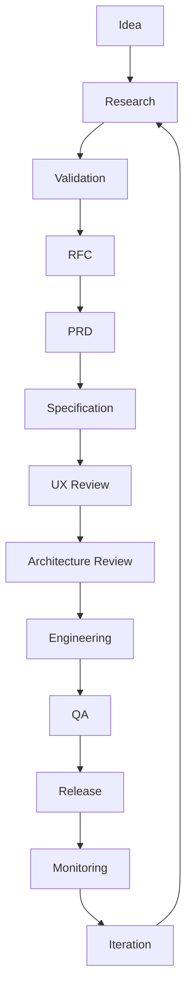
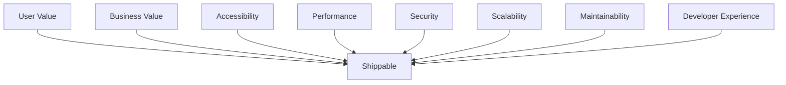
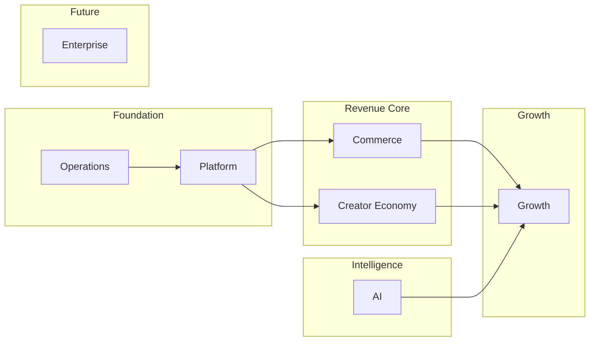
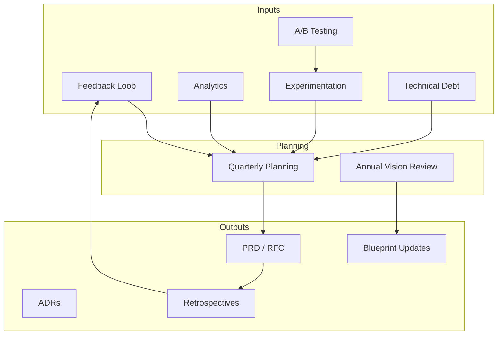

# Jimvio Product Operating System v1.0

**Official product decision governance · July 2026**

> The Product Operating System (JPOS) defines how ideas become shipped products while maintaining world-class quality.  
> Every feature, roadmap item, and product decision must align with JPOS.

**Tactical companion:** [Operating Model](../operating-model/) (tiers, RACI, release detail) · **Strategic truth:** [Product Bible](../product-bible/) · **Decade strategy:** [Product Strategy v10](../product-strategy/)

---

## Executive summary

Jimvio optimizes for **rapid innovation without sacrificing stability**. JPOS provides:

1. **Philosophy** — why we build and how we decide
2. **Lifecycle** — how ideas become products
3. **Governance** — who approves what
4. **Quality** — what "done" means
5. **Decision matrix** — how to prioritize
6. **Portfolio** — how we organize investment
7. **KPIs** — how we measure success
8. **Continuous improvement** — how we get better

**Core rules:**
- Protect what works (Tier 1 domains)
- Specify before build (PRD → FS → TSL)
- Gate before ship (quality is blocking, not optional)
- Ship incrementally (alpha → beta → gradual → global)
- Measure and iterate (every release has KPIs and rollback)

---

## Document map

| Part | Topic |
|------|-------|
| 1 | Product Philosophy |
| 2 | Product Lifecycle |
| 3 | Product Governance |
| 4 | Product Quality |
| 5 | Product Decision Matrix |
| 6 | Product Portfolio |
| 7 | Product KPIs |
| 8 | Continuous Improvement |

---

# PART 1 — PRODUCT PHILOSOPHY

*Full strategic narrative: [Product Bible](../product-bible/JIMVIO-PRODUCT-BIBLE-v1.0.md). JPOS captures operating principles.*

## Mission

Enable anyone, anywhere, to **build, grow, and monetize** an online business from **one connected platform**.

## Vision

Build the world's most **trusted Creator Commerce Operating System** — the default infrastructure where creators, sellers, affiliates, brands, and communities build real businesses, not just audiences.

## North Star

**Metric:** Creator and seller **earnings enabled per active user**

**Not:** Feature count, page count, or module count.

Every product decision must answer: *Does this increase earnings enabled per active user — directly or by removing friction that blocks earnings?*

## Core principles

| # | Principle | Operating rule |
|---|-----------|----------------|
| 1 | **One platform** | No isolated experiences; every feature connects to navigation, wallet, analytics, AI |
| 2 | **User success = platform success** | Optimize for user earnings, sales, and retention — not internal convenience |
| 3 | **Simple before powerful** | First experience is clear; advanced features appear progressively |
| 4 | **Protect what works** | Auth, payments, checkout, orders — Tier 1 lifecycle always |
| 5 | **Specify before build** | PRD approved before FS; FS approved before code |
| 6 | **Quality is a gate** | Accessibility, performance, security block release — not polish |
| 7 | **Ship to learn** | Tier 5 experiments with metrics; promote or kill within 90 days |
| 8 | **Debate in writing** | PRDs, RFCs, ADRs — not hallway decisions |
| 9 | **AI assists, never owns** | AI enhances; never auto-executes payments, payouts, or destructive actions |
| 10 | **Global by default** | Multi-currency, multi-gateway, mobile-first |

## Product values

| Value | Meaning | Product manifestation |
|-------|---------|----------------------|
| **Trust** | Users are never surprised | Transparent payments, honest errors, explain waiting |
| **Connection** | One ecosystem | Commerce Graph, Super App, no dead ends |
| **Simplicity** | Clear over clever | One primary CTA; progressive disclosure |
| **Speed** | Immediate feel | Skeleton loading, optimistic UI, lazy shells |
| **Ownership** | Users decide | Confirm destructive actions; AI recommends only |
| **Quality** | Production always | All states defined; no prototype in critical paths |
| **Inclusion** | Everyone can participate | Accessibility by default; global payments |

## Decision framework

### North Star questions (gate 1)

Before any feature enters Research, it must answer **yes** to at least one:

| # | Question |
|---|----------|
| 1 | Does this help users **succeed**? |
| 2 | Does this **reduce friction**? |
| 3 | Does this **save time**? |
| 4 | Does this **increase trust**? |
| 5 | Does this **improve earnings**? |
| 6 | Does this **improve discovery**? |
| 7 | Does this make Jimvio feel more **connected**? |

**If none apply → reject or rethink.**

### Product Decision Matrix (gate 2)

After Validation, score using [Part 5](#part-5--product-decision-matrix). Minimum composite score required to proceed to PRD (see Part 5).

### Tier assignment (gate 3)

Classify blast radius using [Operating Model Part 3](../operating-model/JIMVIO-PRODUCT-OPERATING-MODEL-v1.0.md#part-3--feature-tiers). **When in doubt, classify up.**

## Success definition

A product initiative succeeds when **all** of the following are true within 14 days of GA:

| Criterion | Definition |
|-----------|------------|
| **User value** | Primary user story validated (qualitative or quantitative) |
| **Business value** | Primary KPI meets or exceeds target (Part 7) |
| **Quality** | No Tier 1–2 regression; quality gates passed |
| **Sustainability** | No unacceptable tech debt introduced; documented in FS |
| **Learnings captured** | Retrospective or iteration backlog item created |

Failure of primary KPI ↓ > 5% → rollback, kill (Tier 5), or pivot within 14 days.

---

# PART 2 — PRODUCT LIFECYCLE

Every feature follows this lifecycle. Stages may overlap but **cannot be skipped** for the feature's tier.



## Stage definitions

| Stage | Owner | Output | Gate to proceed |
|-------|-------|--------|-----------------|
| **Idea** | Anyone | Problem hypothesis logged in backlog | Tagged with portfolio + persona |
| **Research** | Product + Design | User evidence, competitive scan, feasibility signal | Problem worth solving confirmed |
| **Validation** | Product | Decision Matrix score (Part 5); North Star alignment | Score ≥ threshold; CPO review for Tier 2+ |
| **RFC** | Product / Engineering | Approach decision for ambiguous or cross-cutting work | Reviewers approve; ADR if architectural |
| **PRD** | Product | [PRD-NNN](../prd/PRD-TEMPLATE.md) — 33 sections | Product + Design + Leadership sign-off |
| **Specification** | Product + Engineering | [FS-NNN](../feature-specs/) + [TSL-NNN](../technical-spec-library/) (Tier 1–2) | Eng + Security + QA sign-off |
| **UX Review** | Design | Flows, DS compliance, all UI states | Design sign-off; no one-off styles |
| **Architecture Review** | Engineering | Impact analysis, domain assignment, API/DB plan | CTO/Staff approval; ADR if needed |
| **Engineering** | Engineering | Implementation per [Platform Standards](../platform-standards/) | `tsc` clean; code review approved |
| **QA** | QA / Engineering | All P0 acceptance criteria pass | QA checklist complete (PRD §32) |
| **Release** | Product + Engineering | Phased rollout per tier | Release approval (Part 3) |
| **Monitoring** | Product + Engineering | KPIs tracked; alerts active | 48h post-launch dashboard live |
| **Iteration** | Product | Learnings, v1.1 scope, retrospective | Tier 1–3: mandatory retro |

## Lifecycle by tier

| Stage | T1 | T2 | T3 | T4 | T5 |
|-------|:--:|:--:|:--:|:--:|:--:|
| Research | ✅ | ✅ | ✅ | 🟡 | 🟡 |
| Validation | ✅ | ✅ | ✅ | — | — |
| RFC | ✅ | ✅ | 🟡 | — | 🟡 |
| PRD | ✅ | ✅ | ✅ | 🟡 | — |
| Specification (FS/TSL) | ✅ | ✅ | ✅ | 🟡 | — |
| UX Review | ✅ | ✅ | ✅ | ✅ | 🟡 |
| Architecture Review | ✅ | ✅ | ✅ | — | — |
| QA | ✅ | ✅ | ✅ | ✅ | 🟡 |
| Monitoring | ✅ | ✅ | ✅ | 🟡 | ✅ |

✅ = required · 🟡 = lightweight · — = optional

## Protected lifecycle rule

Changes touching **authentication, payments, checkout, orders, pricing, inventory, affiliate logic, or database schema** always run the **full Tier 1 lifecycle** — no shortcuts.

## Lifecycle shortcuts (allowed)

| Scenario | May skip | Still required |
|----------|----------|----------------|
| P0 production bug | Validation, PRD, RFC | Root cause, fix, QA, rollback plan |
| Copy / content | Architecture, Security | Design review if user-facing |
| Tier 5 experiment | Full PRD (use 1-page RFC) | Metrics, rollback date, feature flag |
| DS token only | PRD if no behavior change | Design review |

*Tactical detail: [Operating Model Part 1](../operating-model/JIMVIO-PRODUCT-OPERATING-MODEL-v1.0.md#part-1--product-lifecycle)*

---

# PART 3 — PRODUCT GOVERNANCE

Governance ensures the right people approve the right decisions at the right time.

## Approval authority matrix

| Decision | Accountable | Required approvers | Tier |
|----------|-------------|-------------------|------|
| **Feature prioritization** | CPO | PM proposes; CPO decides | All |
| **Feature approval (proceed to PRD)** | CPO | PM + CPO; Founder if Tier 1 | T1–3 |
| **Architecture approval** | CTO | Staff/Principal Engineer; ADR if structural | T1–3 |
| **Security approval** | CTO | Security review; mandatory sign-off | T1–T2 |
| **Accessibility approval** | Design | Design + Eng spot check | T1–T3 |
| **Performance approval** | Eng lead | Speed Insights / bundle check | T1–T3 |
| **Release approval** | CPO + Eng lead | + Founder for Tier 1 | Per tier |

## Who approves features

| Tier | Feature examples | Approvers before PRD | Approvers before release |
|------|------------------|----------------------|--------------------------|
| **T1** | Auth, payments, checkout, wallet | Founder + CPO + CTO | Founder + CTO + Security + CPO |
| **T2** | Orders, catalog, marketplace core | CPO + CTO | CPO + CTO + Security |
| **T3** | UGC, affiliate, communities, AI | CPO + PM | CPO + Eng lead + Design |
| **T4** | Dashboard widgets, polish | Eng lead + PM | Eng lead |
| **T5** | Experiments | PM + Eng lead | PM (time-boxed) |

## Architecture approval

| Trigger | Required | Output |
|---------|----------|--------|
| New domain or bounded context | CTO + ADR | [Domain Architecture](../domain-architecture/) update |
| API contract change | Staff Engineer | FS/TSL update |
| Database schema change | CTO + ADR | Migration plan + rollback |
| Cross-domain integration | Staff Engineer | Event catalog update |
| New platform module | CTO + CPO + ADR | [BCM](../business-capability-model/) update |

## Security approval

| Trigger | Required | Focus areas |
|---------|----------|-------------|
| Tier 1–2 features | Mandatory Security sign-off | Auth, PII, payments, RLS |
| Auth changes | Founder + CTO + Security | Session, credentials, 2FA |
| Payment changes | Founder + CTO + Security | Finalization path, webhooks |
| AI in user flow | CTO + AI lead | PII boundaries, tool allowlist |
| Admin capabilities | CTO + Security | Role checks, audit |

## Accessibility approval

| Criterion | Standard | Verifier |
|-----------|----------|----------|
| Keyboard navigation | All interactive elements | Design + Eng |
| Screen reader | Labels, live regions | Design |
| Color contrast | WCAG AA | Design |
| Reduced motion | `prefers-reduced-motion` | Eng |
| Focus visibility | Visible focus rings | Design |

**Blocking for Tier 1–3.** Documented in PRD §13 and Platform Standards.

## Performance approval

| Metric | Target | Verifier |
|--------|--------|----------|
| LCP p75 | < 2.5s (no regression > 100ms) | Eng + Speed Insights |
| INP | < 200ms | Eng |
| CLS | < 0.1 | Eng |
| Bundle impact | Lazy load if > 20KB client | Eng |
| API p95 | Per FS/TSL spec | Eng |

**Blocking for Tier 1–3** on affected surfaces.

## Release approval

| Phase | Go/no-go owner | Criteria |
|-------|----------------|----------|
| Alpha | PM + Eng lead | No P0 bugs internal |
| Beta | CPO + Eng lead | AC pass; monitoring ready |
| Limited rollout | CPO + Eng lead | Error rate stable |
| Global (GA) | CPO + Eng lead (+ Founder T1) | All gates passed; rollback tested |

*Release mechanics: [Operating Model Part 5](../operating-model/JIMVIO-PRODUCT-OPERATING-MODEL-v1.0.md#part-5--release-strategy)*

---

# PART 4 — PRODUCT QUALITY

Every feature must satisfy **eight quality dimensions** before release. Quality is **blocking** — not a post-launch afterthought.



## Quality dimensions

### 1. User Value

| Standard | Verification |
|----------|--------------|
| Solves validated problem (Research + Validation) | PRD §2–4 |
| P0 user stories have acceptance criteria | PRD §31 |
| All UI states defined (loading, error, empty, success) | PRD §22–25 |
| No dead ends — next action always visible | PRD §11 |
| Mobile-first from 320px | PRD §11–12 |

### 2. Business Value

| Standard | Verification |
|----------|--------------|
| KPIs defined with baseline and target | PRD §19 |
| North Star alignment documented | PRD §1, §6 |
| Analytics events instrumented | PRD §18 |
| Rollout and rollback planned | PRD §29–30 |

### 3. Accessibility

| Standard | Verification |
|----------|--------------|
| WCAG 2.2 AA compliance | PRD §13 |
| Keyboard, SR, focus, contrast, reduced motion | QA checklist §32 |
| Design System a11y patterns used | Design sign-off |

### 4. Performance

| Standard | Verification |
|----------|--------------|
| Core Web Vitals targets met | PRD §14 |
| No unnecessary client bundle growth | Eng review |
| Server Components default; client when needed | Platform Standards |

### 5. Security

| Standard | Verification |
|----------|--------------|
| Auth and authorization server-enforced | PRD §15, §20 |
| Input validation server-side | FS/TSL |
| No secrets in client; no PII to LLM | Security sign-off |
| Protected domains follow Tier 1 lifecycle | Operating Model |

### 6. Scalability

| Standard | Verification |
|----------|--------------|
| Stateless server patterns | Technical Architecture |
| Pagination for lists; lazy load for media | FS/TSL |
| Domain boundaries respected | Domain Architecture |
| Designed for millions of users (no N+1, no unbounded queries) | Architecture review |

### 7. Maintainability

| Standard | Verification |
|----------|--------------|
| Reuse before create | Platform Standards §2 |
| Type-safe (`tsc` clean) | Completion checklist |
| Domain and capability documented | PRD metadata |
| No dead code; no duplication | Code review |

### 8. Developer Experience

| Standard | Verification |
|----------|--------------|
| Clear FS/TSL for implementers | Specification stage |
| Minimal scope; reversible changes | Platform Standards §4 |
| ADR for architectural decisions | Architecture review |
| Module docs updated when behavior changes | Post-ship |

## Quality gate summary

| Gate | Owner | Blocking tiers |
|------|-------|----------------|
| Product (user + business value) | CPO / PM | T1–T3 |
| Design (UX + a11y) | Design | T1–T3 |
| Security | CTO / Security | T1–T2 |
| Performance | Eng lead | T1–T3 |
| QA (AC + checklist) | QA | T1–T4 |
| Release | CPO + Eng lead | T1–T3 |

*Detailed gate matrix: [Operating Model Part 4](../operating-model/JIMVIO-PRODUCT-OPERATING-MODEL-v1.0.md#part-4--review-gates)*

---

# PART 5 — PRODUCT DECISION MATRIX

Every feature is evaluated on **eight dimensions** before proceeding to PRD. Score each 1–5.

## Scoring dimensions

| Dimension | 1 (Low) | 3 (Medium) | 5 (High) |
|-----------|---------|------------|----------|
| **User Impact** | Niche persona; minor pain | Clear pain for one role | Critical pain; multiple personas |
| **Business Impact** | No revenue/retention effect | Indirect GMV or retention | Direct revenue or retention driver |
| **Strategic Value** | Off-mission | Supports roadmap | Core to Creator Commerce OS vision |
| **Engineering Complexity** | Trivial (< 1 sprint) | Moderate (1–2 sprints) | Major (3+ sprints, cross-domain) |
| **Maintenance Cost** | Set-and-forget | Periodic updates | Ongoing operational burden |
| **Performance Cost** | No client impact | Moderate bundle/latency | Heavy realtime, media, or AI |
| **Risk** | No protected domains | Touches Tier 2 | Touches Tier 1 (auth, payments) |
| **Opportunity** | One-time fix | Incremental improvement | Platform unlock; network effects |

## Scoring worksheet

| Dimension | Score (1–5) | Notes |
|-----------|:-----------:|-------|
| User Impact | | |
| Business Impact | | |
| Strategic Value | | |
| Engineering Complexity | | *Inverse for priority — high complexity lowers priority unless strategic* |
| Maintenance Cost | | *Inverse — high cost lowers priority* |
| Performance Cost | | *Inverse — high cost lowers priority* |
| Risk | | *Inverse — high risk requires Tier 1 process* |
| Opportunity | | |

## Composite score

```
Priority Score = (User Impact + Business Impact + Strategic Value + Opportunity)
               - (Engineering Complexity + Maintenance Cost + Performance Cost)
               + Risk Adjustment
```

| Risk level | Adjustment |
|------------|------------|
| Risk 1–2 | +0 |
| Risk 3 | -1 (requires architecture review) |
| Risk 4–5 | -3 (requires Founder approval; Tier 1 lifecycle) |

## Decision thresholds

| Priority Score | Decision |
|:--------------:|----------|
| **≥ 12** | Strong proceed → PRD |
| **8–11** | Proceed with conditions (scope reduction, phased rollout) |
| **4–7** | Defer — revisit next quarter |
| **< 4** | Reject — document reason |

## Portfolio weighting

CPO may apply portfolio multiplier during quarterly planning (Part 6):

| Portfolio priority (quarter) | Multiplier |
|------------------------------|:----------:|
| Strategic focus portfolio | × 1.5 |
| Maintain portfolio | × 1.0 |
| Exploratory portfolio | × 0.75 |

## Decision record

Every Validation stage output includes:

```markdown
| Feature | [name] |
| Decision Matrix Score | [number] |
| Decision | Proceed / Defer / Reject |
| Tier | T1–T5 |
| Portfolio | Commerce / Creator Economy / … |
| Approver | [CPO name, date] |
```

---

# PART 6 — PRODUCT PORTFOLIO

Jimvio organizes product investment into **seven strategic portfolios**. Every backlog item tags one primary portfolio.



## Portfolio definitions

### Commerce

| Attribute | Detail |
|-----------|--------|
| **Mission** | Enable frictionless buying and selling globally |
| **Capabilities** | [BCM: Commerce](../business-capability-model/) — catalog through fulfillment |
| **Key modules** | Marketplace, Products, Cart, Checkout, Orders, Reviews |
| **Primary personas** | Buyer, seller |
| **Portfolio KPI** | GMV, conversion rate, time to first sale |
| **2026 focus** | Checkout reliability, CJ supply chain, mobile conversion |

### Creator Economy

| Attribute | Detail |
|-----------|--------|
| **Mission** | Enable creators to earn through multiple monetization paths |
| **Capabilities** | Creator Economy, Communities, Affiliate, UGC |
| **Key modules** | Creator Hub, UGC, Affiliate, Communities, Courses, Live |
| **Primary personas** | Creator, affiliate, community owner |
| **Portfolio KPI** | Creator earnings per active user (North Star) |
| **2026 focus** | UGC payouts, community subscriptions, Commerce Graph |

### AI

| Attribute | Detail |
|-----------|--------|
| **Mission** | Assistive intelligence that increases earnings and reduces friction |
| **Capabilities** | [BCM: AI](../business-capability-model/) |
| **Key modules** | Copilot, AI Search, Opportunity Engine, Command Center AI |
| **Primary personas** | All authenticated users |
| **Portfolio KPI** | Copilot adoption; earnings lift for AI users vs control |
| **2026 focus** | FS-001 production AI integration; semantic search |

### Growth

| Attribute | Detail |
|-----------|--------|
| **Mission** | Acquire, activate, and retain users across all roles |
| **Capabilities** | Search, Analytics (acquisition), onboarding, SEO |
| **Key modules** | Marketplace discovery, personalized feed, onboarding |
| **Primary personas** | All; emphasis on new buyers and new sellers |
| **Portfolio KPI** | Activation rate, D30 retention, organic traffic |
| **2026 focus** | Activation funnel, referral mechanics, SEO |

### Platform

| Attribute | Detail |
|-----------|--------|
| **Mission** | One connected ecosystem — shell, design, workspace, identity of product |
| **Capabilities** | Workspace, Platform Services, Identity (UX layer) |
| **Key modules** | Super App, Jimvio OS, Command Center, Design System |
| **Primary personas** | All authenticated users |
| **Portfolio KPI** | Cross-module session depth; module adoption rate |
| **2026 focus** | Design System migration; Command Center; Super App cohesion |

### Operations

| Attribute | Detail |
|-----------|--------|
| **Mission** | Run the platform reliably — admin, support, compliance, supply chain |
| **Capabilities** | Administration, Analytics (ops), Messaging (transactional) |
| **Key modules** | Admin, CJ import, disputes, notifications, wallet ops |
| **Primary personas** | Admin, support, operations |
| **Portfolio KPI** | Incident count, payment success rate, support ticket resolution |
| **2026 focus** | Admin tooling, webhook reliability, audit expansion |

### Enterprise

| Attribute | Detail |
|-----------|--------|
| **Mission** | Future B2B, API, and white-label capabilities |
| **Capabilities** | TBD — API platform, org accounts, SSO |
| **Key modules** | None in production v1.0 |
| **Primary personas** | Brands, agencies, enterprise sellers |
| **Portfolio KPI** | API adoption; enterprise GMV (when launched) |
| **2026 focus** | Architecture readiness; no GA features until 2027+ |

## Portfolio investment guidelines

| Portfolio | Typical capacity allocation |
|-----------|---------------------------|
| Commerce | 25–30% |
| Creator Economy | 25–30% |
| AI | 10–15% |
| Growth | 10–15% |
| Platform | 15–20% |
| Operations | 10–15% |
| Enterprise | 0–5% (R&D only until 2027) |

*Adjusted quarterly by CPO + Founder based on North Star performance.*

---

# PART 7 — PRODUCT KPIs

## KPI hierarchy

```
North Star: Earnings enabled per active user
    ├── Growth KPIs
    ├── Revenue KPIs
    ├── Retention KPIs
    ├── Activation KPIs
    ├── Creator Success KPIs
    ├── Seller Success KPIs
    ├── Buyer Satisfaction KPIs
    └── Platform Stability KPIs
```

## Growth KPIs

| KPI | Definition | Target direction | Owner |
|-----|------------|------------------|-------|
| MAU (total) | Monthly active users | ↑ | CPO |
| New user registrations | Signups per week | ↑ | Growth |
| Role activation rate | % users activating seller/creator/affiliate | ↑ | CPO |
| Organic traffic | Non-paid sessions | ↑ | Growth |
| Viral coefficient | Invites → signups | ↑ | Growth |

## Revenue KPIs

| KPI | Definition | Target direction | Owner |
|-----|------------|------------------|-------|
| GMV | Gross merchandise value | ↑ | CPO |
| Platform revenue | Take rate × GMV + fees | ↑ | Founder |
| ARPU | Revenue per active user | ↑ | CPO |
| Payment success rate | Completed / initiated payments | > 95% | CTO |
| Community MRR | Recurring community subscriptions | ↑ | CPO |

## Retention KPIs

| KPI | Definition | Target direction | Owner |
|-----|------------|------------------|-------|
| D7 retention | % returning day 7 | ↑ | CPO |
| D30 retention | % returning day 30 | ↑ | CPO |
| Buyer repeat purchase rate | % buyers with 2+ orders | ↑ | Commerce |
| Creator 30-day activity | % creators active in 30 days | ↑ | Creator Economy |
| Churn rate (paid communities) | % cancelled subscriptions | ↓ | Creator Economy |

## Activation KPIs

| KPI | Definition | Target direction | Owner |
|-----|------------|------------------|-------|
| Time to first purchase (buyer) | Registration → first paid order | ↓ | Commerce |
| Time to first sale (seller) | Role activation → first order received | ↓ | Commerce |
| Time to first earnings (creator) | Role activation → first wallet credit | ↓ | Creator Economy |
| Onboarding completion | % completing role onboarding | ↑ | Growth |
| Copilot first use | % authenticated users using Copilot | ↑ | AI |

## Creator Success KPIs

| KPI | Definition | Target direction | Owner |
|-----|------------|------------------|-------|
| **Earnings per active creator** | Total creator wallet credits / active creators | ↑ **North Star** |
| UGC campaign participation | Creators per active campaign | ↑ | Creator Economy |
| Affiliate conversion rate | Clicks → orders attributed | ↑ | Affiliate |
| Community member growth | Net new members per community | ↑ | Communities |
| Course completion rate | Completed lessons / enrolled | ↑ | Creator Economy |

## Seller Success KPIs

| KPI | Definition | Target direction | Owner |
|-----|------------|------------------|-------|
| **Earnings per active seller** | Seller revenue / active sellers | ↑ **North Star** |
| Product publish rate | Products published / sellers | ↑ | Commerce |
| Order fulfillment rate | Shipped on time / total orders | ↑ | Commerce |
| Seller retention (90-day) | % sellers active at 90 days | ↑ | Commerce |
| Average order value | GMV / order count | ↑ | Commerce |

## Buyer Satisfaction KPIs

| KPI | Definition | Target direction | Owner |
|-----|------------|------------------|-------|
| NPS (quarterly) | Net Promoter Score | ↑ | CPO |
| Checkout completion rate | Paid / checkout started | ↑ | Commerce |
| Support tickets per MAU | Ticket volume / MAU | ↓ | Operations |
| Return/refund rate | Returns / orders | ↓ (quality signal) | Commerce |
| Review rating average | Mean product review score | ↑ | Commerce |

## Platform Stability KPIs

| KPI | Definition | Target | Owner |
|-----|------------|--------|-------|
| Uptime | Platform availability | 99.9% | CTO |
| P0 incidents per month | Production outages / data issues | 0 | CTO |
| API error rate (5xx) | Server errors / requests | < 0.1% | Eng |
| LCP p75 (marketplace) | Largest Contentful Paint | < 2.5s | Eng |
| Payment webhook success | Processed / received | > 99% | CTO |

## KPI cadence

| Review | Frequency | Participants | Output |
|--------|-----------|--------------|--------|
| Feature launch review | +14 days post-GA | PM, Eng | Proceed / pivot / rollback |
| Weekly product metrics | Weekly | CPO, PM | Backlog adjustments |
| Monthly leadership review | Monthly | Founder, CPO, CTO | Portfolio rebalancing |
| Quarterly OKR review | Quarterly | Leadership | Next quarter priorities |

---

# PART 8 — CONTINUOUS IMPROVEMENT

Jimvio improves through structured loops — not ad hoc reactions.



## Feedback loop

| Channel | Owner | Cadence | Output |
|---------|-------|---------|--------|
| In-app feedback (Copilot thumbs, surveys) | Product | Weekly triage | Tagged backlog items |
| Support tickets | Support → Product | Daily P0; weekly themes | Bug fixes + product signal |
| Creator/seller interviews | Product + Community | Monthly | Qualitative insights → PRD |
| Community hub discussions | Community team | Weekly | Feature requests scored |
| Sales/partnership signal | Founder + CPO | Monthly | Enterprise portfolio input |

**Rule:** Every feedback item gets persona + portfolio + Decision Matrix score before prioritization.

## Analytics

| Layer | Tool / source | Use |
|-------|---------------|-----|
| Product funnels | Vercel Analytics, custom events | Conversion, adoption |
| Performance | Speed Insights | CWV regression |
| Business | Admin reports, dashboard analytics | GMV, earnings, retention |
| AI | `ai_usage_logs` (when shipped) | Token cost, acceptance rate |
| Capability | BCM-aligned event catalog | Portfolio KPI tracking |

**Cadence:** Weekly product review dashboard; monthly leadership deck.

## A/B testing

| Rule | Detail |
|------|--------|
| Tier | Tier 5 experiments default; CPO approval for Tier 3–4 |
| Duration | Min 7 days or 1,000 exposures per variant |
| Metric | One primary metric defined upfront in RFC |
| Ethics | No dark patterns; user can dismiss |
| Cleanup | Winner promoted or experiment removed within 30 days |

## Experimentation

| Type | Process | Max duration |
|------|---------|--------------|
| **Tier 5 feature flag** | 1-page RFC + metric + rollback date | 90 days |
| **Onboarding variant** | A/B test + activation KPI | 30 days |
| **AI prompt variant** | AI lead approval; no PII in test | 14 days |
| **Pricing experiment** | Founder approval mandatory | 30 days |

**Promote or kill:** At experiment end — promote to Tier 3+ with full PRD, or remove code and flag.

## Technical debt

| Practice | Detail |
|----------|--------|
| **Debt budget** | 20% of engineering capacity per sprint |
| **Debt registry** | Issues labeled `tech-debt` with impact score |
| **Triggers** | Same area 3× bugs; p95 regression; security finding |
| **Tier 1 rule** | No new Tier 1 features until payment/auth paths clean |
| **Preferred paydown** | CI/CD; payment test coverage; rate limiting; `.env.example` |

Debt items scored on Decision Matrix (Maintenance Cost inverse) for quarterly planning.

## Quarterly planning

| Activity | Owner | Output |
|----------|-------|--------|
| KPI retrospective | CPO | What worked / didn't |
| Portfolio rebalancing | CPO + Founder | Capacity allocation (Part 6) |
| Roadmap commit | CPO | Next quarter PRDs prioritized |
| Blueprint review | CPO + CTO | [Product Blueprint](../product-blueprint/) updates |
| BCM review | CPO + CTO | [BCM](../business-capability-model/) maturity update |
| Debt allocation | CTO | 20% capacity assigned |

## Annual vision review

| Activity | Owner | Output |
|----------|-------|--------|
| North Star performance | Founder + CPO | Annual earnings-enabled report |
| Strategic portfolio shift | Founder | Next year portfolio weights |
| [Product Bible](../product-bible/) review | Founder + CPO + CTO | Bible amendment if needed |
| Competitive landscape | CPO | Threats and opportunities doc |
| 3-year roadmap refresh | CPO | [Product Blueprint Part 11](../product-blueprint/) |
| Investor narrative update | Founder | If applicable |

---

## Governance stack (complete)

```
Product Bible — permanent strategic truth
        ↓
Product Operating System (JPOS) — HOW product decisions are made
        ↓
Operating Model — tactical lifecycle, tiers, release detail
        ↓
PRD → FS → TSL — WHAT to build
        ↓
Platform Standards — HOW to implement safely
        ↓
Domain Architecture + BCM — WHERE it belongs
        ↓
Code
```

---

## AI contributors (Cursor, internal tools)

AI assistants working on Jimvio product **must**:

1. Follow JPOS Part 1 (Philosophy) and Part 5 (Decision Matrix) before proposing features
2. Require approved PRD before implementation of major features
3. Never modify Tier 1 domains without explicit human approval
4. Tag capabilities ([BCM](../business-capability-model/)) and domains ([Domain Architecture](../domain-architecture/)) in specs
5. Update governance docs when shipping architectural changes

---

## Document maintenance

| Trigger | Action |
|---------|--------|
| Process change | Update JPOS + ADR |
| New portfolio or KPI | Part 6 or 7 amendment |
| Post-incident (T1–T2) | Retrospective → JPOS fix within 7 days |
| Quarterly | CPO reviews JPOS with leadership |
| Annual | Vision review updates Part 1 and Part 8 |

---

## Approval

| Role | Status | Date |
|------|--------|------|
| Founder | Proposed | July 2026 |
| CPO | Proposed | July 2026 |
| CTO | Proposed | July 2026 |

---

**Jimvio Product Operating System v1.0** — *Decide well. Ship safe. Improve always.*

*End of document*
