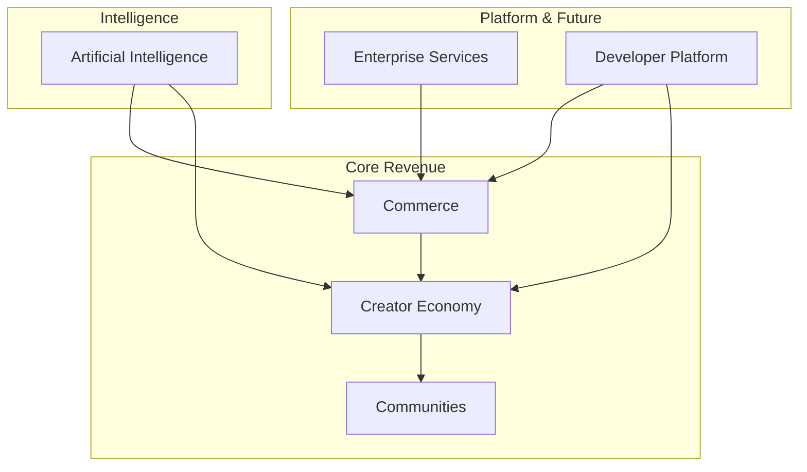

# Jimvio Product Strategy v10

**Official long-term product strategy · July 2026**

> This document defines **why** Jimvio exists, **who** it serves, **where** it is going, and **how** it will win over the next decade.  
> Every product, engineering, AI, business, and design decision must align with this strategy.

**Classification:** Official · Confidential  
**Owners:** Founder · CPO · CTO · Chief Strategy Officer  
**Companion:** [Product Bible](../product-bible/) · [JPOS](../product-operating-system/) · [BCM](../business-capability-model/)

---

## How to use this document

| Reader | Focus |
|--------|-------|
| **Investors / Board** | Part 10 (Executive Summary), Parts 1, 3, 7, 8, 9 |
| **Executive leadership** | All parts; quarterly review of Parts 7–8 |
| **Product / Design** | Parts 3–6, 8 |
| **Engineering / AI** | Parts 4, 6, 7, 8, 9 |
| **New strategic hire** | Part 10 first, then Parts 1–3 |

**Alignment rule:** Strategy informs the [Product Bible](../product-bible/); operational execution follows [JPOS](../product-operating-system/). Strategy amendments require Founder + CPO approval.

---

# PART 1 — COMPANY PURPOSE

## Vision

Build the world's most **trusted Creator Commerce Operating System** — the default global infrastructure where creators, sellers, affiliates, brands, and communities build real businesses, not just audiences.

## Mission

Enable anyone, anywhere, to **build, grow, and monetize** an online business from **one connected platform**.

## Purpose

The creator economy is **fragmented by design** — not by accident. Today's builders stitch together:

- Shopify or WooCommerce for products
- Patreon or Skool for communities
- Linktree or Beacons for links
- TikTok or YouTube for audience
- PayPal or Wise for payouts
- Spreadsheets for analytics

Each tool optimizes for one slice. None optimizes for **total earnings across commerce, content, community, and collaboration**.

Jimvio exists to collapse this fragmentation into **one operating system** with:

| Unification | What it means |
|-------------|---------------|
| **One identity** | Single profile across buyer, seller, creator, affiliate, community owner |
| **One wallet** | Earnings, payouts, and subscriptions in one ledger |
| **One design language** | One product feel — not a bundle of acquisitions |
| **One intelligence layer** | AI that understands the full commercial context |

**We are not building another marketplace.** We are building the **infrastructure layer** where creator-led commerce happens.

## Core beliefs

| # | Belief | Implication |
|---|--------|-------------|
| 1 | **Earnings are the ultimate product metric** | Feature count is vanity; earnings enabled is sanity |
| 2 | **Creators are businesses, not hobbies** | Tools must support diversification — products, affiliate, UGC, community, courses |
| 3 | **Emerging markets are not "later"** | Multi-gateway payments, mobile-first, and cross-border are day-one requirements |
| 4 | **Trust compounds** | Transparent payments and honest errors beat growth hacks |
| 5 | **Connection beats isolation** | Commerce Graph, Super App, and cross-module journeys are strategic — not nice-to-have |
| 6 | **AI amplifies humans; it does not replace them** | No auto-payments, no auto-payouts, no dark patterns |
| 7 | **Platform quality is moat** | Stability in payments and auth is non-negotiable competitive advantage |
| 8 | **Documentation is strategy** | Decisions in writing (PRD, ADR, Strategy) scale better than tribal knowledge |

## Long-term ambition (10 years)

| Horizon | Ambition | Strategic milestone |
|---------|----------|---------------------|
| **2026–2027 (Year 1–2)** | Definitive Creator Commerce OS for emerging markets + global early adopters | Production AI, reliable payments, creator earnings flywheel |
| **2028 (Year 3)** | Native mobile apps; embeddable commerce widgets; creator API v1 | Jimvio commerce surfaces beyond jimvio.com |
| **2029–2030 (Year 4–5)** | Third-party app ecosystem; enterprise brand programs | Platform, not product |
| **2031–2033 (Year 6–8)** | Regional market leadership in Africa + diaspora; expansion to SEA and LATAM | Cross-border creator commerce hub |
| **2034–2036 (Year 9–10)** | Global infrastructure for creator-led commerce — **billions in enabled GMV** | Default OS for creator businesses worldwide |

**North Star (decade):** Maximize **creator and seller earnings enabled per active user** — the single metric that proves Jimvio helps people build real businesses.

---

# PART 2 — MARKET ANALYSIS

## Target markets

| Market tier | Geography | Rationale | Entry phase |
|-------------|-----------|-----------|-------------|
| **Primary** | Sub-Saharan Africa (Rwanda, Nigeria, Kenya, Ghana, South Africa) | Mobile-first; creator economy growth; payment gateway gap | Now |
| **Primary** | African diaspora (US, UK, EU selling to Africa) | Cross-border demand; remittance-adjacent commerce | Year 1–2 |
| **Secondary** | Southeast Asia, LATAM | Similar mobile-first dynamics; large creator populations | Year 3–5 |
| **Tertiary** | Global English-speaking creators | Premium features, enterprise, API | Year 3+ |

**Beachhead:** Creators and sellers who need **one platform** for commerce + community + affiliate + payouts — especially where Stripe-only stacks fail.

## Customer segments

| Segment | Size signal | Primary need | Jimvio wedge |
|---------|-------------|--------------|--------------|
| **Creator-entrepreneurs** | Fastest-growing; multi-income | Diversified earnings from one dashboard | Creator Hub + UGC + affiliate + community |
| **Independent sellers** | Large; underserved in Africa | Sell globally; get paid locally | Multi-gateway checkout + CJ supply chain |
| **Affiliates & promoters** | Growing with social commerce | Trackable links; fast payouts | Affiliate Hub + wallet |
| **Community builders** | Rising (post-Patreon fatigue) | Monetize membership + commerce | Paid communities + courses |
| **Brands & agencies** | Enterprise (later) | UGC campaigns; creator ROI | UGC campaigns + analytics |
| **Buyers** | Mass market | Trust, discovery, speed | Marketplace + Commerce Graph |

## Competitor landscape

| Category | Players | Strength | Weakness vs Jimvio |
|----------|---------|----------|-------------------|
| **Marketplaces** | Amazon, Jumia, Etsy | Traffic, trust at scale | No creator economy; no community; no affiliate-native |
| **Creator stores** | Shopify, Gumroad | Mature commerce | No community, UGC, or affiliate in one OS |
| **Communities** | Patreon, Skool, Circle | Membership model | Weak commerce; fragmented payouts |
| **Affiliate** | Impact, ShareASale, LTK | Enterprise affiliate | No owned marketplace; no creator profile |
| **UGC platforms** | CreatorIQ, Aspire | Brand campaigns | Not creator-first; no wallet/commerce |
| **Social commerce** | TikTok Shop, Instagram | Distribution | Platform lock-in; limited payout infrastructure in Africa |
| **All-in-one (aspirational)** | Kajabi, Stan Store | Simplicity | Western payment bias; no supply chain; no UGC marketplace |

**Jimvio's competitive white space:** Creator Commerce OS with **emerging-market payments**, **UGC + affiliate + community + commerce** unified, and **AI earnings intelligence** — no incumbent owns all four.

## Market trends

| Trend | Impact on Jimvio | Response |
|-------|------------------|----------|
| Creator economy → $500B+ by 2030 | Larger TAM; more tool fragmentation | Position as unifying OS |
| Social commerce growth | Discovery shifts to creators | Commerce Graph + creator storefronts |
| Subscription fatigue | Communities need commerce adjacency | Paid tiers + product sales in one hub |
| Mobile-first commerce (Africa 80%+ mobile) | Desktop-first tools lose | Mobile-first JPOS quality standard |
| Platform distrust (algorithm changes) | Creators want owned audiences | Communities + email + direct commerce |
| Gig economy formalization | Payout compliance matters | Wallet, audit, tax readiness (long-term) |

## Creator economy trends

| Trend | Strategic implication |
|-------|----------------------|
| **Income diversification** | Creators need 3+ revenue streams — Jimvio's core architecture |
| **Micro-creators monetizing** | Lower barrier tools; Opportunity Engine |
| **Brand-creator partnerships** | UGC campaigns as growth engine |
| **Live commerce** | Shoppable live sessions — high conversion |
| **Creator-as-business** | Courses, communities, products — not just ads |
| **Cross-border creator audiences** | Multi-currency wallet essential |

## AI trends

| Trend | Jimvio position |
|-------|-----------------|
| LLM commoditization | Differentiate on **context** — full commerce graph, not generic chat |
| AI agents | User-approved automation only; never financial autonomy |
| Semantic search | AI Search for products and creators |
| AI content generation | Assist descriptions, briefs — human publishes |
| Personalization at scale | Recommendations without creepy surveillance |
| AI cost pressure | Token budgets; caching; model routing |

## Commerce trends

| Trend | Jimvio position |
|-------|-----------------|
| Headless commerce | API-first architecture prepares for embeddable commerce (Year 3) |
| Dropshipping maturity | CJ integration for seller catalog breadth |
| BNPL growth | Gateway expansion (Year 2+) |
| Cross-border default | Multi-gateway from day one |
| Conversion optimization | Commerce Graph, personalized feed, AI search |

## Cross-border commerce trends

| Trend | Jimvio advantage |
|-------|------------------|
| Africa fintech explosion | Flutterwave, PesaPal, PawaPay integration |
| Diaspora remittance → commerce | Creators selling to home markets |
| Currency volatility | Multi-currency display; local settlement |
| Logistics gaps | CJ + future regional fulfillment partners |
| Regulatory fragmentation | Administration domain; compliance roadmap |

---

# PART 3 — STRATEGIC POSITIONING

## What makes Jimvio unique

Jimvio is the **only platform** designed from inception as a **Creator Commerce Operating System** — not a marketplace that added creators, nor a community tool that bolted on a store.

| Dimension | Typical competitor | Jimvio |
|-----------|-------------------|--------|
| **Architecture** | Single-purpose product | Multi-capability OS with shared identity, wallet, AI |
| **Payments** | Stripe-centric | 7+ gateways; Africa-first |
| **Monetization paths** | 1–2 (e.g., products OR community) | 6+ (products, affiliate, UGC, community, courses, live) |
| **Intelligence** | Bolt-on chatbot | Context-aware Copilot with commerce graph |
| **Experience** | Siloed apps | Super App, Command Center, one design system |

## Primary competitive advantages

| # | Advantage | Why it matters | Durability |
|---|-----------|----------------|------------|
| 1 | **Unified earnings wallet** | One place to see all income streams | High — switching cost |
| 2 | **Emerging-market payment stack** | Competitors cannot easily replicate 7 gateways + local UX | High — operational moat |
| 3 | **Commerce + Creator Graph** | Cross-sell intelligence across products, creators, communities | Medium-high — data network effect |
| 4 | **Multi-role identity** | One user is buyer, seller, creator, affiliate simultaneously | High — reduces tool sprawl |
| 5 | **Documented platform architecture** | Faster, safer iteration at scale | Medium — execution moat |
| 6 | **AI with full platform context** | Recommendations grounded in real earnings data | Medium-high — improves with scale |

## Strategic differentiators

```
┌─────────────────────────────────────────────────────────────────┐
│                 JIMVIO CREATOR COMMERCE OS                        │
├─────────────────────────────────────────────────────────────────┤
│  ONE IDENTITY  ·  ONE WALLET  ·  ONE DESIGN  ·  ONE AI LAYER   │
├──────────────┬──────────────┬──────────────┬────────────────────┤
│  COMMERCE    │   CREATOR    │  COMMUNITY   │   INTELLIGENCE     │
│  Marketplace │   UGC        │   Paid hubs  │   Copilot          │
│  Checkout    │   Affiliate  │   Courses    │   Opportunity Eng. │
│  Orders      │   Live       │   Workspace  │   AI Search        │
├──────────────┴──────────────┴──────────────┴────────────────────┤
│           EMERGING-MARKET PAYMENTS (7+ GATEWAYS)                │
└─────────────────────────────────────────────────────────────────┘
```

**Positioning statement:**

*For creator-entrepreneurs and sellers in emerging and global markets who need to earn from multiple sources, Jimvio is the Creator Commerce Operating System that unifies commerce, community, affiliate, and UGC with one wallet and one AI — unlike Shopify, Patreon, or TikTok Shop which solve only one piece of the earnings puzzle.*

## Long-term defensibility

| Moat type | Mechanism | Timeline to strength |
|-----------|-----------|---------------------|
| **Network effects** | More creators → more products → more buyers → more UGC campaigns | Year 2–3 |
| **Data advantage** | Commerce Graph + earnings patterns improve AI recommendations | Year 2–4 |
| **Switching costs** | Wallet balance, community members, affiliate links, course progress | Year 1+ |
| **Payment infrastructure** | Multi-gateway orchestration; local settlement relationships | Year 1–2 |
| **Brand trust** | Reliable payouts in markets where trust is scarce | Year 2–3 |
| **Ecosystem** | Third-party apps on Jimvio platform (API, app store) | Year 4–5 |
| **Operational excellence** | Tier 1 stability; documented governance (JPOS, BCM, ADRs) | Now |

**What we will not compete on:** Generic marketplace traffic against Amazon/Jumia. **What we will win on:** Creator earnings enablement in underserved markets.

---

# PART 4 — PRODUCT PORTFOLIO

Strategic portfolios organize investment and P&L accountability. Maps to [JPOS Part 6](../product-operating-system/JIMVIO-PRODUCT-OPERATING-SYSTEM-v1.0.md#part-6--product-portfolio) and [BCM](../business-capability-model/).

## Portfolio overview



## Commerce

| Attribute | Detail |
|-----------|--------|
| **Strategic role** | Revenue engine; buyer trust; seller GMV |
| **Products** | Marketplace, Products, Cart, Checkout, Orders, Reviews, CJ supply chain |
| **BCM capabilities** | Commerce L1 |
| **2026 priority** | Checkout reliability, mobile conversion, flash deals |
| **2028+ priority** | Embeddable checkout, B2B wholesale, multi-vendor carts |
| **Portfolio owner** | CPO (Commerce) |

## Creator Economy

| Attribute | Detail |
|-----------|--------|
| **Strategic role** | North Star driver — earnings diversification |
| **Products** | Creator Hub, Creator Profiles, UGC, Affiliate, Live Commerce, Courses, Commerce Graph, Business Graph, Opportunity Engine |
| **BCM capabilities** | Creator Economy, Affiliate, UGC |
| **2026 priority** | UGC payouts, affiliate attribution, production AI (FS-001) |
| **2028+ priority** | Campaign marketplace, creator reputation, rights management |
| **Portfolio owner** | CPO (Creator) |

## Artificial Intelligence

| Attribute | Detail |
|-----------|--------|
| **Strategic role** | Differentiation; earnings lift; productivity |
| **Products** | Copilot, AI Search, Opportunity Engine, AI Analytics, Command Center AI |
| **BCM capabilities** | AI L1 |
| **2026 priority** | Production LLM integration; semantic product search |
| **2028+ priority** | User-approved agents; demand forecasting; moderation assist |
| **Portfolio owner** | CPO + CTO (AI) |

## Communities

| Attribute | Detail |
|-----------|--------|
| **Strategic role** | Retention; recurring revenue; owned audience |
| **Products** | Community hubs, paid tiers, workspace, courses, community chat |
| **BCM capabilities** | Communities L1 |
| **2026 priority** | Subscription billing reliability, tier gating, workspace UX |
| **2028+ priority** | Community templates, events, federated communities |
| **Portfolio owner** | CPO (Creator) |

## Enterprise Services

| Attribute | Detail |
|-----------|--------|
| **Strategic role** | High-ACV brands; UGC at scale; compliance |
| **Products** | Brand UGC campaigns, admin analytics, dispute resolution, SSO (future) |
| **BCM capabilities** | Administration, UGC (brand-facing) |
| **2026 priority** | Admin tooling; campaign analytics; audit expansion |
| **2028+ priority** | Enterprise SSO, team accounts, brand API, dedicated support |
| **Portfolio owner** | CPO + Founder |

## Developer Platform

| Attribute | Detail |
|-----------|--------|
| **Strategic role** | Ecosystem moat; embeddable commerce; third-party innovation |
| **Products** | Public API (future), webhooks, app marketplace (future), embeddable widgets |
| **BCM capabilities** | Platform Services, Commerce (API surface) |
| **2026 priority** | API standards documentation; webhook reliability; internal API consistency |
| **2028+ priority** | Creator API v1, OAuth apps, SDK, app review program |
| **Portfolio owner** | CTO |

## Portfolio investment allocation (2026)

| Portfolio | Capacity | Rationale |
|-----------|:--------:|-----------|
| Commerce | 28% | Revenue foundation; checkout stability |
| Creator Economy | 27% | North Star; UGC + affiliate |
| Artificial Intelligence | 15% | FS-001; differentiation |
| Communities | 12% | Retention; MRR |
| Enterprise Services | 8% | Brand campaigns; admin |
| Developer Platform | 5% | Foundation only |
| Platform / Growth (shared) | 5% | Design System, SEO, onboarding |

*Rebalanced quarterly via [JPOS](../product-operating-system/) quarterly planning.*

---

# PART 5 — GROWTH STRATEGY

## User acquisition

| Channel | Strategy | KPI |
|---------|----------|-----|
| **Organic / SEO** | Marketplace and creator profile pages indexed; content marketing | Organic sessions ↑ |
| **Creator-led** | Every creator profile is a landing page; affiliate links drive buyers | Referral signups ↑ |
| **Community viral** | Member invites; public community discovery | Community-driven registrations ↑ |
| **Partnerships** | Fintech, telco, creator agencies in Africa | Partnership-sourced MAU ↑ |
| **Paid (selective)** | Retargeting in diaspora markets only when LTV proven | CAC < 3-month LTV |

**Principle:** Prefer **creator-distributed acquisition** over paid ads — aligns with OS model.

## Creator acquisition

| Tactic | Detail |
|--------|--------|
| **UGC campaign pull** | Brands post campaigns → creators join for earnings |
| **Opportunity Engine** | Surface earnings opportunities to dormant creators |
| **Creator success stories** | Earnings transparency (with permission) as social proof |
| **Low activation barrier** | Role activation in minutes; no upfront fees |
| **Education** | In-platform guides: affiliate → UGC → community → products |

**Target:** 40% of new creators earn within 60 days of activation.

## Seller acquisition

| Tactic | Detail |
|--------|--------|
| **CJ catalog import** | Sellers start with products, not empty shelves |
| **Cross-role promotion** | Creators become sellers (same identity) |
| **Local payment story** | "Get paid via Flutterwave/PesaPal" as acquisition message |
| **Seller success tooling** | Analytics, Opportunity Engine, AI product descriptions |
| **Fulfillment support** | CJ dropshipping reduces operational barrier |

**Target:** Time to first sale < 14 days for new sellers with CJ catalog.

## Brand partnerships

| Phase | Approach |
|-------|----------|
| **Year 1** | Direct outreach to African D2C brands for UGC pilots |
| **Year 2** | Self-serve campaign creation; brand dashboard |
| **Year 3+** | Enterprise sales; annual contracts; dedicated CSM |

**Value prop to brands:** Verified creators, performance-based UGC, unified analytics — cheaper than agency, more authentic than ads.

## Community growth

| Lever | Mechanism |
|-------|-----------|
| **Commerce adjacency** | Communities sell products without leaving hub |
| **Paid tier templates** | One-click monetization setup |
| **Creator cross-promotion** | Commerce Graph links communities to creators |
| **Course bundles** | Courses increase community perceived value |
| **Public discovery** | SEO-indexed community pages |

## International expansion

| Phase | Markets | Requirements |
|-------|---------|--------------|
| **Phase 1 (now)** | East + West Africa | Current gateways |
| **Phase 2 (Y2)** | African diaspora (US, UK, EU buyers) | PayPal, cross-border shipping |
| **Phase 3 (Y3)** | SEA, LATAM | New gateway partnerships; localization |
| **Phase 4 (Y5+)** | Global GA | Multi-language; regional compliance teams |

**Expansion rule:** Never enter a market without **local payment method** support.

## Retention

| Segment | Retention lever |
|---------|-----------------|
| **Buyers** | Order tracking, personalized feed, community membership |
| **Sellers** | GMV analytics, payout reliability, CJ inventory |
| **Creators** | Diversified earnings, Opportunity Engine, wallet growth |
| **Affiliates** | Conversion analytics, commission transparency |
| **Community owners** | MRR dashboard, member engagement tools |

**Target:** D30 retention ↑ 5% year-over-year per cohort.

## Monetization

| Revenue stream | Model | Phase |
|----------------|-------|-------|
| **Transaction take rate** | % of GMV | Now |
| **Community subscriptions** | Platform fee on MRR | Now |
| **UGC campaign fees** | Brand campaign service fee | Now |
| **Premium seller tools** | Subscription for advanced analytics (future) | Y2 |
| **Enterprise / API** | Annual contracts | Y3+ |
| **AI premium tier** | Higher Copilot limits (future) | Y2 |

**Principle:** Monetize **where users earn** — aligned incentives with North Star.

---

# PART 6 — AI STRATEGY

AI is a **strategic differentiator**, not a feature checkbox. AI must increase earnings and reduce friction without creating dependency or trust risk.

## AI principles

| Principle | Rule |
|-----------|------|
| **Assist, never own** | AI recommends; users approve all financial actions |
| **Context is moat** | Full commerce graph context beats generic LLM wrappers |
| **Graceful degradation** | Every flow works when AI is unavailable |
| **No PII to LLM** | Identity and payment data never sent to external models |
| **Bounded tools** | Allowlist only; no arbitrary database access |
| **Human override** | User always has final authority |

## AI across domains

### Commerce

| Application | Phase | Earnings impact |
|-------------|-------|-----------------|
| Product description generation | Y1 | Faster seller listing → more GMV |
| AI Search (semantic) | Y1 | Better discovery → conversion ↑ |
| Demand forecasting | Y2 | Inventory optimization |
| Pricing suggestions | Y2 | Margin optimization |
| Checkout assistance | Y3 | Reduced abandonment (read-only guidance) |

### Creators

| Application | Phase | Earnings impact |
|-------------|-------|-----------------|
| Copilot (earnings advisor) | Y1 | Surfaces opportunities |
| Opportunity Engine scoring | Y1 | Direct earnings enablement |
| Profile optimization | Y1 | Discovery ↑ |
| UGC brief generation | Y1 | Faster campaign participation |
| Content performance narratives | Y2 | Optimization signal |

### Communities

| Application | Phase | Impact |
|-------------|-------|--------|
| Engagement insights | Y2 | Retention ↑ |
| Content moderation assist | Y2 | Safety at scale |
| Course outline generation | Y2 | Faster course creation |
| Member FAQ bot (community-scoped) | Y3 | Support cost ↓ |

### Search

| Application | Phase | Impact |
|-------------|-------|--------|
| Intent parsing | Y1 | Query → product match ↑ |
| Personalized ranking | Y2 | Relevance ↑ |
| Creator discovery matching | Y2 | Brand-creator fit ↑ |
| Command Center natural language | Y1 | Power-user productivity |

### Analytics

| Application | Phase | Impact |
|-------------|-------|--------|
| NL dashboard summaries | Y2 | Democratized analytics |
| Anomaly explanations | Y2 | Faster issue detection |
| Earnings forecasts | Y3 | Planning for creators |
| Cohort narratives | Y3 | Strategic insight for sellers |

### Automation

| Application | Phase | Constraint |
|-------------|-------|------------|
| Scheduled reports | Y2 | Read-only |
| Inventory alerts | Y2 | Notify only; no auto-price change |
| Campaign reminders | Y2 | Notify only |
| User-approved agents | Y3 | Explicit consent per action |
| **Never** | — | Auto-payment, auto-payout, auto-listing without approval |

### Customer support

| Application | Phase | Impact |
|-------------|-------|--------|
| Copilot as first-line support | Y1 | Ticket deflection |
| Order status via Copilot tools | Y1 | Self-serve resolution |
| Escalation to human | Y1 | Trust preservation |
| Support knowledge base RAG | Y2 | Accuracy ↑ |

## AI investment roadmap

| Year | Focus | Key deliverable |
|------|-------|-----------------|
| **Y1 (2026)** | Production AI foundation | FS-001: Gemini/OpenAI, Copilot, AI Search |
| **Y2 (2027)** | Personalization + analytics AI | Recommendations, NL dashboards |
| **Y3 (2028)** | Bounded automation | User-approved agents; moderation assist |
| **Y5 (2030)** | AI Gateway service | Dedicated AI microservice; model routing |
| **Y10 (2036)** | Predictive commerce intelligence | Market-level demand forecasting |

*Technical boundaries: [Domain Architecture — AI](../domain-architecture/) · [FS-001](../feature-specs/FS-001-jimvio-ai-production-integration.md)*

---

# PART 7 — PLATFORM EVOLUTION

## Year 1 (2026) — Foundation & flywheel

| Theme | Milestones |
|-------|------------|
| **Commerce stability** | Checkout, payments, orders production-hardened |
| **Creator earnings** | UGC payouts, affiliate commissions, wallet reliability |
| **AI production** | Copilot + AI Search live (FS-001) |
| **Platform cohesion** | Design System on high-traffic surfaces; Super App polish |
| **Communities** | Paid tiers, subscription billing, workspace UX |
| **Governance** | JPOS, BCM, PRD, Domain Architecture operational |

**Success:** Earnings per active user baseline established; payment success > 95%.

## Year 2 (2027) — Growth & intelligence

| Theme | Milestones |
|-------|------------|
| **Mobile apps** | iOS + Android (shared API layer) |
| **AI depth** | Recommendations, Opportunity Engine v2, NL analytics |
| **Seller growth** | CJ expansion; seller onboarding optimization |
| **Community MRR** | Subscription growth; course bundles |
| **International** | Diaspora buyer flows; PayPal optimization |
| **Platform** | CI/CD; automated tests for Tier 1 paths |

**Success:** D30 retention ↑; creator earnings per user ↑ 25% YoY.

## Year 3 (2028) — Platform expansion

| Theme | Milestones |
|-------|------------|
| **Creator API v1** | Public API for profiles, products, affiliate |
| **Embeddable commerce** | Checkout widget for external sites |
| **Enterprise pilot** | Brand self-serve UGC; team accounts beta |
| **AI automation** | User-approved bounded agents |
| **Localization** | French, Swahili, Portuguese (select surfaces) |
| **Scale** | Read replicas; event bus; 1M+ user architecture |

**Success:** API adoption by 100+ creators/brands; embeddable GMV > 5% of total.

## Year 5 (2030) — Ecosystem

| Theme | Milestones |
|-------|------------|
| **App marketplace** | Third-party apps on Jimvio platform |
| **Enterprise GA** | SSO, annual contracts, dedicated support |
| **Regional leadership** | #1 creator commerce OS in East Africa |
| **SEA/LATAM entry** | Local gateways; regional teams |
| **AI platform** | AI Gateway microservice; multi-model routing |
| **Financial services** | Advanced payout schedules; tax reporting |

**Success:** Enabled GMV $100M+; ecosystem apps driving 15% of engagement.

## Year 10 (2036) — Global infrastructure

| Theme | Milestones |
|-------|------------|
| **Global OS** | Default creator commerce infrastructure worldwide |
| **Billions in enabled GMV** | Platform-enabled transaction volume |
| **Developer ecosystem** | Thousands of third-party apps |
| **Enterprise** | Fortune 500 brand programs |
| **Financial infrastructure** | Wallet, credit, insurance adjacencies (regulated) |
| **AI native** | Predictive commerce; market intelligence products |

**Success:** North Star at scale — earnings enabled per user industry-leading; profitable platform economics.

---

# PART 8 — SUCCESS METRICS

## North Star metric

| Metric | Definition | Why |
|--------|------------|-----|
| **Earnings enabled per active user** | (Total creator + seller wallet credits in period) / (Active creators + sellers) | Proves Jimvio helps people build real businesses — not just use features |

**Supporting North Star decomposition:**

```
Earnings enabled = Σ (product sales + affiliate commissions + UGC payouts + community MRR + course sales)
Active user = creator or seller with ≥1 platform action in 30 days
```

## Platform KPIs

| Category | KPI | Y1 target | Y5 target |
|----------|-----|-----------|-----------|
| **Scale** | MAU | Baseline + growth | 1M+ |
| **Scale** | GMV | Baseline + growth | $100M+ enabled |
| **Quality** | Payment success rate | > 95% | > 98% |
| **Quality** | Uptime | 99.9% | 99.95% |
| **Engagement** | Cross-module sessions | 30% users visit 2+ modules | 60% |
| **Revenue** | Platform revenue | Baseline | Profitable unit economics |

## Creator KPIs

| KPI | Y1 | Y3 | Y5 |
|-----|----|----|-----|
| Active creators (30-day) | ↑ | ↑↑ | ↑↑↑ |
| % creators earning within 60 days | 30% | 50% | 65% |
| Avg earnings per active creator | Baseline | +50% | +150% |
| UGC campaign fill rate | 70% | 85% | 90% |
| Affiliate conversion rate | Baseline | +20% | +40% |
| Copilot adoption (authenticated) | 25% | 50% | 70% |

## Seller KPIs

| KPI | Y1 | Y3 | Y5 |
|-----|----|----|-----|
| Active sellers (30-day) | ↑ | ↑↑ | ↑↑↑ |
| Time to first sale (median) | < 14 days | < 7 days | < 3 days |
| Seller 90-day retention | 50% | 65% | 75% |
| Avg GMV per active seller | Baseline | +40% | +100% |
| Order fulfillment rate | > 90% | > 95% | > 98% |

## Engineering KPIs

| KPI | Target | Owner |
|-----|--------|-------|
| P0 incidents per month | 0 | CTO |
| Deployment frequency | Weekly (Tier 3–4) | Eng lead |
| Lead time for changes (Tier 3–4) | < 1 week | Eng lead |
| Change failure rate | < 5% | Eng lead |
| LCP p75 (marketplace) | < 2.5s | Eng |
| Tier 1 test coverage | 80% critical paths (Y2) | CTO |
| Technical debt ratio | ≤ 20% sprint capacity | CTO |
| Mean time to recovery (T1) | < 1 hour | DevOps |

*Operational KPIs align with [JPOS Part 7](../product-operating-system/JIMVIO-PRODUCT-OPERATING-SYSTEM-v1.0.md#part-7--product-kpis).*

---

# PART 9 — RISKS

## Business risks

| Risk | Likelihood | Impact | Mitigation |
|------|:----------:|:------:|------------|
| Slow creator earnings adoption | Medium | High | Opportunity Engine; UGC campaigns; lower activation barrier |
| Marketplace cold start | Medium | High | CJ catalog; creator-driven traffic; flash deals |
| Monetization vs growth tension | Medium | Medium | Align fees with earnings; transparent pricing |
| Key person dependency | Medium | High | Documentation (JPOS, BCM); hire bar; knowledge sharing |
| Funding runway | Variable | High | Capital efficiency; focus on earnings metric for fundraising |

## Technical risks

| Risk | Likelihood | Impact | Mitigation |
|------|:----------:|:------:|------------|
| Payment gateway failure | Medium | Critical | Multi-gateway routing; failover; monitoring |
| Scale bottlenecks (1M+ users) | Medium | High | System Architecture scale plan; incremental extraction |
| Single-region deployment | Low | High | Multi-region roadmap Y3; DR documented |
| No automated test suite | High | High | Tier 1 test coverage priority; CI/CD Y2 |
| Schema migration errors | Low | Critical | Tier 1 lifecycle; ADR; rollback scripts |

## Regulatory risks

| Risk | Likelihood | Impact | Mitigation |
|------|:----------:|:------:|------------|
| Payment licensing requirements | Medium | High | Legal counsel per market; partner with licensed gateways |
| Data protection (GDPR, local laws) | Medium | Medium | Privacy by design; PRD §16; data minimization |
| UGC content liability | Medium | Medium | Moderation queue; terms of service; takedown process |
| Tax reporting for creators | Low | Medium | Y3+ tax documentation features; jurisdiction research |
| AI regulation (EU AI Act, etc.) | Medium | Medium | Human-in-loop; transparency; no automated financial decisions |

## Competitive risks

| Risk | Likelihood | Impact | Mitigation |
|------|:----------:|:------:|------------|
| Shopify expanding to Africa | Medium | High | Payment moat; creator economy depth; local relationships |
| TikTok Shop in Africa | Medium | High | Owned audience (communities); multi-stream earnings |
| Well-funded local competitor | Medium | Medium | Speed; documentation discipline; creator success focus |
| Big tech AI commoditization | High | Medium | Context moat (Commerce Graph); earnings-specific AI |

## AI risks

| Risk | Likelihood | Impact | Mitigation |
|------|:----------:|:------:|------------|
| Prompt injection | Medium | High | Hardened system prompt; tool allowlist |
| PII leakage to LLM | Low | Critical | No PII policy; audit logs |
| AI hallucination in commerce context | Medium | Medium | Read-only tools; cite sources; user verification |
| Token cost overrun | Medium | Medium | Rate limits; caching; model routing |
| User over-reliance on AI | Low | Medium | Clear AI boundaries; human support path |
| AI-initiated financial action | Low | Critical | Architectural prohibition; Domain Architecture rules |

## Operational risks

| Risk | Likelihood | Impact | Mitigation |
|------|:----------:|:------:|------------|
| CJ supply chain disruption | Medium | Medium | Multi-supplier roadmap; seller-owned inventory |
| Support overwhelm at scale | Medium | Medium | Copilot deflection; FAQ; tiered support Y3 |
| Fraud (affiliate, UGC views) | Medium | Medium | Attribution windows; view verification; rate limits |
| Team scaling challenges | Medium | Medium | JPOS onboarding; documented architecture |
| Incident response gaps | Medium | High | DR plan; on-call rotation; runbooks |

---

# PART 10 — EXECUTIVE SUMMARY

## The opportunity

The creator economy will exceed **$500 billion by 2030**, yet creators and sellers still juggle **6–10 disconnected tools** to earn a living. In emerging markets, the fragmentation is worse: Western-centric payment stacks exclude hundreds of millions of potential builders.

**Jimvio is the Creator Commerce Operating System** — one platform where commerce, community, affiliate, UGC, courses, and AI converge with one identity, one wallet, and one intelligence layer.

## What we are building

| Layer | What |
|-------|------|
| **Commerce** | Marketplace, checkout, orders — global multi-gateway payments |
| **Creator Economy** | Profiles, UGC, affiliate, live, courses — diversified earnings |
| **Communities** | Paid hubs, workspace, subscriptions — owned audiences |
| **AI** | Copilot, search, Opportunity Engine — earnings intelligence |
| **Platform** | Super App, Design System, Command Center — one connected product |

## Why we win

1. **Only OS for creator earnings** — not a point solution
2. **Emerging-market payments** — 7+ gateways; Africa-first
3. **Multi-stream wallet** — one view of all income
4. **AI with commerce context** — not a generic chatbot
5. **Documented platform discipline** — JPOS, BCM, Domain Architecture — execution at scale

## North Star

**Earnings enabled per active user** — the metric that proves Jimvio helps people build real businesses.

## Decade roadmap (headlines)

| Year | Headline |
|------|----------|
| **Y1 (2026)** | Foundation: stable payments, production AI, creator flywheel |
| **Y2 (2027)** | Mobile apps, AI depth, retention growth |
| **Y3 (2028)** | Creator API, embeddable commerce, enterprise pilot |
| **Y5 (2030)** | App ecosystem, regional leadership, $100M+ GMV |
| **Y10 (2036)** | Global creator commerce infrastructure — billions in enabled GMV |

## 2026 priorities

1. **Payment and checkout reliability** — trust is the foundation
2. **Creator earnings flywheel** — UGC, affiliate, community MRR
3. **Production AI** (FS-001) — Copilot and AI Search live
4. **Platform cohesion** — Design System on critical surfaces
5. **Governance maturity** — PRD → FS → TSL on all Tier 1–3 features

## Investment thesis

Jimvio captures value where **creators and sellers earn** — transaction fees, subscriptions, and campaign services — with aligned incentives via the North Star metric. The moat deepens through wallet switching costs, payment infrastructure, Commerce Graph data, and eventually a third-party ecosystem.

## Key risks (top 5)

1. Creator earnings adoption speed
2. Payment reliability in emerging markets
3. Competitive entry by Shopify/TikTok in Africa
4. Technical scale without test infrastructure
5. AI trust and safety at financial boundaries

## The ask (internal)

Every team — Product, Engineering, Design, AI, Operations — aligns daily work to:

> *Does this increase earnings enabled per active user, on a platform users trust?*

If yes, proceed through [JPOS](../product-operating-system/). If no, reject or defer.

---

## Governance alignment

| Document | Relationship to Strategy |
|----------|-------------------------|
| [Product Bible](../product-bible/) | Permanent truth — Strategy informs Bible updates |
| [JPOS](../product-operating-system/) | How we execute Strategy day-to-day |
| [BCM](../business-capability-model/) | What capabilities Strategy invests in |
| [Domain Architecture](../domain-architecture/) | How Strategy maps to engineering boundaries |
| [Product Blueprint](../product-blueprint/) | Detailed spec — derived from Strategy portfolios |

---

## Approval

| Role | Status | Date |
|------|--------|------|
| Founder / CEO | Proposed | July 2026 |
| CPO | Proposed | July 2026 |
| CTO | Proposed | July 2026 |
| Chief Strategy Officer | Proposed | July 2026 |

---

**Jimvio Product Strategy v10** — *One platform. Real earnings. Global by design.*

*End of document*
