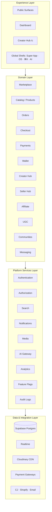
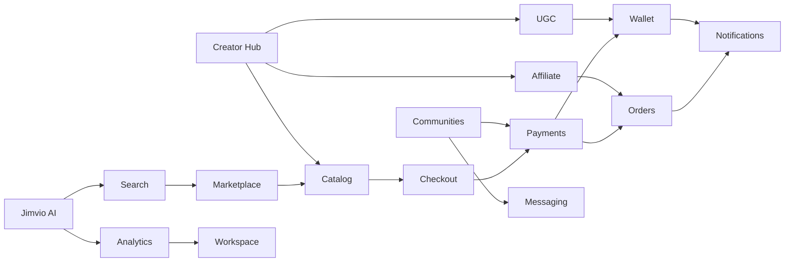
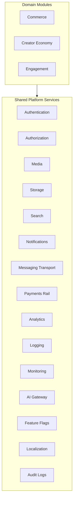
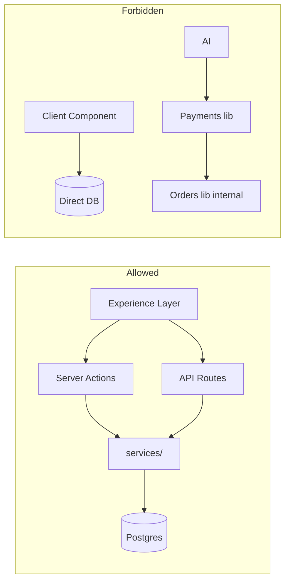
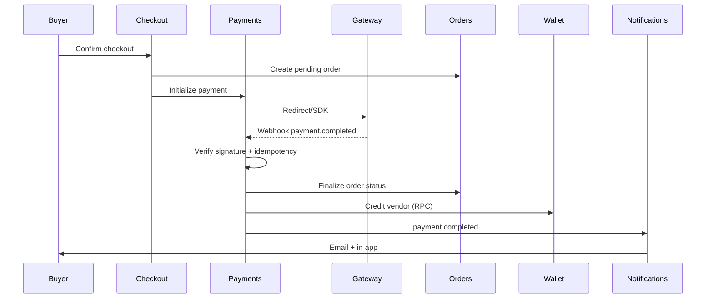
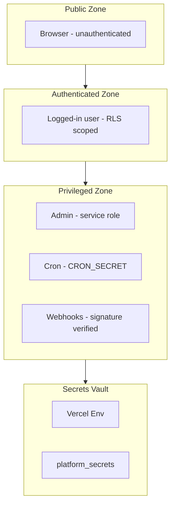
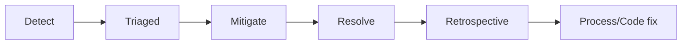

# Jimvio System Architecture Blueprint v1.0

**Official · Master architecture reference · July 2026**

> Describes **how every Jimvio module connects, communicates, and scales** as a unified Creator Commerce Operating System.  
> Implementation details: [Technical Architecture Blueprint](../technical-architecture/JIMVIO-TECHNICAL-ARCHITECTURE-BLUEPRINT-v1.0.md).  
> Product behavior: [Product Blueprint](../product-blueprint/JIMVIO-PRODUCT-BLUEPRINT-v1.0.md).

---

## Table of contents

1. [Platform Overview](#part-1--platform-overview)
2. [Domain Modules](#part-2--domain-modules)
3. [Shared Platform Services](#part-3--shared-platform-services)
4. [Communication Model](#part-4--communication-model)
5. [Event Architecture](#part-5--event-architecture)
6. [Security Boundaries](#part-6--security-boundaries)
7. [Scalability Model](#part-7--scalability-model)
8. [Observability](#part-8--observability)
9. [Disaster Recovery](#part-9--disaster-recovery)
10. [Future Platform Evolution](#part-10--future-platform-evolution)

---

# PART 1 — PLATFORM OVERVIEW

## Vision

Jimvio is a **Creator Commerce Operating System** — a single platform where commerce, creator economy, communities, payments, and AI share one identity, one ledger, one notification fabric, and one design language.

## Core platform responsibilities

| Responsibility | Owner layer |
|----------------|-------------|
| **Identity & access** | Auth + Authorization services |
| **Commerce transaction** | Catalog → Cart → Checkout → Payments → Orders |
| **Value ledger** | Wallet + Transactions |
| **Creator monetization** | Affiliate, UGC, Courses, Live, Communities |
| **Discovery** | Marketplace, Search, Commerce Graph |
| **Engagement** | Messaging, Notifications |
| **Intelligence** | Jimvio AI + Analytics |
| **Operations** | Admin + Audit + Settings |
| **Presentation** | Global shells (Super App, OS, Command Center, Workspace) |

## Design goals

| Goal | Rationale |
|------|-----------|
| **One ecosystem** | Users never feel they left Jimvio when moving marketplace → community → wallet |
| **Modular domains** | Clear boundaries; replaceable implementations |
| **Monolith-first, extract-on-evidence** | Velocity now; microservices only when metrics demand |
| **Event-aware** | Domains communicate via documented events, not hidden coupling |
| **AI-native** | Every domain exposes context; AI never bypasses auth or payments |
| **Global by default** | Multi-currency, multi-gateway, mobile-first |
| **Trust by design** | Audit, idempotency, least privilege on financial paths |

## Engineering goals

| Goal | Target |
|------|--------|
| Availability | 99.9% (production) |
| Payment success | > 95% |
| API p95 (user-facing) | < 500ms (non-AI) |
| AI first token p95 | < 2s |
| Zero data loss on orders/payments | Mandatory |
| Deploy frequency | Daily (Tier 4–5); weekly (Tier 1–3) |
| Mean time to recovery (T1) | < 1 hour |

## High-level architecture



## Module relationship map



## Architectural stance (decision rationale)

| Decision | Rationale | Trade-off |
|----------|-----------|-----------|
| **Modular monolith** (Next.js + Supabase) | Team size, velocity, shared types | Extract services later if needed |
| **Postgres as system of record** | ACID for payments/orders | Vertical scale limits → read replicas |
| **Synchronous + webhook events** (no Kafka today) | Operational simplicity | Event bus at 1M+ users |
| **Server-enforced authorization** | Security over convenience | Duplicated checks in actions + RLS |
| **Additive domain modules** ([ADR-002](../adr/002-additive-platform-modules.md)) | No big-bang rewrites | Multiple integration points to govern |

---

# PART 2 — DOMAIN MODULES

> **Legend:** **PI** = Public Interface · **Events** = emits/consumes (Part 5) · **Code** = primary `lib/` / `services/` / routes

---

## Marketplace

| Field | Detail |
|-------|--------|
| **Purpose** | Product discovery and browse — entry point for buyers |
| **Responsibilities** | Catalog presentation, filters, personalized rails, flash deals, product view tracking |
| **Dependencies** | Catalog, Search, Users, Analytics, Commerce Graph |
| **Public interfaces** | `GET /marketplace/*` pages · `GET /api/marketplace/search` · `lib/actions/marketplace.ts` |
| **Events** | Emits: `product.viewed` · Consumes: `product.published`, `product.price_changed` |
| **Permissions** | Public read; personalization requires authenticated user |
| **Future scale** | CDN-cache browse pages; dedicated search index; edge-rendered category pages |

---

## Products

| Field | Detail |
|-------|--------|
| **Purpose** | Sellable SKU management — physical, digital, variants |
| **Responsibilities** | CRUD, media, variants, publish workflow, digital delivery metadata |
| **Dependencies** | Catalog (taxonomy), Media, Seller Hub, Admin, CJ import |
| **Public interfaces** | `lib/actions/vendor.ts` · `services/products.ts` · `/dashboard/products/*` |
| **Events** | Emits: `product.created`, `product.published`, `product.updated` · Consumes: `vendor.activated` |
| **Permissions** | Vendor owns catalog; admin moderates |
| **Future scale** | Event-sourced inventory; multi-warehouse; bulk API |

---

## Catalog

| Field | Detail |
|-------|--------|
| **Purpose** | Taxonomy, categorization, and product metadata standards |
| **Responsibilities** | Categories, attributes, CJ mapping, search indexing input |
| **Dependencies** | Products, Search, Admin (CJ) |
| **Public interfaces** | `product_categories` table · `lib/cj/*` · `database/seeds/001_categories.sql` |
| **Events** | Emits: `category.updated` · Consumes: `product.published` |
| **Permissions** | Admin writes; public reads |
| **Future scale** | Separate catalog service; GraphQL product API |

*Note: Catalog is embedded in Products/Marketplace today — extract when SKU count > 1M.*

---

## Orders

| Field | Detail |
|-------|--------|
| **Purpose** | Order lifecycle — source of truth for commercial transactions |
| **Responsibilities** | Create, status transitions, fulfillment, cancellation, tracking, invoices |
| **Dependencies** | Checkout, Payments, Wallet, Notifications, CJ fulfillment |
| **Public interfaces** | `lib/actions/orders.ts` · `lib/actions/order-lifecycle.ts` · `services/orders.ts` |
| **Events** | Emits: `order.placed`, `order.shipped`, `order.cancelled`, `order.delivered` · Consumes: `payment.completed` |
| **Permissions** | Buyer (own), Vendor (own store), Admin (all) |
| **Future scale** | Order service extraction; CQRS read models; sharding by `created_at` |

**Protected domain** — Tier 1 lifecycle required for changes.

---

## Checkout

| Field | Detail |
|-------|--------|
| **Purpose** | Pre-payment orchestration — cart → shipping → payment method |
| **Responsibilities** | Price validation, shipping rates, session management, order sync before pay |
| **Dependencies** | Catalog, Cart, Payments, Orders, Localization (currency) |
| **Public interfaces** | `lib/actions/checkout.ts` · `/checkout` · `components/checkout/*` |
| **Events** | Emits: `checkout.started`, `checkout.abandoned` · Consumes: `cart.updated` |
| **Permissions** | Authenticated buyer |
| **Future scale** | Stateless checkout sessions in Redis; guest checkout |

**Protected domain** — Tier 1.

---

## Wallet

| Field | Detail |
|-------|--------|
| **Purpose** | Internal ledger for earnings, balances, withdrawals |
| **Responsibilities** | Credit/debit, transaction history, payout requests, failed credit recovery |
| **Dependencies** | Payments, Orders, UGC, Affiliate, Communities, Notifications |
| **Public interfaces** | `lib/actions/wallet.ts` · `/api/vendor/wallet` · `increment_wallet_balance` RPC |
| **Events** | Emits: `wallet.credited`, `payout.requested`, `payout.completed` · Consumes: `payment.completed`, `commission.earned`, `ugc.payout_triggered` |
| **Permissions** | User (own balance); admin (payout approval) |
| **Future scale** | Double-entry ledger table; separate wallet service; multi-currency wallets |

**Protected domain** — Tier 1.

---

## Payments

| Field | Detail |
|-------|--------|
| **Purpose** | External money movement — checkout, subscriptions, webhooks |
| **Responsibilities** | Gateway routing, initiation, verification, idempotent finalization, refunds |
| **Dependencies** | Orders, Wallet, Notifications, Audit, Platform Settings |
| **Public interfaces** | `lib/payments/router.ts` · `app/api/payments/*` · `app/api/webhooks/*` |
| **Events** | Emits: `payment.initiated`, `payment.completed`, `payment.failed`, `refund.issued` · Consumes: `checkout.ready` |
| **Permissions** | Buyer initiates; admin refunds |
| **Future scale** | Payment orchestration service; PCI-isolated card vault; Stripe Connect |

**Protected domain** — Tier 1. **Never** finalize payments from client.

---

## Users

| Field | Detail |
|-------|--------|
| **Purpose** | Platform identity — accounts, roles, account status |
| **Responsibilities** | Registration, profile bootstrap, role assignment, suspension |
| **Dependencies** | Auth service, Settings |
| **Public interfaces** | `lib/auth/actions.ts` · `profiles` · `user_roles` · `lib/users/account-status.ts` |
| **Events** | Emits: `user.registered`, `user.role_activated`, `user.suspended` · Consumes: — |
| **Permissions** | User (own profile); admin (management) |
| **Future scale** | Identity provider abstraction; SSO for enterprise |

---

## Profiles

| Field | Detail |
|-------|--------|
| **Purpose** | Public and private user presentation — creator identity |
| **Responsibilities** | Bio, avatar, slug, storefront settings, verification status |
| **Dependencies** | Users, Media, Creator Hub |
| **Public interfaces** | `lib/creator-profile/` · `/influencers/[slug]` · `lib/actions/account-settings.ts` |
| **Events** | Emits: `profile.updated`, `creator.verified` · Consumes: `user.role_activated` |
| **Permissions** | Owner edit; public read |
| **Future scale** | Profile CDN cache; verified identity API |

---

## Creator Hub

| Field | Detail |
|-------|--------|
| **Purpose** | Creator monetization surface — profile, studio, earnings, content |
| **Responsibilities** | Public creator pages, video studio, submissions, analytics aggregation |
| **Dependencies** | Profiles, Products, UGC, Affiliate, Live, Commerce Graph, Business Graph |
| **Public interfaces** | `lib/creator-profile/` · `/dashboard/influencer/*` · `services/creator-analytics.ts` |
| **Events** | Emits: `content.published`, `creator.earnings_updated` · Consumes: `ugc.submitted`, `commission.earned` |
| **Permissions** | `influencer` role |
| **Future scale** | Creator API; embeddable profile widgets |

---

## Seller Hub

| Field | Detail |
|-------|--------|
| **Purpose** | Vendor operations — store, fulfillment, campaigns |
| **Responsibilities** | Store setup, vendor orders, inventory, customers, Shopify connect |
| **Dependencies** | Products, Orders, Payments, Wallet, Analytics |
| **Public interfaces** | `lib/actions/vendor.ts` · `/dashboard/vendor/*` |
| **Events** | Emits: `store.created`, `vendor.order_received` · Consumes: `order.placed` |
| **Permissions** | `vendor` role |
| **Future scale** | Multi-store; ERP integrations |

---

## Affiliate Hub

| Field | Detail |
|-------|--------|
| **Purpose** | Performance marketing — links, clicks, commissions |
| **Responsibilities** | Link generation, click tracking, attribution, commission calculation |
| **Dependencies** | Products, Orders, Wallet, Analytics |
| **Public interfaces** | `lib/actions/affiliate.ts` · `/ref/[code]` · `/api/affiliates/track` |
| **Events** | Emits: `affiliate.click`, `commission.earned` · Consumes: `order.placed` (attributed) |
| **Permissions** | `affiliate` / `influencer` roles |
| **Future scale** | Attribution service; fraud ML pipeline |

---

## UGC Hub

| Field | Detail |
|-------|--------|
| **Purpose** | Campaign-based creator content and performance payouts |
| **Responsibilities** | Campaign CRUD, join/submit, view sync, payout triggers |
| **Dependencies** | Creator Hub, Wallet, Media, Admin moderation |
| **Public interfaces** | `lib/ugc/*` · `app/api/ugc/*` |
| **Events** | Emits: `campaign.created`, `ugc.submitted`, `ugc.approved`, `ugc.payout_triggered` · Consumes: `campaign.joined` |
| **Permissions** | Creator submit; seller create campaigns |
| **Future scale** | View verification service; rights management |

---

## Communities

| Field | Detail |
|-------|--------|
| **Purpose** | Audience hubs — membership, content, monetization |
| **Responsibilities** | Community CRUD, tiers (free/paid/premium), feed, spaces, hub `/c` |
| **Dependencies** | Users, Payments (subscriptions), Messaging, Courses, Live, Wallet |
| **Public interfaces** | `services/communityService.ts` · `app/c/*` · `lib/community/*` |
| **Events** | Emits: `community.created`, `member.joined`, `subscription.paid` · Consumes: `payment.completed` |
| **Permissions** | `community_owner` + workspace roles |
| **Future scale** | Federated communities; cross-hub discovery index |

---

## Courses

| Field | Detail |
|-------|--------|
| **Purpose** | Structured learning within communities |
| **Responsibilities** | Course/lesson CRUD, progress, tier-gated access |
| **Dependencies** | Communities, Payments (tier), Profiles |
| **Public interfaces** | `community_courses` tables · `CourseRoom.tsx` |
| **Events** | Emits: `course.published`, `lesson.completed` · Consumes: `member.joined` |
| **Permissions** | Tier-based content access |
| **Future scale** | SCORM; standalone course marketplace |

---

## Live Commerce

| Field | Detail |
|-------|--------|
| **Purpose** | Real-time video — live streams, clips, shorts |
| **Responsibilities** | Live pages, view tracking, studio integration |
| **Dependencies** | Communities, Creator Hub, Products, Messaging |
| **Public interfaces** | `app/api/c/live` · `app/api/clips/track-view` · `/shorts` |
| **Events** | Emits: `live.started`, `live.ended`, `clip.viewed` · Consumes: — |
| **Permissions** | Creator broadcast; member watch |
| **Future scale** | RTMP ingest; shoppable overlay service |

---

## Messaging

| Field | Detail |
|-------|--------|
| **Purpose** | Direct and community chat |
| **Responsibilities** | Inbox, chat rooms, realtime delivery |
| **Dependencies** | Users, Communities, Notifications, Realtime |
| **Public interfaces** | `hooks/useChatRoom.ts` · `/api/messages/*` · `/api/communities/[slug]/inbox/*` |
| **Events** | Emits: `message.sent` · Consumes: `member.joined` |
| **Permissions** | Participant-scoped |
| **Future scale** | Dedicated messaging service; push; E2E option |

---

## Notifications

| Field | Detail |
|-------|--------|
| **Purpose** | Cross-domain alert fabric — in-app, email, toast |
| **Responsibilities** | Insert notifications, mark read, transactional email trigger |
| **Dependencies** | All event-producing domains, Email service |
| **Public interfaces** | `lib/notifications/notify-user.ts` · `lib/actions/notifications.ts` |
| **Events** | Consumes: all user-facing domain events · Emits: `notification.delivered` |
| **Permissions** | User (own); admin (system) |
| **Future scale** | Notification orchestration service; push providers |

---

## Search

| Field | Detail |
|-------|--------|
| **Purpose** | Discovery across products and navigation |
| **Responsibilities** | Marketplace search, suggestions, AI NL search, Command Center entity search |
| **Dependencies** | Catalog, AI Gateway, Analytics |
| **Public interfaces** | `lib/marketplace/search-engine.ts` · `/api/marketplace/search` · `/api/ai/search` |
| **Events** | Emits: `search.performed` · Consumes: `product.published` |
| **Permissions** | Public search; Command Center role-scoped |
| **Future scale** | Typesense/Algolia; unified entity index |

---

## Jimvio AI

| Field | Detail |
|-------|--------|
| **Purpose** | Contextual intelligence — assist, explain, never override |
| **Responsibilities** | Copilot, tool use (bounded), Opportunity explanations, Search NL |
| **Dependencies** | AI Gateway, Search, Analytics, all context domains |
| **Public interfaces** | `lib/ai/copilot/` · `/api/ai/chat` · [FS-001](../feature-specs/FS-001-jimvio-ai-production-integration.md) |
| **Events** | Emits: `ai.query`, `ai.tool_invoked` · Consumes: domain context (read-only) |
| **Permissions** | Authenticated; tools scoped by role |
| **Future scale** | AI Gateway service; RAG; bounded agents |

---

## Workspace

| Field | Detail |
|-------|--------|
| **Purpose** | Personalized dashboard composition |
| **Responsibilities** | Widget grid, layout persistence, module shortcuts |
| **Dependencies** | Analytics, Opportunity Engine, Notifications, Jimvio OS |
| **Public interfaces** | `lib/jimvio-workspace/` · `use-workspace-store.ts` |
| **Events** | Consumes: analytics snapshots · Emits: `workspace.layout_changed` |
| **Permissions** | User (own layout) |
| **Future scale** | Server-persisted layouts; widget marketplace |

---

## Analytics

| Field | Detail |
|-------|--------|
| **Purpose** | Metrics aggregation and reporting |
| **Responsibilities** | Role dashboards, event aggregation, admin exports |
| **Dependencies** | All domains (read), Orders, Wallet, product_views |
| **Public interfaces** | `services/dashboard-analytics.ts` · `/api/*/analytics` · Vercel Analytics |
| **Events** | Consumes: all business events · Emits: `report.generated` |
| **Permissions** | Role-scoped; admin global |
| **Future scale** | ClickHouse/BigQuery warehouse; real-time OLAP |

---

## Admin

| Field | Detail |
|-------|--------|
| **Purpose** | Platform operations and governance |
| **Responsibilities** | User/vendor moderation, disputes, CJ import, system settings, maintenance |
| **Dependencies** | All domains (elevated access), Audit |
| **Public interfaces** | `app/admin/*` · `lib/actions/admin-*.ts` · service role client |
| **Events** | Emits: `admin.action` · Consumes: dispute/refund triggers |
| **Permissions** | `admin` role; super admin for maintenance |
| **Future scale** | Admin API; scoped support role |

---

## Settings

| Field | Detail |
|-------|--------|
| **Purpose** | User and platform configuration |
| **Responsibilities** | Account, security/2FA, roles, integrations, platform_settings |
| **Dependencies** | Users, Auth, Payments (gateway config) |
| **Public interfaces** | `lib/actions/account-settings.ts` · `lib/platform-settings*.ts` |
| **Events** | Emits: `settings.updated`, `2fa.enabled` · Consumes: — |
| **Permissions** | User (own); admin (platform) |
| **Future scale** | Settings service; org-level config |

---

# PART 3 — SHARED PLATFORM SERVICES

Platform services are **horizontal capabilities** consumed by domains. Domains must not reimplement them.



| Service | Implementation | Consumers | Boundary rule |
|---------|----------------|-----------|---------------|
| **Authentication** | Supabase Auth + `proxy.ts` session refresh | All protected routes | Never custom JWT without ADR |
| **Authorization** | `user_roles`, RLS, `requireAdmin()`, hub auth | All domains | Always server-side |
| **Media** | Cloudinary + signed uploads | Products, UGC, Profiles | No direct S3 from domains |
| **Storage** | Supabase Storage (where used) + Cloudinary | Digital assets | Signed URLs only |
| **Search** | Postgres + `match_products` RPC + in-memory engine | Marketplace, AI, ⌘K | Domains index via events |
| **Notifications** | `notify-user.ts` + Resend | All domains | Single entry point |
| **Messaging** | Supabase Realtime + Postgres messages | Communities, Dashboard | No parallel chat DB |
| **Payments** | `lib/payments/router.ts` | Checkout, Communities, Payouts | Single finalization path |
| **Analytics** | DB tables + Vercel + services | All domains | Write via defined events |
| **Logging** | Console (structured target) | All server code | Prefix by domain |
| **Monitoring** | Vercel Analytics/Speed Insights | Platform | Per-domain dashboards (target) |
| **AI Gateway** | `/api/ai/*` + provider adapters | Copilot, Search AI | Rate limit + audit at gateway |
| **Feature Flags** | `platform_settings` JSON | All domains | No hardcoded env toggles in UI |
| **Localization** | `CurrencyProvider`, FX rates | Checkout, Marketplace | Single rate source |
| **Audit Logs** | `webhook_events`, order history (partial) | Payments, Admin | Append-only; no PII in AI logs |

---

# PART 4 — COMMUNICATION MODEL

## Interaction styles

| Style | When | Example |
|-------|------|---------|
| **Synchronous call** | User waiting for result | Checkout → Payments initiate |
| **Database write + read** | Shared state | Orders table read by Wallet |
| **Webhook (async)** | External provider callback | PesaPal → `payment.completed` |
| **Realtime push** | Live UI update | Order status → client channel |
| **Cron (batch)** | Scheduled reconciliation | UGC view sync |
| **In-process event** | Post-mutation side effect | `notify-user` after order |

**Forbidden:** Domain A directly importing Domain B's internal `lib/` helpers across boundaries — use `services/` or documented public interfaces.

## Communication matrix

| From → To | Mechanism | Interface |
|-----------|-----------|-----------|
| **Marketplace → Catalog** | Read | `services/products.ts` |
| **Catalog → Search** | Index trigger | `product.published` → search index |
| **Marketplace → Orders** | Via Checkout | Cart → Checkout → Order create |
| **Checkout → Payments** | Sync API | `lib/actions/checkout.ts` → `payments/initialize` |
| **Payments → Orders** | Sync finalize | `finalize-order-payment.ts` |
| **Payments → Wallet** | Sync RPC | `increment_wallet_balance` |
| **Orders → Notifications** | Sync call | `notify-user.ts` |
| **Wallet → Notifications** | Sync call | Payout events |
| **Affiliate → Orders** | Attribution read | `affiliate_clicks` + order metadata |
| **Orders → Wallet** | Commission credit | Post-order hook |
| **Communities → Messaging** | Shared tables + Realtime | `community_messages` |
| **Communities → Payments** | Sync | `community-payment-finalizer.ts` |
| **UGC → Wallet** | API/cron | `/api/ugc/payouts/trigger` |
| **AI → Search** | Tool call | `search_products` bounded tool |
| **Analytics → Workspace** | Read aggregate | Dashboard adapters |
| **All → Admin** | Service role | Elevated read/write |
| **External → Payments** | Webhook | Signature-verified routes only |

## Boundary rules



1. **Clients never touch Postgres** — except Supabase Realtime subscriptions (RLS-protected)
2. **Payments finalization** — only `lib/payments/finalize-order-payment.ts`
3. **Wallet credits** — only `increment_wallet_balance` RPC or documented finalizers
4. **AI** — read-only tools; no write path to Orders/Payments
5. **Admin** — service role isolated to server routes

---

# PART 5 — EVENT ARCHITECTURE

## Current model (v1.0)

Jimvio uses an **event-informed monolith** — not a distributed event bus.

| Pattern | Implementation |
|---------|----------------|
| **Domain events** | Documented contracts; implemented as synchronous post-mutation calls + DB state |
| **Integration events** | Webhooks from payment providers |
| **Realtime events** | Supabase `postgres_changes` |
| **Scheduled events** | Vercel Cron |

**Future (1M+ users):** Outbox table → message broker (see Part 7).

## Event catalog

| Event | Producer | Consumers | Side effects |
|-------|----------|-----------|--------------|
| `user.registered` | Auth | Profiles, Analytics, Notifications | Profile bootstrap, welcome email |
| `user.role_activated` | Settings | Dashboard nav, Creator/Seller hubs | Unlock features |
| `product.created` | Products | Admin (moderation queue) | — |
| `product.published` | Products / Admin | Marketplace, Search, Notifications | Index, seller notify |
| `product.viewed` | Marketplace API | Analytics, Personalization | `product_views` insert |
| `order.placed` | Checkout/Payments | Orders, Seller Hub, Notifications, Affiliate | Vendor alert, attribution window |
| `payment.initiated` | Payments | Audit | `webhook_events` log |
| `payment.completed` | Payments webhook | Orders, Wallet, Notifications | Finalize order, credit vendor |
| `payment.failed` | Payments webhook | Notifications, Checkout | Retry CTA email |
| `refund.issued` | Admin/Payments | Orders, Wallet, Notifications | Status update, debit |
| `wallet.credited` | Wallet RPC | Notifications, Analytics | Balance update |
| `payout.requested` | Wallet | Admin, Notifications | Approval queue |
| `payout.completed` | Admin | Wallet, Notifications, Email | Transaction record |
| `commission.earned` | Affiliate (post-order) | Wallet, Notifications | Credit affiliate |
| `campaign.created` | UGC / Seller | Marketplace discovery, Notifications | — |
| `campaign.joined` | UGC | Notifications, Analytics | — |
| `ugc.submitted` | UGC | Seller, Admin, Notifications | Review queue |
| `ugc.approved` | Seller/Admin | Wallet (pending), Notifications | — |
| `community.created` | Communities | Search, Analytics | Index hub |
| `member.joined` | Communities | Notifications, Messaging | Welcome |
| `subscription.paid` | Payments | Communities, Wallet | Tier unlock |
| `creator.verified` | Admin | Profiles, Notifications | Badge |
| `live.started` | Live Commerce | Notifications | Follower alert |
| `message.sent` | Messaging | Notifications | Unread badge |
| `search.performed` | Search | Analytics, Personalization | Query log |
| `ai.query` | AI Gateway | Audit (`ai_usage_logs` planned) | Token log |

## Event flow: order placement



## Outbox pattern (future)

```
Domain mutation → INSERT business row + INSERT outbox_events (same TX)
                → Worker polls outbox → publishes to broker
                → Consumers: Notifications, Analytics, Search index
```

---

# PART 6 — SECURITY BOUNDARIES

## Trust zones



## Authentication boundaries

| Boundary | Mechanism |
|----------|-----------|
| Browser ↔ Jimvio | Supabase session cookies (`@supabase/ssr`) |
| Jimvio ↔ Payment gateways | API keys + webhook signatures |
| Jimvio ↔ Cloudinary | Signed upload signatures |
| Jimvio ↔ AI providers | Server-side API keys only |
| Cron ↔ Jimvio | `CRON_SECRET` |
| Admin ↔ Jimvio | Session + `user_roles.role = admin` |

## Authorization boundaries

| Resource | Enforcement layers |
|----------|-------------------|
| User data | RLS + server action user check |
| Vendor data | `requireVendorOwnerOrAdmin()` |
| Orders | Buyer ID / vendor ID / admin |
| Wallet | User ID match |
| Community content | Membership tier + workspace role |
| Admin operations | Admin role + audit |

## Sensitive data ownership

| Data class | Classification | Storage | LLM exposure |
|------------|----------------|---------|--------------|
| Passwords | Critical | Supabase Auth (hashed) | Never |
| Payment credentials | Critical | Gateway only | Never |
| 2FA secrets | Critical | `user_2fa_secrets` encrypted | Never |
| PII (email, phone) | Sensitive | `profiles` | Never without consent |
| Order details | Sensitive | `orders` | Status only to AI tools |
| Wallet balances | Sensitive | `wallets` | Aggregates only |
| API keys | Critical | Env / `platform_secrets` | Never |

## Audit requirements

| Action | Audit today | Target |
|--------|-------------|--------|
| Payment webhook | `webhook_events` | ✅ |
| Order status change | `order_status_history` | ✅ |
| Admin role change | Partial | `audit_log` table |
| Payout approval | Partial | `audit_log` table |
| AI tool invocation | Planned FS-001 | `ai_usage_logs` |
| Failed login / 2FA | Console | Centralized security log |

## Compliance considerations

| Area | Approach |
|------|----------|
| **GDPR** | Account deletion via `account_status`; export on request (roadmap) |
| **PCI** | No card data on Jimvio — gateway tokenization |
| **Regional payments** | Gateway selection by region (PawaPay, PesaPal, etc.) |
| **Data residency** | Supabase region selection; EU AI endpoint (TBD) |
| **SOC 2** | Future — audit log + access controls prerequisite |

---

# PART 7 — SCALABILITY MODEL

## Evolution stages

### Prototype (historical)

| Dimension | State |
|-----------|-------|
| Users | < 1K |
| Architecture | Monolith MVP |
| Database | Single Supabase instance |
| Risk | Acceptable technical debt |

### Production (current — ~1K–10K users)

| Dimension | Strategy |
|-----------|----------|
| Compute | Vercel serverless auto-scale |
| Database | Supabase Pro; connection pooling |
| Cache | React cache, ISR, `unstable_cache` |
| Background | Vercel Cron + `cj_order_queue` |
| Search | Postgres + in-memory engine |
| Realtime | Supabase Realtime |
| **Focus** | CI/CD, tests for payments, Sentry, Redis rate limits |

### 100K users

| Dimension | Strategy |
|-----------|----------|
| Database | Read replica for analytics; index optimization |
| Cache | Redis/Vercel KV — FX, platform stats, sessions |
| Search | Typesense or Algolia index |
| Email | Queue (Inngest/Trigger.dev) |
| Images | Aggressive Cloudinary CDN caching |
| AI | Dedicated rate limits; usage budgets per user |
| Observability | Sentry + structured logging + `/api/health` |

### 1M users

| Dimension | Strategy |
|-----------|----------|
| Database | Partition `orders`, `transactions`, `product_views` by time |
| Events | Outbox + message broker (NATS/Kafka) |
| Payments | Webhook queue workers; payment service extraction |
| Search | Dedicated search cluster |
| Multi-region | Vercel multi-region; DB read replicas per region |
| API | Versioned public API (`/api/v1`) |

### 10M users

| Dimension | Strategy |
|-----------|----------|
| Services | Extract: Payments, Search, Notifications, AI Gateway |
| Database | Shard by tenant/region; CockroachDB evaluation |
| CDN | Edge cache marketplace browse |
| Analytics | ClickHouse warehouse; stream processing |
| Team | Domain-aligned squads per service |

### 100M users

| Dimension | Strategy |
|-----------|----------|
| Platform | Service mesh; global load balancing |
| Commerce graph | Standalone discovery API |
| Payments | Regional payment hubs |
| AI | Dedicated inference cluster; model routing |
| Ecosystem | Partner API marketplace |

## Scale decision rule

```
IF p99_latency > SLO for 7 days
  OR error_rate > 2× baseline
  OR team_size > 15 engineers on same domain
THEN evaluate service extraction for that domain ONLY
```

---

# PART 8 — OBSERVABILITY

## Three pillars

| Pillar | Current | Target (100K) |
|--------|---------|---------------|
| **Logs** | Prefixed console | Structured JSON → log drain |
| **Metrics** | Vercel + DB queries | Prometheus/Datadog dashboards |
| **Tracing** | None | OpenTelemetry on checkout/payments/AI |

## Logs

| Domain | Prefix | Fields |
|--------|--------|--------|
| Auth | `[middleware]`, `[auth/callback]` | user_id (hashed), route |
| Payments | `[PaymentRouter]` | transaction_id, gateway, status |
| Cron | `[Cron-*]` | job, duration, records |
| AI | `[AI]` | user_id, tokens, provider |
| **Rule** | No PII, no secrets in logs |

## Metrics (key dashboards)

| Dashboard | Metrics |
|-----------|---------|
| **Commerce** | GMV, orders/min, checkout funnel, cart abandonment |
| **Payments** | Success rate by gateway, webhook latency, failed credits |
| **Platform** | MAU, error rate, p95 latency by route |
| **Creator** | UGC submissions, affiliate CTR, creator earnings |
| **AI** | Queries/day, token cost, tool usage, latency |
| **Infra** | Vercel function duration, DB connections, cron success |

## Health checks

| Check | Endpoint | Frequency |
|-------|----------|-----------|
| App alive | `/api/health` (recommended) | 1 min |
| Database | Supabase status | 1 min |
| Payment gateway | Synthetic initiate (staging) | 15 min |
| Cron last run | Internal metric | Per schedule |

## Alerts

| Alert | Condition | Severity |
|-------|-----------|----------|
| Payment failure spike | > 10% in 15 min | P0 — page CTO |
| Error rate | > 1% 5xx for 10 min | P1 |
| Webhook backlog | > 100 unprocessed | P1 |
| DB connections | > 80% pool | P2 |
| AI spend | > daily budget | P2 |
| Cron failure | 2 consecutive | P2 |

---

# PART 9 — DISASTER RECOVERY

## Recovery objectives

| Tier | RTO (recovery time) | RPO (data loss) |
|------|-------------------|-----------------|
| **T1** — Payments, Orders, Wallet | < 1 hour | 0 (no lost transactions) |
| **T2** — Marketplace, Catalog | < 4 hours | < 15 min |
| **T3** — UGC, Communities, AI | < 24 hours | < 1 hour |

## Backup strategy

| Asset | Backup | Frequency | Retention |
|-------|--------|-----------|-----------|
| **Postgres** | Supabase automated backups + PITR | Daily / continuous | 30 days (upgrade at scale) |
| **Media** | Cloudinary redundancy | Provider-managed | — |
| **Secrets** | Vercel env + `platform_secrets` export (encrypted) | On change | Versioned |
| **Code** | Git (GitHub) | Every commit | Indefinite |

## Recovery strategy

| Scenario | Response |
|----------|----------|
| **Vercel outage** | Status page; wait for provider; no data loss |
| **Supabase outage** | Read-only mode message; queue webhooks (future) |
| **Payment gateway down** | Failover gateway via router; user message |
| **Bad deploy** | Vercel instant rollback |
| **Data corruption** | PITR to timestamp; incident commander (CTO) |
| **Credential leak** | Rotate keys; revoke sessions; audit access |

## Rollback strategy

| Layer | Mechanism |
|-------|-----------|
| Application | Vercel deployment rollback |
| Feature | `platform_settings` feature flags |
| Database | Forward migrations only; PITR for T1 emergencies |
| Payments | Idempotent webhooks prevent double-credit on replay |

## Incident response



| Severity | Response time | Commander |
|----------|---------------|-----------|
| P0 — payments down, data leak | 15 min | CTO + Founder |
| P1 — major feature broken | 1 hour | Eng lead |
| P2 — degraded performance | 4 hours | On-call |

## Business continuity

- **Maintenance mode** — `lib/platform-maintenance.ts`; admins retain access
- **Payment redundancy** — multi-gateway router
- **Documentation** — this blueprint + runbooks (target: per T1 domain)
- **Cross-training** — 2+ engineers familiar with payments finalization

---

# PART 10 — FUTURE PLATFORM EVOLUTION

## AI

| Horizon | Capability |
|---------|------------|
| **2026** | Production LLM ([FS-001](../feature-specs/FS-001-jimvio-ai-production-integration.md)); bounded tools |
| **2027** | RAG over help docs + user-permitted data; AI Gateway service |
| **2028** | User-approved bounded agents; creator copilot API |
| **2030** | Marketplace intelligence — demand forecasting, pricing ML |

## Creator economy

| Horizon | Capability |
|---------|------------|
| **2026** | Commerce Graph + Business Graph maturity |
| **2027** | Shoppable live; course certificates |
| **2028** | Creator Commerce API — embed profile/storefront anywhere |
| **2030** | Creator reputation graph as platform primitive |

## Global payments

| Horizon | Capability |
|---------|------------|
| **2026** | Stripe Connect; saved payment methods |
| **2027** | Split payments multi-vendor; automated payouts |
| **2028** | Regional payment hubs (EU, Africa, APAC) |
| **2030** | Jimvio Pay — licensed infrastructure partner model |

## Logistics

| Horizon | Capability |
|---------|------------|
| **2026** | CJ fulfillment maturity |
| **2027** | Multi-carrier shipping labels |
| **2028** | 3PL integrations; warehouse API |
| **2030** | Global logistics orchestration layer |

## Enterprise APIs

| Horizon | Capability |
|---------|------------|
| **2027** | `/api/v1` — products, orders, webhooks |
| **2028** | OAuth for third-party apps |
| **2030** | Enterprise SSO; org accounts; SLA tiers |

## Partner ecosystem

| Horizon | Capability |
|---------|------------|
| **2028** | App marketplace on Jimvio |
| **2029** | Revenue share for partner integrations |
| **2030** | Jimvio as commerce infrastructure (Stripe Connect analogy) |

## Marketplace intelligence

| Horizon | Capability |
|---------|------------|
| **2027** | Unified search index — products + creators + communities |
| **2028** | Personalization ML pipeline |
| **2029** | Trend API for sellers/creators |
| **2030** | External data feeds (social, market) with consent |

---

## Document relationships

| Document | Relationship |
|----------|--------------|
| [Product Blueprint](../product-blueprint/) | **What** — features, users, KPIs |
| [Technical Architecture](../technical-architecture/) | **How (implementation)** — stack, APIs, frontend/backend |
| **System Architecture (this)** | **How (systems)** — domains, events, boundaries, scale |
| [Operating Model](../operating-model/) | **Process** — lifecycle, reviews, release |
| [Feature Specs](../feature-specs/) | **Build specs** — per-feature before implementation |
| [ADRs](../adr/) | **Why** — decision records |

---

## Maintenance

| Trigger | Action |
|---------|--------|
| New domain module | Add Part 2 entry + event catalog |
| Service extraction | Update Part 1 diagram + Part 7 stage |
| New integration | Part 3 + Part 4 matrix |
| Incident learnings | Part 9 runbook update |
| Quarterly | Architecture review with CTO |

---

**Jimvio System Architecture Blueprint v1.0** — *One platform. Clear boundaries. Built to scale for a decade.*

*End of document*
