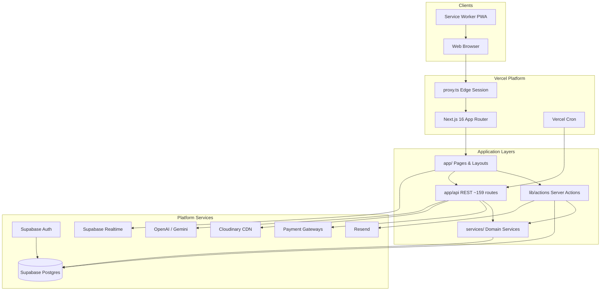
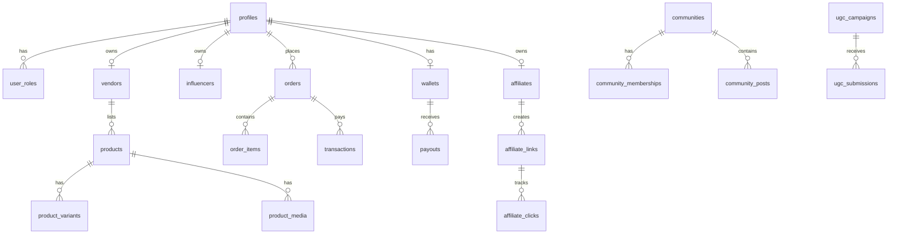
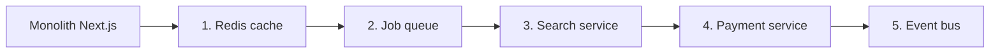

# Jimvio Technical Architecture Blueprint v1.0

**Status:** Official · **Audience:** Engineering, Platform, Security, SRE, AI/ML · **July 2026**

> Engineering counterpart to the [Product Blueprint v1.0](../product-blueprint/JIMVIO-PRODUCT-BLUEPRINT-v1.0.md).  
> Describes **how** Jimvio is built — not what product features exist.

---

## Table of contents

1. [Architecture Principles](#part-1--architecture-principles)
2. [System Architecture](#part-2--system-architecture)
3. [Frontend Architecture](#part-3--frontend-architecture)
4. [Backend Architecture](#part-4--backend-architecture)
5. [API Standards](#part-5--api-standards)
6. [Database Architecture](#part-6--database-architecture)
7. [Security](#part-7--security)
8. [Performance](#part-8--performance)
9. [Observability](#part-9--observability)
10. [Deployment](#part-10--deployment)
11. [Scalability Roadmap](#part-11--scalability-roadmap)

---

# PART 1 — ARCHITECTURE PRINCIPLES

## Engineering Vision

Jimvio is engineered as a **modular Creator Commerce Operating System** on a single Next.js codebase — not a collection of microservices prematurely split. The architecture optimizes for:

- **Velocity** — one repo, shared types, fast iteration
- **Reliability** — protected domains (payments, auth, checkout) with explicit change control
- **Scale path** — clear extraction points when bottlenecks emerge
- **AI-native** — context injection and tool-use hooks without rewriting core flows

**Trade-off accepted:** Monolith-first reduces operational complexity at current scale. Services extract when metrics demand it — not before.

## Scalability Principles

| Principle | Application |
|-----------|-------------|
| **Stateless server** | Next.js serverless functions; session in cookies + Supabase |
| **Database as source of truth** | Postgres via Supabase; no duplicated business state in client |
| **Horizontal scale by default** | Vercel auto-scales route handlers; no sticky sessions |
| **Async where possible** | Webhooks, crons, queue tables for long-running work |
| **Read optimization** | `unstable_cache`, React `cache()`, ISR `revalidate` |
| **Extract on evidence** | Split services only when latency, cost, or team boundaries require |

## Simplicity Principles

| Principle | Application |
|-----------|-------------|
| **Minimal safe change** | Smallest diff; no unrelated refactors |
| **Reuse first** | Search `lib/`, `services/`, `components/` before creating |
| **One data access path** | Supabase client (not Prisma + Supabase) |
| **Explicit over clever** | Server actions for mutations; REST for webhooks/cron/external |
| **Document decisions** | ADRs for architectural changes |

## Modular Design Principles

**Additive module pattern** ([ADR-002](../adr/002-additive-platform-modules.md)):

```
lib/<module>/              Types, config, adapters, builders
components/<module>/       UI, panels, loaders
lib/store/use-*-store.ts   UI state only (Zustand + localStorage)
*Loader.tsx                dynamic() + requestIdleCallback
```

**Module boundaries:**
- `app/` — routing and page composition only
- `lib/actions/` — server mutations (user-initiated)
- `app/api/` — REST endpoints (webhooks, cron, external clients)
- `services/` — complex queries, caching, third-party orchestration
- `components/` — presentation; no direct DB access

**Never:** hidden cross-module imports that bypass auth or payment finalization.

## Security Principles

- **Defense in depth** — middleware + API guards + RLS + server validation
- **Least privilege** — service role only in server routes; never client-exposed
- **Protected domains** — auth, payments, checkout, orders require explicit approval to change
- **Secrets in environment** — `platform_secrets` for runtime config; never committed
- **Audit critical actions** — webhooks, admin ops, payout triggers logged
- **Fail closed** — suspended users, revoked sessions, maintenance mode block access

## Performance Principles

- **Mobile-first** — lazy load non-critical UI; skeleton states; no layout shift
- **GPU motion only** — transform/opacity; 150–300ms; `prefers-reduced-motion`
- **Bundle discipline** — dynamic imports for Copilot, OS, Super App, heavy charts
- **Image optimization** — Cloudinary transforms; Next.js `Image` remote patterns
- **No N+1 in hot paths** — batch queries in services layer

## AI-Ready Principles

| Principle | Implementation |
|-----------|----------------|
| **Pluggable providers** | `lib/ai/copilot/stub-provider.ts` → swap for production LLM |
| **Route context** | Copilot receives current path/module for grounded responses |
| **Tool-use boundary** | AI reads/suggests; server actions execute with user auth |
| **Rate limiting** | `/api/ai/*` guarded; no unbounded token spend |
| **No PII leakage** | Prompt construction excludes unauthorized user data |
| **Embeddings in DB** | `match_products` RPC for semantic search |

---

# PART 2 — SYSTEM ARCHITECTURE

## High-Level Overview



## Layer Responsibilities

| Layer | Technology | Responsibility |
|-------|------------|----------------|
| **Frontend** | React 19, Next.js 16 App Router, Tailwind | UI, client state, optimistic UX |
| **Edge** | `proxy.ts` + `@supabase/ssr` | Session refresh, route protection |
| **Backend** | Server Actions + API Routes | Business logic, auth enforcement |
| **API Layer** | `app/api/` REST | Webhooks, cron, external integrations |
| **Services** | `services/`, `lib/*` | Domain orchestration, caching |
| **Database** | Supabase Postgres | Persistent state, RLS, RPCs |
| **Auth** | Supabase Auth + custom 2FA | Identity, sessions, OAuth |
| **Storage** | Cloudinary + Supabase Storage | Media, digital assets |
| **Caching** | React cache, unstable_cache, ISR | Read optimization |
| **Search** | Postgres FTS + `match_products` RPC + in-memory engine | Product discovery |
| **Messaging** | Supabase Realtime + Postgres | Chat, inbox |
| **Notifications** | Postgres `notifications` + Resend | In-app + email |
| **Payments** | Multi-gateway router + webhooks | Checkout, subscriptions, payouts |
| **Analytics** | Vercel Analytics, custom DB metrics | Product and platform metrics |
| **AI Layer** | Gemini, OpenAI, copilot lib | Chat, search, recommendations |
| **Event Bus** | Postgres triggers + webhooks + cron | No dedicated message broker today |
| **Background Jobs** | Vercel Cron + `cj_order_queue` table | Scheduled sync, reconciliation |

## Tech Stack Summary

| Category | Choice | Version |
|----------|--------|---------|
| Framework | Next.js (App Router) | 16.x |
| Runtime | React | 19.x |
| Language | TypeScript | 5.7 |
| Database | Supabase (Postgres 17) | — |
| Auth | Supabase Auth + TOTP 2FA | — |
| Styling | Tailwind CSS 3 + Design System | — |
| Client state | Zustand (UI only) | 5.x |
| Forms | react-hook-form + zod | — |
| Media | Cloudinary | — |
| Email | Resend (HTTP) | — |
| Deployment | Vercel (region: `fra1`) | — |
| AI | Google Generative AI, OpenAI | — |

> **Note:** Prisma is in `package.json` but **inactive** (`lib/prisma.ts` commented; no `/prisma/` schema). **Supabase client is the sole ORM.**

## Request Lifecycle

```
1. Browser request
2. proxy.ts → refresh Supabase session cookie
3. Check: maintenance, account status, session revocation, hub auth
4. Next.js routes to Server Component or API handler
5. getCachedUser() / requireAdmin() / requireVendorOwnerOrAdmin()
6. services/ or direct Supabase query (RLS or service role)
7. Response → HTML stream (RSC) or JSON
8. Client hydration → Zustand UI state; Realtime subscriptions
```

## Integration Map

| External System | Integration Point | Direction |
|-----------------|-------------------|-----------|
| PesaPal, PawaPay, Flutterwave, PayPal, NowPayments, Binance, AfriPay | `app/api/payments/*`, `app/api/webhooks/*` | Bidirectional |
| CJ Dropshipping | `lib/cj/*`, cron sync | Inbound catalog, outbound orders |
| Shopify | `app/api/shopify/*`, cron | Bidirectional sync |
| Cloudinary | `services/media/*`, signed uploads | Outbound |
| Resend | `lib/email/send.ts` | Outbound |
| OpenAI / Gemini | `app/api/ai/*`, `lib/ai/*` | Outbound |
| Vercel | Hosting, cron, analytics | Platform |

---

# PART 3 — FRONTEND ARCHITECTURE

## Application Structure

```
app/
├── (public)/          Marketplace, checkout, communities, influencers
├── (auth)/            Login, register, 2FA
├── dashboard/         Role-specific hubs
├── admin/             Platform operations
├── c/                 Creator Hub (community workspace)
├── ugc/               UGC campaign surfaces
├── api/               REST handlers (~159 routes)
├── layout.tsx         Global shell + providers
└── auth/callback/     OAuth PKCE

components/
├── design-system/     Ds* — canonical new UI (ADR-001)
├── ui/                Legacy primitives (preserved)
├── marketplace/       Commerce UI
├── community/         Hub UI
├── copilot/           AI Copilot (lazy)
├── command-center/    ⌘K (lazy)
├── jimvio-os/         Dashboard OS (lazy)
├── jimvio-super-app/  Global dock (lazy)
└── [domain]/          Feature components

lib/
├── actions/           Server actions (30 modules)
├── store/             Zustand UI stores
├── supabase/          Auth clients
├── payments/          Payment domain
├── design-system/     Tokens
└── [module]/          Platform modules

services/              Server-side data layer
hooks/                 Client hooks (chat, upload, mobile)
context/               CurrencyContext
types/                 supabase.ts (generated), domain types
```

## Module Boundaries

| Rule | Detail |
|------|--------|
| Pages compose | `app/**/page.tsx` imports components; minimal logic |
| No DB in components | Data via Server Components, actions, or API |
| UI state in Zustand | Cart UI, workspace layout, panel open/close |
| Business state in DB | Orders, wallet, permissions — never Zustand |
| Lazy global shells | Copilot, OS, Super App via `*Loader.tsx` |

## Component Hierarchy

```
app/layout.tsx
├── ThemeProvider
├── DialogProvider
├── CurrencyProvider
├── PlatformStatsProvider
├── {children}                    ← Page content
├── JimvioCopilotLoader           ← dynamic, idle
├── CommandCenterLoader           ← dynamic, idle
├── JimvioSuperAppLoader          ← dynamic, idle
└── Toaster (Sonner)

app/dashboard/layout.tsx
├── DashboardShell (sidebar)
├── JimvioOSLoader                ← dynamic, idle
└── {children}
```

## Shared UI Library

| Layer | Path | Usage |
|-------|------|-------|
| **Design System** | `components/design-system/` | All new features |
| **Legacy UI** | `components/ui/` | Existing pages (incremental migration) |
| **Tokens** | `lib/design-system/`, `styles/jimvio-design-system.css` | Colors, spacing, motion |

## Routing

- **App Router** file-system routing with route groups `(public)`, `(auth)`
- **Middleware** via `proxy.ts` (Next.js 16 convention)
- **Post-login redirect** — role priority: admin → vendor → affiliate → influencer → buyer
- **Hub auth** — `lib/community/hub-auth.ts` for `/c/*` public vs protected paths
- **No client-side router guards for security** — middleware + server enforcement

## State Management

| Type | Tool | Examples |
|------|------|----------|
| UI / layout | Zustand | Cart, workspace grid, OS panel, command center |
| Preferences | localStorage via Zustand | Workspace layout, search history |
| Server data | Server Components + actions | Products, orders, profile |
| Realtime | Supabase channels | Chat, notifications, orders |
| Global display | React Context | Currency, theme, dialogs, platform stats |

**Anti-pattern:** Duplicating server data in Zustand (except optimistic cart).

## Data Fetching Strategy

| Pattern | When |
|---------|------|
| **Server Components** | Initial page data, SEO-critical content |
| **Server Actions** | Mutations (forms, buttons) with `revalidatePath` |
| **API routes** | Webhooks, cron, client polling, external consumers |
| **SWR** | Minimal — prefer server-first |
| **Supabase Realtime** | Live chat, notification badges, order updates |

## Error Boundaries

- Next.js `error.tsx` / `not-found.tsx` per route segment where defined
- `DsErrorState` / `DsEmptyState` for in-component graceful degradation
- Payment errors → friendly pages (`/checkout/error`, `/payment/session-expired`)
- Never expose stack traces to users

## Performance Strategy

| Technique | Implementation |
|-----------|----------------|
| Code splitting | `dynamic()` on Copilot, OS, Super App, heavy admin |
| Idle loading | `requestIdleCallback` (2.5s cap) before mounting shells |
| ISR | `revalidate` on homepage (60s), sitemap (3600s) |
| Virtualization | `@tanstack/react-virtual` on long lists |
| Image CDN | Cloudinary transforms + Next.js Image |
| Font | `@fontsource/dm-sans`, `next/font` in layout |

## Accessibility Strategy

- Design System: `ds-focus-ring`, form labels, ARIA on `Ds*` components
- Radix primitives for dialogs, menus, tabs (keyboard + screen reader)
- `prefers-reduced-motion` in `jimvio-design-system.css`
- Chat: ARIA live regions in `useChatRoom.ts`
- Goal: WCAG 2.1 AA on all new DS surfaces

---

# PART 4 — BACKEND ARCHITECTURE

## Domain Modules

| Domain | lib/ | services/ | actions/ | api/ |
|--------|------|-----------|----------|------|
| Commerce | `marketplace/`, `cart/`, `orders/` | `products.ts`, `orders.ts` | `marketplace.ts`, `checkout.ts`, `orders.ts` | `marketplace/`, `cart/`, `orders/` |
| Payments | `payments/` | `paymentService.ts` | `payment.ts`, `create-transaction.ts` | `payments/`, `webhooks/` |
| Auth | `auth/`, `supabase/` | — | `security.ts`, `account-settings.ts` | — |
| Community | `community/` | `communityService.ts`, `community/` | `community_posts.ts` | `communities/` |
| UGC | `ugc/` | — | — | `ugc/` |
| CJ/Supply | `cj/` | `cj/` | `cj_product.ts` | `cj/`, `cron/` |
| AI | `ai/` | `ai/` | — | `ai/` |
| Admin | `admin/` | `admin/` | `admin-*.ts` | `admin/` |
| Platform | `platform-settings*.ts` | `platform.ts` | — | `cron/` |

## Services Layer

`services/base.ts` provides:
- `getDB()` — cached Supabase server client per request
- `getAdminDB()` — service role for admin operations

**When to use services/ vs lib/actions/:**
- **actions/** — user-initiated mutations from UI (forms, buttons)
- **services/** — shared query logic, caching, third-party orchestration called from actions OR api routes

## API Layer

~159 `route.ts` handlers organized by domain namespace.

| Category | Auth | Examples |
|----------|------|----------|
| **Webhooks** | Signature verification | `webhooks/pesapal`, `webhooks/nowpayments` |
| **Cron** | `CRON_SECRET` | `cron/shopify-sync`, `cron/cj-catalog-sync` |
| **User API** | Session cookie | `vendor/wallet`, `messages/*` |
| **Public** | Rate limited | `products/[id]/view`, `affiliates/track` |
| **Admin API** | `requireAdmin()` | `admin/*` |

## Background Workers

**No dedicated queue service.** Background work via:

| Mechanism | Use case |
|-----------|----------|
| **Vercel Cron** | Shopify sync, CJ catalog, UGC view sync, webhook retry |
| **`cj_order_queue` table** | CJ order processing (`lib/cj/cj-order-queue.ts`) |
| **Inline webhook processing** | Payment finalization at request time |
| **Cron routes** | `export const dynamic = "force-dynamic"` |

**Trade-off:** Simple ops at current scale. At 1M+ users, evaluate Inngest/Trigger.dev for payment reconciliation and CJ queue.

## Events

| Type | Mechanism |
|------|-----------|
| Payment received | Webhook → `finalize-order-payment.ts` |
| Order status change | DB update → Realtime → client |
| Notification | `notify-user.ts` insert + optional email |
| Webhook audit | `webhook_events` table (idempotency) |
| UGC view sync | Daily cron → `lib/ugc/syncViews.ts` |

No Kafka/RabbitMQ. Postgres + HTTP webhooks suffice today.

## Rate Limiting

| Location | Method |
|----------|--------|
| 2FA attempts | In-memory (5/15min) — **needs Redis at scale** |
| Auth actions | `lib/auth/actions.ts` rate limits |
| AI routes | Per-route limits (implement per provider budget) |
| Public tracking | Implicit via Supabase RLS + API design |

## Caching (Backend)

| Pattern | Location | TTL |
|---------|----------|-----|
| `unstable_cache` | `services/platform.ts` | 300s |
| React `cache()` | `getCachedUser`, `getDB` | Per-request |
| FX rates | `lib/currency/rates.ts` | 15 min in-memory |
| `revalidatePath` | After mutations | On-demand |

## Observability (Backend)

- Prefixed `console.log` (`[PaymentRouter]`, `[middleware]`, `[Cron-Shopify]`)
- `webhook_events` audit table
- Vercel function logs
- **Gap:** No Sentry/Datadog — see Part 9

---

# PART 5 — API STANDARDS

## REST Conventions

| Rule | Standard |
|------|----------|
| **Paths** | `/api/<domain>/<resource>` — lowercase, kebab-case |
| **Methods** | GET (read), POST (create/action), PATCH (partial update), DELETE |
| **Dynamic segments** | `[id]`, `[slug]` — Next.js App Router convention |
| **Response** | `NextResponse.json({ ... })` |
| **Dynamic routes** | `export const dynamic = "force-dynamic"` when session/realtime dependent |

## Error Responses

```json
{
  "error": "Human-readable message",
  "code": "OPTIONAL_MACHINE_CODE"
}
```

| HTTP Status | When |
|-------------|------|
| 400 | Validation failure |
| 401 | Unauthenticated |
| 403 | Forbidden (wrong role) |
| 404 | Resource not found |
| 409 | Conflict (duplicate, idempotency) |
| 429 | Rate limited |
| 500 | Internal error (generic message to client) |

**Never** return stack traces, SQL errors, or secret values.

## Pagination

| Pattern | Usage |
|---------|-------|
| `limit` + `offset` query params | List endpoints |
| Default `limit=20`, max `limit=100` | Prevent abuse |
| Return `{ data, total, hasMore }` | Client infinite scroll |

## Filtering & Sorting

- Query params: `?status=active&sort=created_at&order=desc`
- Server-side validation of allowed sort fields (whitelist)
- Full-text search via dedicated endpoints (`/api/marketplace/search`)

## Authentication

| Context | Method |
|---------|--------|
| Browser | Supabase session cookie (refreshed by `proxy.ts`) |
| Cron | `CRON_SECRET` query param or `Authorization: Bearer` |
| Webhooks | Provider signature verification per gateway |
| Service-to-service | Service role key (server only) |

## Authorization

```typescript
// lib/auth/api-helpers.ts
requireAdmin()
requireVendorOwnerOrAdmin(vendorId)
```

- Always enforce on server — never trust client role state
- Community: workspace roles + membership tiers
- RLS as second layer in Supabase

## Versioning Strategy

**Current:** Unversioned (`/api/...`). Breaking changes avoided.

**Future (at external API launch):**
- `/api/v1/...` prefix
- Deprecation headers on old routes
- 6-month sunset policy

## Idempotency

| Domain | Mechanism |
|--------|-----------|
| Webhooks | `webhook_events.idempotency_key` upsert |
| Payments | Transaction ID dedup in `finalize-order-payment.ts` |
| Wallet credits | `increment_wallet_balance` RPC with guards |

## Validation

- **zod** schemas for request bodies in API routes
- **react-hook-form + zod** on client forms
- Server-side re-validation always (never trust client)
- **DOMPurify** (`isomorphic-dompurify`) for user HTML content

---

# PART 6 — DATABASE ARCHITECTURE

## Primary Store

**Supabase Postgres 17** — single source of truth.

| Access mode | Client | When |
|-------------|--------|------|
| User-scoped | Server client + RLS | Normal operations |
| Admin | Service role (`createAdminClient`) | Admin routes, webhooks, cron |
| Anon | Anon key + RLS | Public reads |

**Types:** `types/supabase.ts` (~5,200 lines, generated)

## Core Entity Groups



## Key Tables

| Domain | Tables |
|--------|--------|
| **Users** | `profiles`, `user_roles`, `user_2fa_secrets` |
| **Commerce** | `products`, `product_variants`, `product_media`, `carts`, `cart_items`, `orders`, `order_items`, `transactions` |
| **Wallet** | `wallets`, `payouts`, `failed_wallet_credits` |
| **Affiliate** | `affiliates`, `affiliate_links`, `affiliate_clicks`, `affiliate_commissions` |
| **Community** | `communities`, `community_memberships`, `community_posts`, `community_messages`, `rooms`, `spaces` |
| **Courses** | `community_courses`, `course_modules`, `course_lessons`, `lesson_progress` |
| **UGC** | `ugc_campaigns`, `ugc_submissions`, `ugc_payouts`, `ugc_view_snapshots` |
| **Platform** | `platform_settings`, `platform_secrets`, `notifications`, `webhook_events` |
| **CJ** | `cj_product_map`, `cj_order_queue`, `cj_logs`, `cj_sync_logs` |
| **Analytics** | `product_views`, `short_video_views`, `affiliate_clicks` |

## RPCs (Stored Procedures)

| RPC | Purpose |
|-----|---------|
| `match_products` | AI semantic search (embeddings) |
| `get_user_roles` | Role resolution |
| `increment_wallet_balance` | Atomic wallet credit |
| Cart helpers | Add/update/remove cart items |

## Indexes & Constraints

- Foreign keys on all relationship columns
- Unique constraints: `profiles.slug`, `affiliate_links.code`, `webhook_events.idempotency_key`
- Indexes on: `orders.user_id`, `orders.status`, `products.vendor_id`, `notifications.user_id + read`
- **Migrations:** `database/migrations/` (numbered SQL) + `supabase/migrations/`

## Audit Strategy

| Event | Storage |
|-------|---------|
| Order status | `order_status_history` |
| Payment status | `order_payment_status_history` |
| Webhooks | `webhook_events` |
| CJ operations | `cj_logs`, `cj_sync_logs` |
| Admin actions | Partial — **improve with dedicated audit table** |

## Soft Deletes

- Account: `account_status` (`suspended`, `banned`, `frozen`, `deleted`) — `lib/users/account-status.ts`
- Products: `status` field (`draft`, `published`, `archived`)
- No universal `deleted_at` — domain-specific status enums

## Migrations

| Track | Path |
|-------|------|
| Primary | `database/migrations/00.sql` (combined) + `061`–`066` |
| Supabase CLI | `supabase/migrations/20260513081827_remote_schema.sql` |
| Seeds | `database/seeds/001_categories.sql` |

**Rule:** Never modify schema without explicit approval + migration file + ADR.

## Data Ownership

| Entity | Owner | Platform access |
|--------|-------|-----------------|
| `profiles` | User | Admin read |
| `products` | Vendor | Admin moderate |
| `orders` | Buyer + Vendor | Admin full |
| `communities` | Community owner | Admin moderate |
| `wallets` | User | Admin for payouts |
| `transactions` | Platform ledger | Admin full |

---

# PART 7 — SECURITY

## Authentication

| Mechanism | Implementation |
|-----------|----------------|
| Primary | Supabase Auth (email/password, OAuth) |
| Session | HTTP-only cookies via `@supabase/ssr` |
| Refresh | `proxy.ts` on every request |
| 2FA | TOTP (`otpauth`) + backup codes |
| OAuth callback | `app/auth/callback/route.ts` (PKCE) |
| Session registry | `platform_settings` JSON — device list, revocation |
| Revocation | Middleware checks `isSessionRevoked()` |

## Authorization (RBAC)

| Layer | Enforcement |
|-------|-------------|
| Middleware | Route-level (`/dashboard`, `/admin`, `/c/*`) |
| API helpers | `requireAdmin()`, `requireVendorOwnerOrAdmin()` |
| Supabase RLS | Row-level policies on tables |
| Hub auth | `lib/community/hub-auth.ts` |
| Access control | `services/accessControl.ts` — free/paid/premium tiers |
| Workspace roles | member / moderator / admin / owner |

## Input Validation

- zod on all API inputs and server actions
- HTML sanitization via DOMPurify
- File upload: type/size limits; Cloudinary signed uploads
- SQL: parameterized queries via Supabase client (no raw string concat)

## Secrets Management

| Secret type | Storage |
|-------------|---------|
| API keys | Vercel environment variables |
| Payment keys | Env + `platform_secrets` table |
| Service role / secret | `SUPABASE_SECRET_KEY` — server only |
| Publishable key | `SUPABASE_PUBLISHABLE_KEY` / `NEXT_PUBLIC_SUPABASE_PUBLISHABLE_KEY` |
| Webhook secrets | Per-provider env vars |
| **Never** | Client bundle, git, logs |

## Rate Limiting

| Surface | Current | Target at scale |
|---------|---------|-----------------|
| 2FA | In-memory | Redis/Upstash |
| Auth login | In-memory | Redis/Upstash |
| AI API | Per-route | Token budget per user |
| Webhooks | Provider-side | + server idempotency |

## CSRF

- Server Actions use Next.js built-in CSRF protection
- API routes: session cookie + SameSite policies
- Webhooks: signature verification (not cookie-based)

## XSS Prevention

- React default escaping
- DOMPurify for rich text
- CSP headers (evaluate strengthening)
- No `dangerouslySetInnerHTML` without sanitization

## SQL Injection Prevention

- Supabase client parameterized queries only
- RPCs with typed parameters
- No dynamic SQL string building

## File Uploads

- Signed upload via `/api/uploads/signature` (auth required)
- Cloudinary folder taxonomy (`jimvio/products`, `jimvio/ugc`, etc.)
- Protected delivery via `/api/file/[id]` and `/api/files/access/[accessId]`

## Audit Logs

| Today | Target |
|-------|--------|
| `webhook_events` | ✅ |
| `order_status_history` | ✅ |
| Admin user role changes | Partial |
| Payout approvals | Partial |
| **Unified `audit_log` table** | Phase 2 roadmap |

---

# PART 8 — PERFORMANCE

## Caching Layers

| Layer | Technology | Scope |
|-------|------------|-------|
| CDN | Vercel Edge + Cloudinary | Static assets, images |
| ISR | Next.js `revalidate` | Homepage, sitemap |
| Data cache | `unstable_cache` | Platform stats (300s) |
| Request dedup | React `cache()` | User, DB client per request |
| In-memory | FX rates (15 min) | Currency conversion |
| Client | localStorage | Workspace layout, search history |
| **Future** | Redis/Vercel KV | Sessions, rate limits, hot data |

## Lazy Loading

| Asset | Strategy |
|-------|----------|
| Copilot, OS, Super App | `dynamic()` + `requestIdleCallback` |
| Heavy charts | Route-level code split |
| Images | Next.js Image lazy + Cloudinary `f_auto,q_auto` |
| Below-fold content | Intersection Observer where implemented |

## Image Optimization

- Cloudinary transforms (format, quality, resize)
- Next.js `remotePatterns` in `next.config.ts`
- WebP/AVIF via Cloudinary `f_auto`
- Explicit `width`/`height` to prevent CLS

## Code Splitting

- App Router automatic per-route splitting
- `dynamic(() => import(...), { ssr: false })` for client-only shells
- Tree-shakeable DS exports from `components/design-system/index.ts`

## Streaming

- React Server Components stream HTML by default
- Suspense boundaries on slow data fetches (where applied)
- **Opportunity:** More granular Suspense on dashboard widgets

## Background Processing

- Payment webhooks processed inline (target < 5s)
- CJ order queue processed via cron (not blocking user)
- UGC view sync daily batch
- Email sent inline (consider queue at high volume)

## CDN Strategy

| Asset | CDN |
|-------|-----|
| JS/CSS bundles | Vercel Edge Network |
| Images/video | Cloudinary global CDN |
| Fonts | Self-hosted via `@fontsource` + `next/font` |
| API | Vercel serverless (region `fra1`) |

## Core Web Vitals Targets

| Metric | Target |
|--------|--------|
| LCP | < 2.5s |
| INP | < 200ms |
| CLS | < 0.1 |
| TTFB | < 800ms (SSR pages) |

Monitored via Vercel Speed Insights.

---

# PART 9 — OBSERVABILITY

## Current State

| Capability | Tool | Status |
|------------|------|--------|
| Page analytics | Vercel Analytics | ✅ |
| Web Vitals | Vercel Speed Insights | ✅ |
| Function logs | Vercel dashboard | ✅ |
| Webhook audit | `webhook_events` table | ✅ |
| Console logging | Prefixed logs in code | ✅ |
| Error tracking | — | ❌ Gap |
| APM / tracing | — | ❌ Gap |
| Structured logging | — | ❌ Gap |
| Uptime monitoring | — | ❌ Gap |

## Logging Standards (Target)

```
[domain/component] message { structured fields }
```

Examples in codebase: `[PaymentRouter]`, `[middleware]`, `[Cron-Shopify]`, `[sendEmail]`

**Recommendation:** Adopt `pino` or Vercel Log Drain → Datadog at Phase 2.

## Metrics

| Metric | Source |
|--------|--------|
| Request latency | Vercel (built-in) |
| Payment success rate | `transactions` + admin reports |
| Webhook processing | `webhook_events` timestamps |
| Cron success | Vercel cron logs |
| Business KPIs | `services/dashboard-analytics.ts`, admin reports |

## Tracing

**Not implemented.** At 100K+ users, add OpenTelemetry via Vercel OTel integration for payment and checkout flows.

## Health Checks

| Check | Endpoint |
|-------|----------|
| App alive | Vercel deployment health |
| DB | Implicit via Supabase status page |
| **Dedicated `/api/health`** | Recommended addition |

## Alerts (Target)

| Alert | Trigger |
|-------|---------|
| Payment failure spike | > 10% failure in 15 min |
| Webhook backlog | `webhook_events` unprocessed > 100 |
| Cron failure | Vercel cron notification |
| Error rate | Sentry alert (when adopted) |

## Error Reporting

**Gap:** No Sentry. Payment and auth errors logged to console + DB only.

**Phase 2:** Sentry for client + server with PII scrubbing.

---

# PART 10 — DEPLOYMENT

## Environments

| Environment | Purpose | URL pattern |
|-------------|---------|-------------|
| **Development** | Local (`next dev`) | `localhost:3000` |
| **Preview** | Vercel PR previews | `*.vercel.app` |
| **Production** | Live platform | `jimvio.com` (www redirect in `next.config.ts`) |

## Hosting

- **Vercel** — primary deployment target
- **Region:** `fra1` (Frankfurt) per `vercel.json`
- **Serverless** — API routes and Server Actions as functions
- **Edge** — `proxy.ts` session middleware

## CI/CD

| Today | Target |
|-------|--------|
| Vercel git integration (auto deploy) | ✅ |
| No GitHub Actions workflows | ❌ Add lint + type-check on PR |
| Manual `npm run type-check` | Pre-merge requirement |

**Recommended pipeline:**
```
PR → lint + type-check → Vercel preview → manual QA → merge → production deploy
```

## Rollback

- Vercel instant rollback to previous deployment
- Database migrations are **forward-only** — plan rollback scripts for critical migrations
- Feature flags via `platform_settings` for risky launches

## Environment Variables

Canonical template: `.env.example`

| Group | Keys |
|-------|------|
| Supabase | `NEXT_PUBLIC_SUPABASE_URL`, `SUPABASE_PUBLISHABLE_KEY` / `NEXT_PUBLIC_SUPABASE_PUBLISHABLE_KEY`, `SUPABASE_SECRET_KEY` |
| App | `NEXT_PUBLIC_APP_URL` |
| Email | `RESEND_API_KEY`, `EMAIL_FROM` |
| Payments | PesaPal, PawaPay, NowPayments, AfriPay, Flutterwave, PayPal, Binance |
| AI | `GOOGLE_GENERATIVE_AI_API_KEY`, `OPENAI_API_KEY` |
| Cron | `CRON_SECRET` |
| Shopify/CJ | Integration-specific keys |

> **Gap:** `.env.example` missing Cloudinary, Flutterwave, PayPal keys — document in Phase 2.

## Secrets

- Vercel encrypted environment variables per environment
- `platform_secrets` table for runtime-rotatable secrets
- Never log secrets; scrub from error reports

## Cron Schedules (`vercel.json`)

| Schedule | Job |
|----------|-----|
| Daily 00:00 | Shopify sync |
| Every 6h | CJ catalog sync |
| Every 15m | CJ enrichment |
| Daily 04:00 | CJ intelligence |
| Daily 03:00 | UGC view sync |
| Daily 02:00 | Failed webhook retry |

## Monitoring

- Vercel deployment dashboard
- Vercel Analytics + Speed Insights
- Supabase dashboard (DB metrics, auth)
- Cloudinary dashboard (media usage)
- Payment provider dashboards per gateway

---

# PART 11 — SCALABILITY ROADMAP

## Scale Tiers

### 1,000 users — Current baseline ✅

| Dimension | Architecture |
|-----------|--------------|
| Compute | Vercel serverless (auto-scale) |
| Database | Supabase free/pro tier |
| Caching | React cache + ISR |
| Background | Vercel cron |
| Realtime | Supabase Realtime |
| **Bottleneck risk** | Low |

### 10,000 users

| Change | Rationale |
|--------|-----------|
| Supabase Pro + connection pooling | Connection limits |
| Complete `.env.example` | Onboarding reliability |
| GitHub Actions CI | Prevent regressions |
| Sentry error tracking | Debug production issues |
| Redis/Upstash for 2FA rate limits | Multi-instance serverless |

### 100,000 users

| Change | Rationale |
|--------|-----------|
| Read replicas (Supabase) | Analytics queries off primary |
| `unstable_cache` → Redis for hot data | Platform stats, FX rates |
| Email queue (Resend batch or queue) | Decouple from request |
| Dedicated `/api/health` + uptime monitoring | SRE readiness |
| Search → dedicated index (Typesense/Algolia) | Marketplace search latency |
| Audit log table | Compliance, admin accountability |
| Automated test suite (Vitest + Playwright) | Payment/auth coverage |

### 1 million users

| Change | Rationale |
|--------|-----------|
| Supabase Team/Enterprise | SLA, support, scale |
| CDN for API responses (cacheable reads) | Reduce origin load |
| Background job platform (Inngest/Trigger.dev) | CJ queue, webhooks, emails |
| Payment webhook queue | Prevent timeout on burst |
| Multi-region Vercel | Latency for global users |
| Formal API versioning (`/api/v1`) | External integrations |
| Database partitioning strategy | `orders`, `transactions`, `product_views` |

### 10 million users

| Change | Rationale |
|--------|-----------|
| Extract payment service | Independent scale + PCI isolation |
| Extract search service | Dedicated team + infra |
| Event bus (Kafka/NATS) | Decouple modules |
| CQRS for analytics | Separate read models |
| Multi-region Postgres | Data residency |
| Edge caching for marketplace browse | Sub-100ms discovery |

### 100 million users

| Change | Rationale |
|--------|-----------|
| Service mesh | Inter-service auth, observability |
| Global CDN for all static + API cache layers | Origin protection |
| Sharded Postgres or CockroachDB | Write scale |
| Dedicated ML inference infra | AI at scale |
| Platform API marketplace | Third-party ecosystem |
| 24/7 SRE team + incident response | Operational maturity |

## Extraction Priority (when metrics demand)



**Rule:** Extract only with evidence (latency p99, error rate, team size, cost). Premature microservices are rejected.

---

## Known Gaps & Technical Debt

| Gap | Severity | Phase |
|-----|----------|-------|
| No CI workflows | High | 10K users |
| No automated tests | High | 100K users |
| Prisma in deps but inactive | Medium | Clean up |
| 2FA rate limit in-memory | High | 10K users |
| No Sentry/error tracking | High | 10K users |
| `.env.example` incomplete | Medium | 10K users |
| No dedicated health endpoint | Low | 100K users |
| Inline email sends | Medium | 100K users |
| README stale (Prisma, postbuild) | Low | Cleanup |

---

## Related Documents

| Document | Path |
|----------|------|
| Product Blueprint | `docs/product-blueprint/JIMVIO-PRODUCT-BLUEPRINT-v1.0.md` |
| ADR: Design System | `docs/adr/001-design-system-foundation.md` |
| ADR: Additive Modules | `docs/adr/002-additive-platform-modules.md` |
| ADR: Product Blueprint | `docs/adr/003-product-blueprint-v1.md` |
| Design System | `docs/design-system/README.md` |

---

## Document Maintenance

| Trigger | Action |
|---------|--------|
| New external service | Update Part 2 integration map |
| API convention change | Update Part 5 |
| Schema migration | Update Part 6 + ADR |
| New observability tool | Update Part 9 |
| Scale milestone | Review Part 11 tier |

---

**Jimvio Technical Architecture Blueprint v1.0** — *Built for millions. Engineered for decades.*

*End of document*
